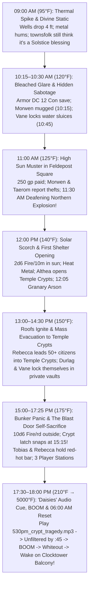

# Beregost Time Loop — Session 1 (Loop 0) DM Study Guide

> [!IMPORTANT]
> **Your Core Goal in Session 1 (Loop 0):**
> Run the morning (`06:00 – 11:00 AM`) as a warm, charming, grounded D&D festival adventure where the players fall in love with Beregost's people, play carnival games, hear organic street rumors, and tackle 1–2 quick outskirts errands before returning for the **11:00 AM High Sun Muster**. That emotional investment makes the afternoon thermal escalation (`12:00 – 15:00 PM`), the **15:15 PM Crypt Blast Door self-sacrifice**, the **17:30 PM *"Daisies"* audio cue**, and the **18:00 PM → 06:00 AM Time Loop Reset** unforgettable.

---

## 1. The Central Town's Motivation & Philosophy

### Why Beregost Is Bustling & Unworried in the Morning (`06:00 – 11:00 AM`)
1. **The High Summer Solstice Festival**: Today is Beregost's biggest holiday of the year—celebrating the longest day of summer around the **Song of the Morning** (the grand Temple of Lathander, God of the Dawn) and **Feldepost Square**. Merchants, farmers, and performers have gathered for the morning booths, the **11:00 AM High Sun Muster**, and the evening solstice feast.
2. **The Collective Blind Spot ("Lathander's Blessing")**: Because Lathander is the Morninglord of sun and renewal, the townsfolk—led by devout High Priestess **Sister Althea**—initially interpret the unusually bright sky and early morning warmth (`06:00 – 10:30 AM`) as a **sacred Solstice blessing from Lathander**. Even the blazing wildfire in Old Branden's western barleyfield (`Hex 7, 10`) is contained on the town side by stone irrigation canals, so citizens treat it as a localized farm nuisance rather than an apocalypse.
3. **The 11:00 AM "High Sun Muster" Magnet**: Every major town authority (**Artificer Bram**, **Captain Rebecca**, and **Baker Tobias**) explicitly tells the party: *"Whatever errands you run outside the gates this morning, be back in Feldepost Square by **11:00 AM sharp** for the High Sun Muster!"* At 11:00 AM, the town pays out the **250 gp Clocktower Hero Commendation**, Tobias taps the spiced cider casks, and the outer gates close for the noon procession. This ensures your party returns to town right on time to witness the **11:00 AM Muster**, the **11:30 AM Northern Explosion**, and the afternoon catastrophe.
4. **The Thematic Spine — Self-Sacrifice vs. Selfish Preservation**:
   - **The Heroes of Beregost**: Ordinary working folk (**Tobias**, **Rebecca**, **Elorion**, **Jonas**, **Young Kaelen**, **Morwen**, **Taerom**, **Althea**) who willingly give their hands, breath, sanity, or youth to protect their neighbors.
   - **The Selfish Foils**: Corrupt or manipulated figures (**Alderman Durlag** hoarding cold-iron in his private vault, charmed **Scribe Vane**, and **"Lord Aurelius the Radiant"** manipulating heroes from behind a fake halo).

---

## 2. Complete Character Study Guide: Motivations, Interactions & Clues

### Tier 1: The 4 Emotional & Structural Pillars (Must-Meet in Act 1)

#### 1. 🕰️ Artificer Bram Copperwheel — Chief Horologist (Grand Clocktower Belfry)
* **Where He Is**: Top of the Clocktower Belfry (`05:59 – 12:30 PM`), briefly in Feldepost Square at `11:00 AM` for the Muster.
* **Motivation**: Keep the 150-foot Solstice Clocktower running on time and figure out what smashed his western stone balcony at `05:58 AM`.
* **Voice & Mannerisms**: Breathless, excitable rock gnome with copper magnifying goggles and grease-stained knuckles.
* **Player Interactions**:
  * **At `05:59 AM` (Opening Scene)**: Hires the party to pull the pale **Chronocite Bone** out of the Grand Escapement Gear so the `06:00 AM` bell can ring.
  * **Points Out Early Bootstrap Clue #1**: Marvels at the **freshly smashed western stone balcony rubble** (*"Some freak meteor or flying beast smashed clean through my western rail in the fog at 5:58 AM!"* — later revealed to be the future party and True Angel).
  * **Rewards & Hook**: Pays **25 gp per player** immediately and tells them to return to Town Square at **11:00 AM sharp** for the Council's **250 gp Solstice Hero Commendation**. (Inspecting the gears with him on later loops reveals the memorized **Escapement Code `7-3-9-1`**).

#### 2. 🥖 Tobias Miller — Master Baker (Miller's Hearth Bakery, Feldepost Square)
* **Where He Is**: Bakery porch & Feldepost Square (`06:00 – 12:00 PM`).
* **Motivation**: Feed the whole town warm honey-currant rolls for the Solstice and save his western sourdough grain shed from the farmland fire at `Hex (7, 10)`.
* **Voice & Mannerisms**: Booming, warm-hearted, flour on his cheeks, treats everyone like family; fiercely protective of orphan **Little Maya**.
* **Player Interactions**:
  * **Free Morning Buff**: Hands the party steaming **Honey-Currant Solstice Rolls** (`+5 Temp HP`) right after they descend the clocktower.
  * **Gives Errand #1 (West Gate Firebreak — `Hex 7, 10`)**: Asks the party to head 1 hex West to chop down a 60-ft dry cedar windbreak so the wildfire in Old Branden's field doesn't jump the canal into his grain shed.
  * **Seeds Early Bootstrap Clue #2 (`05:45 AM` Caravel Heist)**: Mentions a terrified coastal fish-carter saw a *"hulking winged figure"* and flying thieves drop onto the Commodore's beached caravel (`Hex 5, 11`) at `05:45 AM`, steal a pale bone, and rocket east over the barleyfields right as the fire started!
  * **Hosts Carnival Game #4**: *The Honey-Currant Pie Sprint* (`DC 12 Con` or `DC 13 Acrobatics`).
  * **Self-Sacrifice Payoff (`15:15 PM` in Crypts)**: Grips the snapped, red-hot iron crossbar of the Temple Crypt blast door in his bare baker's hands to save Maya and 50 townsfolk.

#### 3. 👧 Little Maya — 8-Year-Old Orphan Girl (Municipal Well, Feldepost Square)
* **Where She Is**: Skipping around the Municipal Well (`06:00 – 08:00 AM`), Temple Lawn (`08:30 AM`), Bakery shade (`11:00 AM`).
* **Motivation**: Recover her dropped hand-carved wooden thrush from the well and weave lucky clover bracelets for her heroes.
* **Voice & Mannerisms**: Bright-eyed, scraped knees, patched green smock; sniffling at `07:15 AM` when her toy falls into the well.
* **Player Interactions**:
  * **The `07:15 AM` Well Micro-Quest**: She accidentally bumps the well bucket and drops her carved wooden thrush 40 feet down the shaft. Retrieving it (*Mage Hand*, rope/climb `DC 10 Athletics`, or diving in) makes her beam with joy.
  * **The Emotional Token**: Weaves a **Braided Green Clover Bracelet** onto a PC's wrist: *"It's for good luck! Don't take it off until the festival stars come out tonight!"* (Watching this bracelet char to black ash in the `15:00 PM` crypt is a signature heartbreak beat).
  * **Crucial Rakshasa Witness Clue**: If befriended, she whispers what she saw in Cobbler's Lane at `06:45 AM`: *"The pretty golden man by the North Gate didn't have a shadow when the sun came up, and his thumbs pointed backward under his silk sleeves!"*

#### 4. 🛡️ Captain Rebecca Thorne — Town Guard Captain (Guard Barracks & Square)
* **Where She Is**: Guard Barracks & Town Gates (`06:00 – 08:00 AM`), Market Square (`08:30 – 11:00 AM`).
* **Motivation**: Keep the Solstice peace, protect Beregost's children, and check on her out-of-town patrols before the midday heat peaks.
* **Voice & Mannerisms**: Gruff, no-nonsense half-orc veteran rubbing wintermint salve into a steel knee-brace.
* **Self-Sacrifice Backstory**: Ten years ago, she shattered her knee holding up a falling, burning gatehouse portcullis on her own shoulders so a wagon of town children (including toddler Maya) could roll to safety.
* **Player Interactions**:
  * **Gives Outskirts Errand Hooks & Lodging Vouchers**: Offers free lodging vouchers for the Jovial Juggler and points the party to the **East Highway Patrol (`Hex 9, 10`)**, **South Cornfields (`Hex 8, 11`)**, or **West Firebreak (`Hex 7, 10`)**—reminding them to report back by **11:00 AM sharp** for the High Sun Muster.
  * **The `10:15 AM` Sabotage Window**: At `10:15 AM`, charmed Scribe Vane brings her forged dispatches to pull guards away from the granary (intervening on later loops earns her **Municipal Armory Master Key**).

---

### Tier 2: The 5 Festival, Prophecy & Mystery Anchors

#### 5. 📜 Old Jonas the Rhymer — The Martyr Prophet (Municipal Well)
* **Where He Is**: Sitting against the Municipal Well wrapped in a patched quilt (`06:00 – 12:00 PM`), visiting Tobias's porch at `07:30 AM`.
* **Motivation**: Repeat the 8-line Solstice Chant until the heroes who can thread the needle finally hear and understand it.
* **Self-Sacrifice Backstory (The Mnemonic Branding Rite)**: Formerly **Brother Jonas of Ulcaster**. Three winters ago, after reading the Golden Alabaster Tablets in the Southern Necropolis (`Hex 12, 16`), he faced the Pharaoh's **Curse of the Oblivion Sands** (which wipes all higher declarative memory at sunrise). To save the warning, Jonas **willingly burned out his own intellect, family memories, and name** via a forbidden Ulcaster Mnemonic Branding Rite so Stanza I would survive seared into his autonomic brain stem like a music box that can only play one song.
* **Player Interactions**:
  * **Recites the 8-Line Dawn Chant**:
    > *"With six chimes the belfry wakes, / But doom is coming with no escape. / Only one narrow path can provide salvation, / Threading this needle stops the devil's elation. / First east to the ice, then south to the sand, / Find the path to stop the devil's hand. / Blame not the angel for he is confused, / Led astray by the fiendish ruse."*
  * **If Shown Kindness (`DC 12 Persuasion/Insight` or warm food)**: Weeps and reveals: *"I burned my own mind to ash so the Pharaoh's sands couldn't steal those eight lines! Scribe Vane in Town Hall bought my scorched expedition satchel when I stumbled back from the desert!"*

#### 6. ✨ Sister Althea — High Priestess of Lathander (Song of the Morning Temple)
* **Where She Is**: Temple Garden & Altar (`06:00 – 12:00 PM`).
* **Motivation**: Honor the Morninglord with sunrise prayers and archery games—until `11:30 AM`, when she realizes the sun is corrupt and pivots to saving every life in Beregost.
* **Player Interactions**:
  * **Hosts Carnival Game #1**: *The Solar Bullseye of Lathander* (`DC 13 Ranged Attack/Dex` $\rightarrow$ *Ribbon of the Morninglord*, `+1` to one Death Save or radiant check).
  * **The `07:30 AM` Tell**: When "Aurelius the Radiant" passes the temple steps at `07:30 AM`, Althea invites him onto the consecrated threshold—and Aurelius smoothly makes an excuse and **refuses to set foot on hallowed ground**.
  * **Codex Insight**: Recognizes Jonas's verse meter as the ancient *Hymn of the Sundered Halos* from the Southern Desert.

#### 7. 🌿 Old Granny Morwen — Blind Herbalist (Morwen's Apothecary & Stall)
* **Where She Is**: Apothecary & Carnival Stall (`06:00 – 10:00 AM`), Cobbler's Lane (`10:15 AM`), Feldepost Square (`11:00 AM`).
* **Motivation**: Brew cooling mountain-lichen salves for the town and deliver her prized *Moon-Dew & Sun-Orchid* basket before noon.
* **Player Interactions**:
  * **Hosts Carnival Game #2**: *Blindfold Aromatics & Herb Tasting* (`DC 13 Medicine/Nature` $\rightarrow$ *Tin of Mint & Lavender Lozenges*, restores `1d4 HP` + Advantage on 1 Con save vs heat).
  * **Sensory Clue (`07:30 AM`)**: Sniffs the northern breeze and remarks that the "horned beast" in the northern woods smells of **sanctified temple frankincense, roses, and morning rain**, not brimstone.
  * **Victim of Town Mystery #1 (`10:15 AM` Cobbler's Lane Mugging)**: At `10:15 AM`, she takes a shortcut through Cobbler's Lane and is mugged from behind by **Dredge the Harbor Cutthroat** (who throws a flour sack over her head). At the **11:00 AM Muster**, she arrives with a bruised forehead and tells the party she was mugged at `10:15 AM` by someone smelling of low-tide bilge water, setting up the party's Loop 1 stakeout! (Foiling the mugging on a later loop or speaking her pass-phrase *"Wintermint & Silver Dew"* at dawn rewards a free **Potion of Heroism** + **2x Potions of Fire Resistance**!).

#### 8. 🔨 Taerom Thunderhammer — Master Blacksmith (Thunderhammer Smithy)
* **Where He Is**: Smithy Courtyard & Forge (`06:00 – 10:45 AM`), Feldepost Square (`11:00 AM`).
* **Motivation**: Forge cold-iron ballista tips for his cousins at Dwarvenhold (`Hex 15, 7`) and test the strength of festival visitors.
* **Player Interactions**:
  * **Hosts Carnival Game #3**: *The Anvil-Ringer Sledgehammer of Might* (`DC 14 Athletics` $\rightarrow$ *Thunderhammer Whetstone*, `+1` damage on next weapon hit).
  * **Seeds Rumor #1 (Eastern White Dragon)**: Mentions that Thane Torvald at Dwarvenhold (`Hex 15, 7`) sent urgent word that **Rimefang the Adult White Dragon** has awakened on Frostpeak (`Hex 17, 10`).
  * **Victim of Town Mystery #2 (`08:45 AM` Smithy Yard Heist)**: At `08:45 AM`, while Taerom is out front shoeing merchant draft mules, charmed town courier **Vex** climbs the back coal-yard wall, puts Taerom's hound to sleep, and steals his **Masterwork Weapon-Tempering Oil**. At `09:00 AM` and at the **11:00 AM Muster**, Taerom furiously complains about the `08:45 AM` theft—setting up the party's Loop 1 stakeout! (Catching Vex or speaking *"Moradin's Tongs"* at dawn grants **free `+1` Silvered/Adamantine Weapon Tempering** on 2 weapons + a *Potion of Greater Healing* + Vex's testimony that Aurelius had backwards Rakshasa hands!).

#### 9. 🎻 Elorion the Solstice Bard (Jovial Juggler Outdoor Stage)
* **Where He Is**: Jovial Juggler Plaza Stage (`06:00 – 11:00 AM`, with Pip the Juggler).
* **Motivation**: Keep Beregost's spirits bright with rhyme and music, and decipher the strange `F-sharp` harmonic overtone drifting from the western sea cliffs.
* **Player Interactions**:
  * **Hosts Carnival Game #5**: *Solstice Rhyme Duel & Baton Knife-Catch* (`DC 13 Performance/Acrobatics` $\rightarrow$ *Bardic Solstice Token* [`+1d6` inspiration] and his *Counter-Harmony of the Morning* sheet music).
  * **Self-Sacrifice Payoff (`15:00 – 17:30 PM` in Crypts)**: Refuses to save his own breath in the smoke-filled cellar/crypts, spending his last lungfuls of oxygen singing a lullaby so the children hear music instead of the roaring fire.

---

### Tier 3: Supporting Intrigue NPCs & The Disguised Villain

| NPC & Location | Core Motivation & Secret | Session 1 Interaction & Loop Payoff |
| :--- | :--- | :--- |
| **🔮 Young Kaelen** *(Feldepost's Inn, Room #4)* | 26-year-old apprentice chronomancer whose instruments are spinning backward. **Self-Sacrifice**: Discovers that calibrating the *Chronomancy Tuning Fork* takes 60 years—so he voluntarily steps into a solitary mountain temporal rift (`Hex 14, 13`) to become 86-year-old **Ancient Kaelen**! | Knocking on Room #4 (`06:00–12:00`) reveals his whirling gyroscopes. At `11:30 AM`, his blank journal fills with handwriting from his 86-year-old future self! |
| **📜 Scribe Vane** *(Town Hall Archives)* | Nervous municipal clerk who bought Brother Jonas's desert satchel. At **`07:45 AM`**, Aurelius corners him in an alley and casts *Dominate Person* to make him forge guard dispatches (`10:15 AM`) and lock the water sluices (`10:45 AM`). | Visiting Town Hall before `07:45 AM` (or breaking his charm with *Dispel Magic* / `DC 15 Insight`) uncovers **Brother Jonas's Scorched Final Diary Page** (recording Jonas's self-inflicted mnemonic lobotomy) and the **Sluice Wheel Key**! |
| **🍺 Barnaby Feldepost** *(Feldepost's Inn Taproom)* | Gruff, pragmatic innkeeper who knows every rumor and smuggler's tunnel in Beregost. | Shares **Rumor #2** (Rimefang's frozen hoard & Djinni Zephyrus's Wish), recalls finding Brother Jonas half-dead on the South Road, and knows the secret wine-cellar smuggler's passage. |
| **💰 Alderman Durlag Stonecrest** *(Stonecrest Manor / Council)* | Pompous, greedy councilman (**anti-sacrifice foil**). Manipulated by Aurelius at `07:15 AM` into impounding all 4 cold-iron wagons into his private warehouse at `08:30 AM`. | Refuses to release cold-iron to the militia at `11:00 AM`; retreats into his private granite vault at `13:00 PM` and suffocates clutching melted gold at `15:30 PM` when the door welds shut. |
| **🗝️ Garrick the Fence** *(Shadow Alley behind Red Sheaf)* | Shady black-market dealer holding Brother Jonas's **Charcoal Tablet Rubbing (Stanza III)**, a *Municipal Skeleton Key*, and a *Brass Spyglass*. | Barters Stanza III (`100 gp` or `DC 14 Intimidation/Persuasion`). At **`11:15 AM`**, charmed thugs ambush and murder him in Cobbler's Lane unless the party intercept them (tipped off by Dredge's `10:15 AM` note)! |
| **🏃 Corin the Swift** *(Rooftops & Cobbler's Lane)* | 12-year-old rooftop urchin and Little Maya's fiercely protective foster brother. | At `06:45 AM`, peeks through a Cobbler's Lane skylight and sees Aurelius preparing his disguise. For `5 gp` or food, he can tail Aurelius and even **pickpocket the Crucible Charm** at `07:10 AM`! |
| **🛡️ Constable Renwick** *(North Gatehouse)* | Dutiful gate sentry who logs every arrival into Beregost in his gatehouse ledger. | At `07:00 AM`, logs *"Lord Aurelius the Radiant"* and writes in the margin: *"Remarkably, traveler casts no shadow in direct morning glare."* |
| **🎭 "Lord Aurelius the Radiant"** *(North Gate `06:45–07:15 AM` $\rightarrow$ Wayside Shrine `Hex 8, 9`)* | **Secretly Lord Ravana (CR 13 Tiger-Headed Rakshasa)**. Wants the party or druids to execute the "horned beast" (the True Angel) in the northern Ash Grove at `11:30 AM`. | Most parties stay in Town Square on Loop 0 morning and won't meet him until Loop 1—if they do walk to the North Gate at `07:00 AM`, he warmly offers his **"Cleanse the Corrupted Angel"** cover story and the cursed **Crucible Charm**. **3 Secret Tells**: (1) **Casts no shadow**, (2) **Backwards palms/thumbs** under silk gloves, (3) Smells of **cinnamon pastry + sulfur**. |

---

## 3. Initial Quests & Morning Activities (`05:59 – 11:00 AM`)

### Step 1: The Opening Scene (`05:59 – 06:00 AM` — Clocktower Belfry)
1. **Unjam the Clock (`05:59 AM`)**: The party stands atop the Beregost Clocktower beside **freshly smashed western balcony rubble** (Bootstrap Clue #1). Pulling the pale **Chronocite Bone** from the Grand Escapement Gear lets the clock tick to `06:00 AM`.
2. **Read the Verbatim Dawn Monologue (`06:00 AM`)**: The bronze bell strikes **GONG**, the bone dissolves into gray dust (leaving a faint phantom tingle on the wrist of the PC who holds it), and the guard below calls up: *"Hey! You got the clock working! Thank you! Happy Solstice!"*

### Step 2: Town Square Exploration, Carnival Booths & Micro-Quests (`06:15 – 08:30 AM`)
* **Rescue Little Maya's Wooden Thrush (`07:15 AM` at Municipal Well)**: `DC 10 Athletics` or *Mage Hand* $\rightarrow$ **Clover Bracelet** + Maya's clue about the shadowless golden man.
* **Play the 5 Solstice Carnival Booths (`06:30 – 08:30 AM` at Base of Church & Juggler Stage)**:
  1. **Solar Bullseye (Sister Althea)**: `DC 13 Ranged/Dex` $\rightarrow$ *Ribbon of the Morninglord* (`+1` to 1 Death Save or radiant roll).
  2. **Blindfold Herb Tasting (Granny Morwen)**: `DC 13 Medicine/Nature` $\rightarrow$ *Mint & Lavender Lozenges* (`1d4 HP` + Adv on 1 heat save).
  3. **Anvil-Ringer Sledgehammer (Taerom)**: `DC 14 Athletics` $\rightarrow$ *Thunderhammer Whetstone* (`+1` dmg on first hit).
  4. **Honey-Currant Pie Sprint (Tobias)**: `DC 12 Con` or `DC 13 Acrobatics` $\rightarrow$ *Baker's Apron Pin & Warm Buns* (`+2 HP` on short rest).
  5. **Solstice Rhyme Duel (Elorion & Pip)**: `DC 13 Performance/Acrobatics` $\rightarrow$ *Bardic Solstice Token* (`+1d6` to a d20 roll) + *Counter-Harmony Sheet Music*.

### Step 3: The 3 Outskirts Morning Errands (`07:30 – 10:30 AM` — Pick 1 or 2, Return by `11:00 AM`)
Each errand is **1 hex (1 hour on foot)** outside Beregost, features a quick low-CR encounter that lets Level 7 PCs feel heroic, and plants a major campaign clue:

1. **🔥 West Gate Errand (`Hex 7, 10`): Old Branden's Blazing Barleyfield Firebreak** *(Given by Tobias)*
   * **Action**: Defeat **2x Cinder Mephits** (`CR 1/2`, `AC 12`, `HP 22`) pinning down Old Farmer Branden and chop down the 60-ft dry cedar windbreak (`3x DC 13 Athletics` checks, `30` slashing/force damage, or *Create Water*) so the flames don't jump the ditch into Tobias's grain shed.
   * **Clue & Reward**: Branden notes the 600-acre blaze started around `05:25 AM` right in the middle of the field *"like somebody dropped a glowing book on their walk into town—you'd never find it on foot in all this smoke; you'd have to fly over at dawn before it spread!"* Tobias rewards his **Subterranean Flour-Chute Key** and **Baker's Warmth Loaf** (`+5 Temp HP` & Cold Resistance).
2. **🌾 South Gate Errand (`Hex 8, 11`): The Cornfield Scarecrow Snare** *(Given by Farmer Bran / Rebecca)*
   * **Action**: Rescue 16-year-old apprentice *Young Tom* from an animated **Cornfield Scarecrow** (`CR 1`, `AC 11`, `HP 36`, **Vulnerable to Fire**, `DC 11 Wis` save vs paralyzing claws).
   * **Clue & Reward**: Tom reveals the scarecrow twitched alive at dawn when a sulfurous chime echoed from the Southern Desert tombs. Rewards an *Ivory Cornucopia Whistle* and smoked solstice cheddar.
3. **🏹 East Gate Errand (`Hex 9, 10`): East Highway Patrol & Snirk the Goblin** *(Given by Captain Rebecca)*
   * **Action**: Check on Corporal Harek's patrol, who have caught **Snirk the Goblin Scout** (`CR 1/4`, `AC 15`, `HP 7`) dangling upside-down in a boar snare after trying to steal strawberry tarts.
   * **Clue & Reward**: Interrogating Snirk (`DC 10 Persuasion/Intimidation` or offering a pastry) reveals his whole goblin clan fled the eastern foothills at sunrise because **Rimefang the Adult White Dragon (`Hex 17, 10`)** woke on Frostpeak! Rewards spiced dwarven cider and a militia voucher.

---

## 4. When Things Heat Up & When People Evacuate (`09:00 AM – 18:00 PM`)

Here is the exact chronological escalation showing how the town responds as the sun turns lethal and when each wave of evacuation occurs:

### Phase 1: The Unnatural Warmth (`09:00 – 10:45 AM`)
* **`09:00 AM` (`95°F` — Thermal Spike & Divine Static)**:
  * **Environment**: Temperature jumps 20 degrees in minutes. The municipal well drops 4 feet. A faint, high-pitched divine hum vibrates through metal baking pans, anvils, and weapons.
  * **How People Respond**: Townsfolk wipe their brows and laugh it off as *"Lathander's Solstice warmth."* Dogs pant in the shade; ale goes warm. **Taerom** discovers his Masterwork Tempering Oil was stolen from his back yard at `08:45 AM` and blames festival pranksters.
* **`10:15 – 10:45 AM` (`120°F` — Bleached-White Sky & Sabotage)**:
  * **Environment**: The blue sky bleaches into a harsh, cloudless chalk-white glare. Characters in medium/heavy armor must make a **`DC 12 Con save`** or take 1 level of Exhaustion unless cooled.
  * **How People Respond**: Elderly citizens retreat onto shaded porches; **Granny Morwen** hands out cooling mint draughts before getting mugged in Cobbler's Lane at `10:15 AM`. Behind the scenes, charmed **Scribe Vane** delivers forged guard dispatches (`10:15 AM`) and locks the subterranean aqueduct sluice wheels (`10:45 AM`) so the town cannot flood its cooling canals.

### Phase 2: The High Sun Muster & The Northern Blast (`11:00 – 11:30 AM`)
* **`11:00 AM` (`125°F` — The High Sun Muster in Feldepost Square)**:
  * **How People Respond**: Crowds gather in the shade of the Clocktower. **Bram and Captain Rebecca** award the party their **250 gp commendation**, and **Tobias** taps the cold cider casks.
  * **Public Mystery Hooks**: **Granny Morwen** arrives with a bruised forehead (reporting her `10:15 AM` mugging in Cobbler's Lane) and **Taerom** loudly complains about the `08:45 AM` smithy thief—giving the players two clear mysteries to stake out on Loop 1. (At `11:15 AM`, charmed thugs ambush **Garrick the Fence** in Cobbler's Lane).
* **`11:30 AM` (The Deafening Northern Thunderclap)**:
  * **What Happens**: Four miles north in the Ash Grove (`Hex 7, 6`), the True Angel willingly shatters her own heart as the druids strike (`70` radiant/fire dmg) to sever the Singing Devil's noon solar siphon.
  * **How People Respond**: A concussive **BOOM** shakes Beregost, rattling windows and scattering crows as a pillar of white-crimson smoke rises over the northern forest. Inside the Temple of Lathander, the consecrated stained-glass windows crack and shatter from thermal pressure. **Sister Althea** drops to her knees in horror: *"That is not the Morninglord's light... the sun is poisoned!"*

### Phase 3: Solar Scorch & The Two-Wave Evacuation (`12:00 – 14:30 PM`)
* **`12:00 – 12:30 PM` (`140°F` — Solar Scorch, Granary Arson & First Shelter Opening)**:
  * **Environment**: Direct sunlight becomes lethal, dealing **`2d6` Fire damage per 10 minutes** in the open. Metal armor and weapons become scalding hot (*Heat Metal* disadvantage). Canvas festival banners spontaneously ignite; road tar melts.
  * **How People Respond (Wave 1 Evacuation Begins)**:
    * Festival stalls are abandoned in panic.
    * **Sister Althea** throws open the heavy iron blast doors to the deep stone **Temple of Lathander Crypts** at `12:00 PM` as an emergency shelter for children and the elderly (**Little Maya** is escorted down at `12:30 PM`).
    * At `12:05 PM`, charmed arsonists ignite **Tobias's granary**; the party helps Tobias and bucket brigades fight the flames with *Create Water* / *Ray of Frost*.
    * At `12:30 – 13:00 PM`, the Clocktower's bronze gears glow cherry-red and warp the upper iron ladder, forcing **Artificer Bram** to grab his blueprints and retreat down to the street.
* **`13:00 – 14:30 PM` (`150°F` — Rooftop Fires & General Town Evacuation)**:
  * **Environment**: Direct sun deals **`1d6` Fire damage per minute**. Dry cedar shingle roofs spontaneously ignite across Cobbler's Lane and Feldepost Square.
  * **Who Evacuates Where (Wave 2 — Full Town Evacuation)**:
    * **To the Temple of Lathander Crypts (`13:30 – 14:30 PM`)**: **Captain Rebecca** rings the brass emergency bells and leads the main evacuation column of 50+ citizens down into the consecrated Temple Crypts, joined by:
      * **Tobias Miller** (`13:30 PM`, hauling his remaining sacks of bread and water)
      * **Old Granny Morwen** (`13:30 PM`, wheeling her handcart of burn salves)
      * **Young Kaelen** (`13:30 PM`, sneaking down from Feldepost's Room #4 clutching his chronometer)
      * **Taerom Thunderhammer** (`14:00 PM`, carrying heavy cold-iron wedges to shore up the crypt archways)
      * **Corin the Swift** (`14:00 PM`, slipping down through a secret ossuary grate to hold Little Maya's hand)
      * **Constable Renwick** (`14:00 PM`, carried down with heat exhaustion from the North Gate)
      * **Artificer Bram**, **Barnaby Feldepost** (hauling tavern water casks), and **Elorion the Bard** (`14:30 PM`, playing soothing melodies on his lute to keep the children calm).
    * **Who Locks Themselves in Private Traps (Selfish Foil)**:
      * **Alderman Durlag Stonecrest** (`13:00 PM`) refuses to share his manor shelter and locks himself inside his private granite vault—where thermal expansion welds the vault door shut and he suffocates clutching melted gold at `15:30 PM`.
      * **Scribe Vane** (`13:30–15:00 PM`) either evacuates with the town charters or, if still charmed, locks himself in the Town Hall archive vault.

### Phase 4: Bunker Panic, The Blast Door Sacrifice & *"Daisies"* (`15:00 – 18:00 PM`)
* **`15:00 – 17:25 PM` (`175°F` Surface — The Crypt Blast Door Sacrifice & 3 Player Stations)**:
  * **Environment**: Surface air is a `175°F` furnace (**`10d6` Fire damage per round outdoors**; birds drop dead from the sky). Even underground, convective heat begins seeping into the Temple Crypts (**`1d10` Fire damage per round** unless mitigated).
  * **The `15:15 PM` Crisis (The Snapped Crossbar)**: Thermal expansion snaps the inner iron locking bar of the Temple Crypt's heavy blast doors! The warped iron doors groan open an inch, pouring `175°F` superheated air and black smoke into the crowded crypt.
  * **How the Townsfolk Respond (Heroic Self-Sacrifice)**:
    * **Captain Rebecca** braces her ruined war-knee against the scorching iron door until her plate armor begins welding to her skin.
    * **Tobias the Baker** shoves forward to grip the glowing, red-hot iron crossbar in his bare, flour-dusted hands so Rebecca and the children can pull back into the inner sanctuary: *"My hands have worked a 500-degree brick oven for thirty years, Captain—let a baker mind the door! Keep Little Maya's roll warm for me!"*
    * **Elorion the Bard** refuses to conserve his oxygen in the choking smoke—spending his very last lungfuls of breath singing a gentle solstice lullaby so the terrified children hear music instead of the roaring fire above.
  * **The 3 Player Self-Sacrifice Stations (`15:15 – 17:30 PM`)**:
    Give your players three active ways to sacrifice themselves for the townsfolk:
    1. **Station 1 — Hold the Red-Hot Iron Crossbar**: A PC steps into Tobias and Rebecca's place at the warping blast door, gripping the glowing iron bar with their own hands/body (**`2d10` Fire damage per round, no save**, searing their flesh to the bone) so Tobias and Rebecca survive into the final minutes.
    2. **Station 2 — Shield the Cracked Belfry Air-Shaft**: Superheated soot and glowing embers rain down the cracked 200-ft stone belfry shaft directly onto **Little Maya** and the orphans. A PC climbs the stonework and wedges their own cloak and body across the scalding grate—voluntarily taking Exhaustion and `1d10` fire/smoke damage per round to shield the children, placing that PC **right beneath the belfry shaft when *"Daisies"* starts playing at `17:30 PM`!**
    3. **Station 3 — Soul-Burn Life Transference at Althea's Altar**: When **Sister Althea** collapses at `15:20 PM`, PCs pour their remaining **Spell Slots, Lay on Hands, Hit Dice, and current HP** directly into her consecrated sun-disc to sustain a cool, breathable pocket around the townsfolk until `17:59 PM`.
* **`17:30 – 18:00 PM` (`210°F → 5000°F` — The *"Daisies"* Audio Cue, The BOOM & The Reset)**:
  * **At `17:30 PM`**: As the PCs are burning and sacrificing themselves at the door, air-shaft, and altar, hit play on [`530pm_crypt_tragedy.mp3`](file:///c:/Users/harts/Desktop/Beregost%20Time/530pm_crypt_tragedy.mp3) (`0:53`).
    * **`0:00 – 0:25`**: Heavy multi-voice smoke coughing, roaring fire, and deep subterranean rumble fill the dark crypt as a muffled Broadway-swing voice (*"Daisies"*) echoes down the 200-ft stone belfry shaft.
    * **`0:25 – 0:50`**: As the crypt ceiling mortar cracks, the song pierces through stronger and stronger until by **`:45`** (*"Pretty soon I'll be pushin' up daisies where the sun don't shine"*), it is **almost completely unfiltered**.
    * **`0:50 – 0:53`**: Right after *"where the sun don't shine"*, a massive concussive **BOOM** detonates!
  * **At `17:59 PM` (The Whiteout)**: The crypt ceiling splits open in blinding white solar plasma (**`100d10` Radiant/Fire damage**, no save). Describe each PC vaporizing *in the middle of their sacrificial act*—hands welded to the blast door bar, shielding Little Maya, or pouring their last life-force into the altar. Silence.
  * **At `06:00 AM` (The Loop 1 Reveal)**: *Tick. Tick. CLACK. GONG.* Re-read the **Dawn Monologue** word-for-word. The party snaps awake on the **rubbled, destroyed clocktower balcony** in the crisp `55°F` morning air—HP and spell slots 100% full, holding the dissolving bone, as Tobias steps out below with the exact same tray of warm rolls and the guard calls up: *"Hey! You got the clock working! Thank you! Happy Solstice!"*
