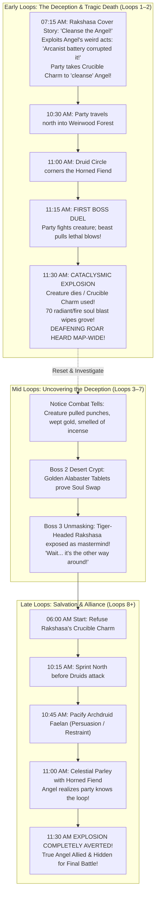
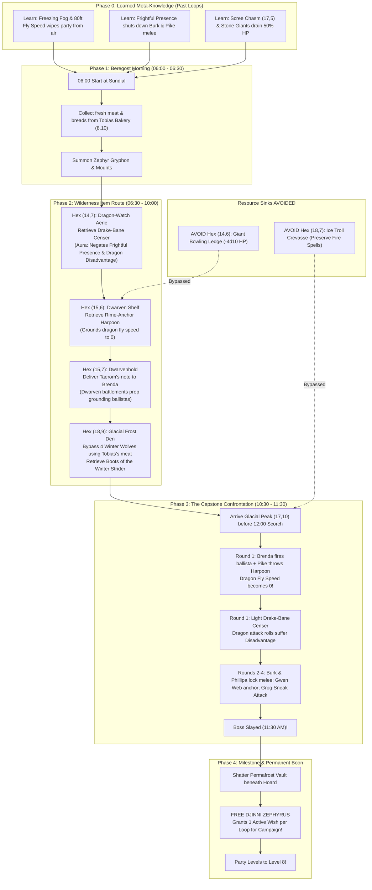
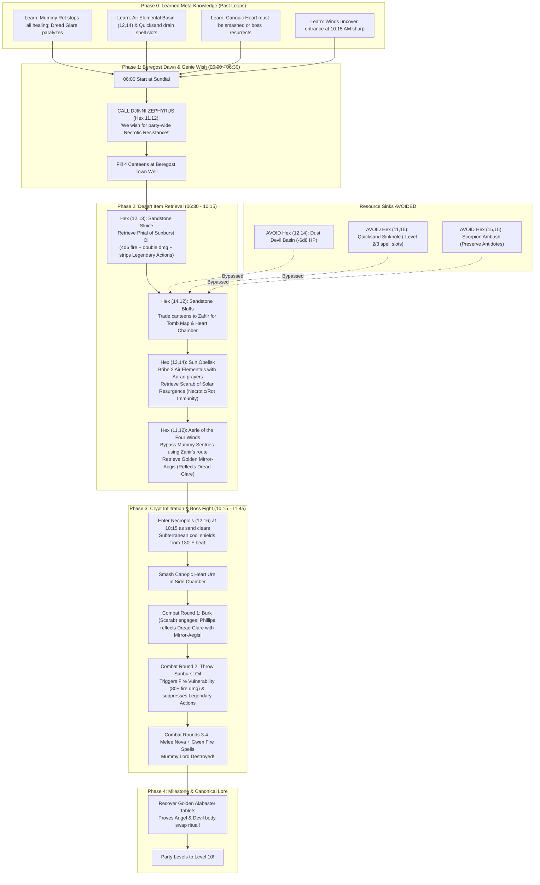
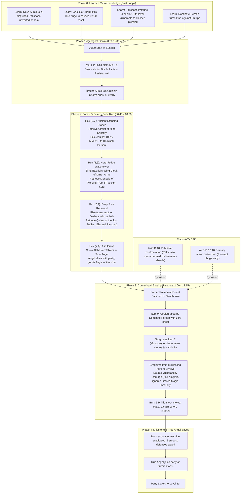
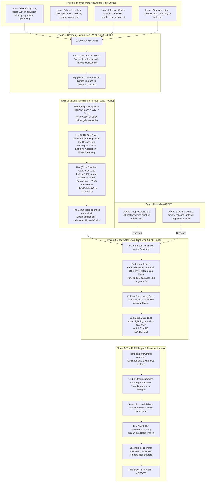
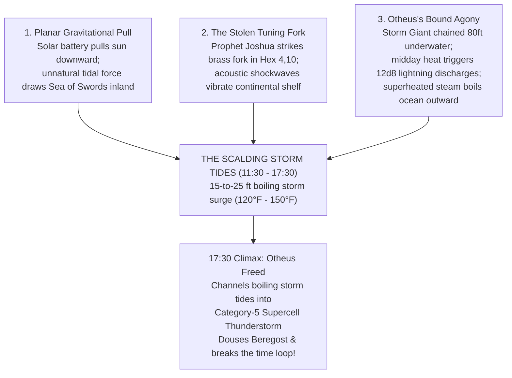

# The Beregost Time Loop: Master Campaign Specification (D&D 2024 / 5.5e)
**Levels 7 → 11 | Setting: Beregost & Surrounding Sword Coast Hexes**

---

## 1. System Architecture & Party Baseline

* **Ruleset**: D&D 2024 (5.5e) for a 5-player party.
* **Level Progression**: Strictly Level 7 to Level 11 via milestone level-ups awarded upon defeating each of the four capstone bosses.
* **Pre-Campaign Character Sheet Baseline**: All player characters start the campaign at Level 7 with their permanent pre-campaign character sheet bonuses (**+1 AC** and **+1 to Attack rolls** earned in their prior adventure before entering Beregost).
* **Fixed Operational Window**: 12 hours (06:00 to 18:00).
* **Reset Triggers**: Total solar cataclysm at 18:00, or total party death at any time. Resets strictly to sunrise at **06:00 AM**.
* **Asymmetric Knowledge Rule**: The 5 player characters are the **only entities in the multiverse aware of the time loop**. No NPCs, bosses, genies, devils, angels, or monsters retain memories or "soul-imprints" across cycles. Their routines, dialogues, and tactical responses reset identically every dawn.
* **Strict Reset Boundary (Memories & Level-Ups Only)**: Nothing persists across time resets except **the players' memories** and **their milestone level-ups** (Level 7 $\rightarrow$ 8 $\rightarrow$ 10 $\rightarrow$ 11). No physical items, no soul-imprinted blessings, no persistent boss state changes, and no permanent movement buffs carry over. Faster progression on later loops relies 100% on the players' memorized knowledge of **True Names**, **ritual chants/somatic touches**, **vault combinations**, **passwords**, and **clockwork schedules**.

### 1.1 Narrative Continuity: The Arcanist's Battery & The Swapped Souls
* **The Previous Campaign (The Arcanist's Battery)**: In the party's prior adventures, they defeated a corrupt arcanist who was exploiting an **Angel** and an **Archdevil** as an opposing-planar magical battery. When the party shattered the arcane conduits and liberated them, the catastrophic planar backlash caused an unforeseen **Inversion Soul-Swap**:
  - The **True Angel's soul** was drawn into the grotesque, horned physical vessel of the Devil.
  - The **True Devil's soul** was drawn into the resplendent, feathered physical vessel of the Angel.
* **Player Recognition & The "Angel Acting Weird" Observation**:
  - The players recognize both entities from the previous campaign!
  - However, the players **do not know their bodies were swapped**.
  - Crucially, the party has noticed that the "Angel" has recently been acting bizarrely—displaying un-angelic cruelty, callous indifference to civilian suffering, and unsettling malevolence ("the Angel has been doing weird/bad things").
* **The Rakshasa's Cover Story ("Cleanse the Corrupted Angel")**:
  - The tiger-headed Rakshasa ("Aurelius the Radiant") capitalizes on the party's suspicions:
  - Rather than trying to deny that the Angel is acting strange, the Rakshasa validates it:
    > *"You have seen it yourselves! Our radiant Angel was corrupted by the dark energies of the Arcanist's vile battery! That horned beast prowling the northern forest is psychically poisoning the Angel's mind. We must cleanse the Angel! You must track down the horned fiend and drive the Crucible Charm into its heart to sever the corruption and save our holy friend!"*
  - This traps the players through their own heroic empathy: they believe they are embarking on a sacred mission to **save and cleanse the Angel from the previous campaign**, unaware that the "beast" in the woods is the True Angel and the "corrupted Angel" is the Devil!

---

## 2. Loop 0: The Emotional Baseline & Session 1 Walkthrough

> **DM Design Philosophy:**  
> Loop 0 must play out as a completely standard, charming, high-fantasy adventure. **Do not introduce time loop mechanics, the Rakshasa disguise, or the angel/devil swap during the morning of Loop 0.**  
> The players should believe this is a classic heroic quest in a lively, welcoming town. The goal is to build deep, authentic emotional attachment to Beregost and its civilians, making the afternoon conflagration harrowing and the final reset an unforgettable, jaw-dropping twist.

### 2.0 DM Quick-Memory Cheat Sheet (Sessions 1 & 2)
*(Built into the Web Companion under the `🧠 Sessions 1 & 2 Memory Sheet` tab for fast mid-session reference)*

1. **The 30-Second North Star**:
   - **Session 1 (Loop 0)**: Pure, heartwarming festival fun followed by catastrophic solar heartbreak. Let players earn tokens from Tobias, Maya, and Captain Rebecca. At 17:59 PM, the Angel atop the West Cliffs tears the sun down, vaporizing Beregost. At 06:00 AM, the clock resets.
   - **Session 2 (Loop 1)**: The party wakes with full memories and rushes West to investigate. At 07:15 AM on the West Road, **"Aurelius the Radiant" (Lord Ravana the Rakshasa)** intercepts them with a convincing cover story (*"The Angel was corrupted; kill the horned beast in Ash Grove to cleanse it!"*). Killing the beast detonates a 70 Radiant death-burst at 11:30 AM, wiping the grove and resetting the loop!
2. **The 3 Aha! Clues to Seed**:
   - **05:45 AM**: Commodore's caravel lockbox stolen by winged figure & crew (*"That was us!"*).
   - **05:59 AM**: Clocktower stone balcony freshly smashed into rubble (*"That was us!"*).
   - **06:00 AM Reset**: Guard calls up: *"Hey! You got the clock working! Thank you! Happy Solstice!"*
3. **Aurelius's 3 Secret Tells**:
   - **NO SHADOW**: Even under direct midday sun, Aurelius casts no shadow.
   - **INVERTED PALMS**: Hands are backward; concealed under silk gloves.
   - **SCENT**: Sweet cinnamon pastry undercut with blood and sulfur.
4. **Combat Numbers at a Glance**:
   - **Cornfield Scarecrow (CR 1, Hex 8,11)**: AC 11, HP 36, DC 11 Wis save vs paralyzing claws, **Vulnerable to Fire**.
   - **Snirk the Goblin (CR 1/4, Hex 9,10)**: AC 15, HP 7, dangling in tree snare. DC 10 check / pastry bribe reveals White Dragon Rimefang in Cloud Peaks.
   - **Horned Fiend / True Angel (CR 10, Hex 7,6)**: AC 18, HP 144, non-lethal strikes (mercy). 70 Radiant death-burst on Crucible execution.

---

### 2.1 The Official Dawn Monologue (Read-Aloud Script for Every Reset)
*(The DM reads this verbatim at 05:59 AM in Session 1 when the party pulls the bone from the clocktower gears, and re-reads it word-for-word at 06:00 AM on every subsequent loop reset. It provides rich sensory immersion while subtly foreshadowing every cardinal biome, faction, and boss—and plants the recurring **rubbled, destroyed clocktower balcony** line that players will recontextualize later as **"Aha! That was us!"**)*

> **[DM READ-ALOUD — DAWN AT 06:00 AM]** *(Read time: ~40s; re-read verbatim on every reset)*  
> *"You hear a sharp, heavy **CLACK** as the clock ticks forward to 6:00 AM. A great bronze bell strikes—**GONG**. In your hand, the pale bone that jammed the mechanism crumbles, dissolving into a fine gray dust that slips through your fingers.  
>  
> The morning air is crisp and cool. The town square down below you stirs to life: a baker emerges with a steaming tray of honey-currant rolls, a little girl skips past the well tossing a carved wooden thrush into the air, a haggard old man sits up, wrapped in a patched quilt, and merchants unfurl colorful festival banners across the cobblestones.  
>  
> Beyond the rooftops, the morning horizons stretch wide: to the north, crows scatter over the green forest canopy; to the east, snowy peaks glint white; to the south, ribbons of dust lift off desert dunes; and far to the west, low thunder rumbles over the sea.  
>  
> **It is dawn, and the sun sets in 12 hours.**  
>  
> Down in the square, a town guard shields her eyes, calling up to you standing on the rubbled, destroyed clocktower balcony with a wide grin:  
> **'Hey! You got the clock working! Thank you! Happy Solstice!'**"*  
>  
> The bell fades into the morning chatter. It is **06:00 in the morning**."*
---


### 2.1.1 The Solstice Prophecy of Old Jonas & The Complete Ulcaster Codex

*(Delivered at 06:00 AM by the haggard old prophet wrapped in a patched quilt sitting against the municipal well in Feldepost Square. Townsfolk ignore him as an eccentric madman, but on Loop 1 the players realize every line is literal truth.)*

> **[THE SOLSTICE DAWN CHANT — RECITED BY OLD JONAS (14 LINES)]**  
> *"With six chimes the belfry wakes,  
> But doom is coming with no escape.  
> Only one narrow path can provide salvation,  
> Threading this needle stops the devil's elation.  
>  
> First east to the ice, then south to the sand,  
> Find the path to stop the devil's hand.  
> Blame not the angel for he is confused,  
> Led astray by the fiendish ruse."*

#### Tactical Decryption & The Two-Phase Progressive Epiphany
1. **Lines 1–4 (The Belfry Chimes & The Tight Causal Needle)**:
   - *Atmospheric Doom*: At 06:00 AM, six chimes ring from the clocktower. Time resets, and doom rushes toward 18:00 PM sunset with no natural escape.
   - *Threading the Needle*: The campaign is not a wide-open wandering sandbox—there is only **one narrow sequence of operations** that can break the temporal recursion before the dusk vaporization.
2. **Lines 5–6 (The Tactical Directive: First East, Then South)**:
   - *The Immediate Roadmap*: After the Loop 1 disaster in the Ash Grove (where attacking the horned beast triggers a 70-damage radiant suicide blast at 11:30 AM), the party wakes up on Loop 2 and hears Jonas chant this line.
   - *The Pivot*: The rhyme explicitly redirects the party away from the Ash Grove dead end: **First East to the ice** (Hex 17, 10: Adult White Dragon Rimefang) to acquire the *Wish of Frozen Heart*, and **Then South to the sand** (Hex 14, 12: Sunken Necropolis of Akh-en-Amon)!
3. **Lines 7–8 (Blame Not the Angel & The Fiendish Ruse — The Phase 1 Assumption vs. Phase 2 Reveal)**:
   - **Phase 1 (Loops 1–7 — What the Players Believe)**: The players still do **NOT** know of the body swap! Hearing *"Blame not the angel for he is confused, led astray by the fiendish ruse,"* they believe the radiant seraph on the Western Sea Cliffs is merely "confused" or grieving, and that an unseen devil is manipulating the cosmos. They set out across the map thinking they are gathering artifacts to stop this devil's hand.
   - **Phase 2 (Loop 8 — The Mummy Lair Revelation)**: Deep inside the **Sunken Necropolis of Akh-en-Amon (Boss 2)**, the party recovers the **Complete Solstice Codex & Golden Alabaster Tablets**. The full scripture explicitly reveals that the *"fiendish ruse"* was spun by **Lord Ravana the Rakshasa ("Aurelius")**, and that the souls were swapped: the weeping horned fiend in the woods was the True Angel, and the radiant creature pulling down the sun on the cliffs is the Archdevil!

---

### 2.1.2 The Complete Solstice Codex: The Unabridged Scripture (Discovered at the Mummy Lair)

What Old Jonas shouts by the municipal well is only Stanza I—the 8-line street nursery rhyme that guides the party through the first half of the campaign. The full, unabridged text—**"The Complete Solstice Codex: The Canticle of the Inverted Souls"**—is discovered carved into the golden alabaster slabs inside the **Sunken Necropolis of Akh-en-Amon (Hex 14, 12)**:

```text
═══════════════════════════════════════════════════════════════════════
THE COMPLETE SOLSTICE CODEX: CANTICLE OF THE INVERTED SOULS
Recovered from the Pharaoh's Suncophagus Chamber (Hex 14, 12)
═══════════════════════════════════════════════════════════════════════

[STANZA I: THE AWAKENING DAWN & THE NARROW PATH (JONAS'S STREET CHANT)]
With six bronze chimes the belfry wakes,
But doom is coming with no escape.
Only one narrow path can provide salvation,
Threading this needle stops the devil's elation.
First east to the ice, then south to the sand,
Find the path to stop the devil's hand.
Blame not the angel for he is confused,
Led astray by the fiendish ruse.

[STANZA II: THE GREAT DECEPTION & THE UNMASKING OF AURELIUS]
The "devil's ruse" is woven in gold,
By a striped deceiver, cruel and bold.
Lord Ravana struts in the saint's attire,
Posing as "Aurelius," born of fire!
Look not to golden feathers for a righteous heart,
Nor slay the weeping horned beast that bleeds apart.
The angel's weeping soul inside the fiend is bound,
While devil's malice struts upon the holy ground!
If mortal blades should strike the weeping beast in dread,
The devil's triumph seals, and hope of dawn is dead!

[STANZA III: THE EASTERN WYRM & THE GENIE'S BREATH]
Slay the white wyrm upon the glacial peak for chart,
To free the Lord of Air and claim the Frozen Heart.
His wish shall cool the burning gears before they bind,
And grant the breath of winter to the mortal mind.

[STANZA IV: THE SOUTHERN TOMBS & THE INVERSION RITE]
South: sunken tombs of shifting sand reveal
Two traded souls an alabaster touch must heal.
Within the pharaoh’s crypt the ancient scrolls impart:
The sacred word that severs flesh and swaps the heart.

[STANZA V: THE NORTHERN MASQUERADE & THE TIGER'S MOCKERY]
North: pierce the striped fiend’s radiant and holy guise,
His secret name commanded binds his web of lies.
The Rakshasa shall urge you on to slay the beast—
Beware his gilded tongue before the solstice feast!

[STANZA VI: THE WESTERN HURRICANE & BREAKING THE CYCLE]
West: break the deep-sea giant’s abyssal iron chain,
To summon tempest winds and douse the skies in rain.
Four corners mend the falling sun and turn the key:
Restore the angel's form, and set the morning free!
═══════════════════════════════════════════════════════════════════════
```

---

### 2.1.3 The Townsfolk Investigative Trail: How Players Track the Complete Codex

The players do not start with the Complete Codex. On early loops, they hear Old Jonas's 8-line rhyme after the 11:30 AM Ash Grove explosion (*"First east to the ice, then south to the sand, find the path to stop the devil's hand. Blame not the angel for he is confused, led astray by the fiendish ruse"*). Interviewing Beregost citizens confirms *why* they must journey East then South to uncover the unabridged truth:

1. **Old Jonas the Rhymer (Municipal Well Square)**:
   - *Approach*: Offering warm bakery goods from Tobias, mulled cider from Feldepost's, or succeeding on a DC 12 Charisma (Persuasion) or Wisdom (Insight) check.
   - *Testimony*: Jonas breaks down in tears: *"The verses I shout? Just the warning stanza that survived the sandstorm! The master's ledger... the Golden Alabaster Tablets... the full scripture had six stanzas! It told what the fiendish ruse truly is and why the angel weeps! Scribe Vane in the Town Hall bought my expedition notes when I stumbled back from the southern desert half-dead!"*
2. **Scribe Vane (Town Hall & Civic Archives)**:
   - *Investigation*: Visiting the Civic Archives and asking about Jonas or ancient regional prophecies.
   - *Discovery*: Vane confirms Jonas was Brother Jonas, an archivist from the School of Ulcaster who accompanied an expedition into the Southern Desert three winters ago. Vane's municipal lockbox preserves **Leaf 1 (Stanza I)** alongside the **Ulcaster Expedition Manifest**, which records that the unabridged **Golden Alabaster Tablets (Stanzas II–VI)** remain sealed inside the Pharaoh's Suncophagus Chamber in the **Sunken Necropolis (Hex 12, 16)**—guarded by lethal necrotic wards that only the **Eastern Air Genie's Wish** (frozen beneath Rimefang's glacier at **Hex 17, 10**) can withstand!
3. **Barnaby Feldepost (Feldepost's Inn & Tavern)**:
   - *Investigation*: Buying Barnaby an ale and asking about Old Jonas's arrival in town.
   - *Testimony*: Barnaby recalls finding Jonas half-delirious on the South Coast Way clutching a scorched brass scroll-tube. Starving, Jonas bartered his brass desert astrolabe and a charcoal tablet rubbing to Garrick the Fence in Shadow Alley for hard cheese and dry wool blankets.
4. **Garrick the Fence (Cobbler's Lane & Shadow Alley)**:
   - *Investigation*: Interrogating or bartering with Garrick in his cellar hatch (DC 14 Intimidation/Persuasion, or 100 gp purchase, or DC 14 Thieves' Tools).
   - *Discovery*: Garrick holds Jonas's **Charcoal Tablet Rubbing (Stanza III)**, which explicitly details how slaying the White Wyrm on the eastern glacial peak (`Hex 17, 10`) frees the Lord of Air (`Zephyrus`) so his Wish can shield mortal minds and bodies inside the Southern Pharaoh's Crypt!
5. **Sister Althea (The High Hall of Lathander)**:
   - *Investigation*: Presenting Jonas's verses to Sister Althea at the Morning Temple.
   - *Theological Insight*: Althea identifies the meter as the forbidden *Hymn of the Sundered Halos*, noting that ancient Netherese solar priests in the Southern Desert recorded rites capable of severing a spirit from its true vessel—and urges the party to follow Jonas's path (*East to the Ice, then South to the Sand*) to recover the complete liturgy.
6. **The Sunken Necropolis Archive (Hex 12, 16 — Boss 2 Reward)**:
   - *Exploration*: After defeating Rimefang (`Hex 17, 10`) and using Djinni Zephyrus's Wish for Necrotic Resistance to conquer the **Sunken Necropolis (`Hex 12, 16`)**, the party claims the **Golden Alabaster Tablets** containing **Stanzas II, IV, V, and VI**—delivering the mid-campaign bombshell that the Angel and Devil swapped bodies and that "Lord Aurelius" is the Tiger-Headed Rakshasa!

---

### 2.1.4 Day 0 Solstice Street & Tavern Gossip Table (d12)

During the morning of Loop 0 (06:00 – 09:00 AM), as the party explores Beregost, browses festival stalls, or visits taverns (Feldepost's Inn, Jovial Juggler, Red Sheaf), roll on or choose from the table below. Every rumor offers authentic local color while subtly seeding organic clues for the four cardinal sectors—most importantly, the legendary **White Dragon in the East and its frozen hoard**, as well as the **two early time-loop bootstrap clues** (**Rumor #5**: the `05:45 AM` flying thieves who stole the pale bone from the Commodore, and **Tall Tale #4**: the `05:59 AM` crash that left the Clocktower balcony in rubble) that players will recontextualize later as **"Oh—that was US!"**

| d12 | Rumor & Topic | Speaker & Location | Read-Aloud Dialogue & Tavern Whisper | Secret DM Lore / Truth & Destination |
| :---: | :--- | :--- | :--- | :--- |
| **1** | **The Frostpeak Wyrm & The Ice Drafts** *(East / Dragon)* | Master Smith Taerom Thunderhammer / Dwarven Ore-Carter *(Thunderhammer Smithy)* | *"Feel that unnatural sub-zero breeze spilling down off the Cloud Peaks? Thane Torvald sent an urgent courier down from Dwarvenhold at sunrise. He swears Rimefang—the great white wyrm of the high glacier—has stirred from his two-hundred-year slumber! The beast was seen circling the jagged summit of Frostpeak at dawn, frost freezing the pine needles white. The dwarves are begging for fifty cold-iron ballista tips to fortify their ramparts!"* | **True.** Rimefang (CR 13 Adult White Dragon) inhabits the Glacial Peak at **Hex (17, 10)**. His freezing aura chills the eastern valley. Defeating him is Capstone Boss 1! |
| **2** | **The Frozen Hoard & The Djinn's Brass Urn** *(East / Dragon Treasure)* | Barnaby Feldepost / Old Gorm the Prospector *(Feldepost's Inn Taproom)* | *"Every prospector from Nashkel to the Peaks knows what Rimefang sleeps on! It ain't just mountains of ancient dwarven silver and uncut star rubies. Legend says an ancient Netherese treasure-vault lies frozen in his grotto, holding a seamless brass urn bound with four elemental seals. Trapped inside is Zephyrus, a Prince of the Djinn! The old verses say whoever slays the white wyrm and frees the genie claims a Wish that can freeze the gears of fate itself!"* | **True.** Rimefang's frozen hoard at **Hex (17, 10)** contains the *Brass Urn of Zephyrus*, yielding 15,000 gp in gems, ancient Netherese star-charts, and the *Wish of Frozen Heart*—the essential counter-boon needed to survive Boss 2! |
| **3** | **Snirk's Warning on the East Highway** *(East / Foothills)* | Corporal Harek / Town Watch Guard *(North-East Gatehouse)* | *"We caught a miserable green wretch named Snirk dangling upside down from a boar snare in the eastern orchard this morning. Little goblin wasn't scouting for a raid—he was shaking like a dry reed, weeping that his entire tribe abandoned their caves in the eastern foothills because the white dragon's shadow swept right over their pine woods at sunrise! If goblins are running west in broad daylight, there's pure terror on that eastern ridge."* | **True.** Leads directly to the morning errand at **Hex (9, 10)** where players can interrogate Snirk and confirm the Eastern Dragon threat early on Day 0. |
| **4** | **The Lost Dwarven Expedition & Rime-Anchor** *(East / Dwarvenhold)* | Brenda Deepforge *(Dwarven Merchant in Market Row)* | *"Three days ago, Master Smith Taerom's cousin led a 10-dwarf excavation team up into the old Cloud Peak mines. Not a single mule has returned down the pass. A shepherd swears he saw blue lightning crackle over the peaks and heard a roar that shattered avalanches. My cousin took half of Taerom's runic cold-chisels—if that dragon got them, a fortune in masterwork dwarven forgecraft is locked under the ice!"* | **True.** Dwarvenhold at **Hex (15, 7)** has been isolated by Rimefang's territorial hunting. Thane Torvald is trapped behind barricades and will reward the party with *Glacial Grappling Hooks* and cold-resistance dwarven tonics. |
| **5** | **The Late Yeast Carts & The 05:45 AM Caravel Heist** *(West / Commodore & Future-Self Clue)* | Tobias Miller *(Master Baker at the Bakery Porch)* | *"My solstice morning is ruined if the teamsters don't arrive! The wagon hauling my fresh sea-salt and sea-fermented yeast from the West Port is two hours overdue. Word from a frightened carriage driver is that at 5:45 AM in the pre-dawn fog, a band of flying thieves dropped onto an old sea captain's beached caravel, snatched a strange pale bone from his lockbox, and rocketed straight east toward Beregost—while coastal silt-gull bandits made off with his iron relic chest into the sea caves!"* | **True (Dual Clue!).** Points to Commodore Vance's beached caravel at **Hex (5, 11)** and the Bandit Sea Caves at **Hex (4, 10)**—AND plants **Early Bootstrap Clue #2**: the `05:45 AM` flying thieves who stole the bone from the Commodore and flew east toward Beregost were **the future party and the True Angel** on their way to start the time loop! |
| **6** | **Unnatural Geometrics in the Southern Dunes** *(South / Necropolis)* | Zahir the Nomad *(Caravan Master at the South Gate Caravanserai)* | *"The south winds carry ash and old incense this morning, effendi. My camel-scouts returned from the edge of the Southern Dunes before dawn with wide eyes. They swear the shifting sands receded overnight, uncovering alabaster obelisks and a sunken golden necropolis that has slept under the grit since the Age of Netheril. But no desert fox or scorpion dares tread near it—the sand itself glints like hot gold."* | **True.** Zahir's Desert Margin camp at **Hex (14, 12)** guides travelers to the **Sunken Necropolis of Akh-en-Amon at Hex (12, 16)** (Boss 2)—home to the Mummy Lord and the *Golden Alabaster Tablets* containing the Complete Codex! |
| **7** | **The Shadowless Arch-Mage at Sunrise** *(North / Aurelius)* | Constable Renwick *(North Gate Checkpoint)* | *"Fine-looking noble rode in through the North Gate just after the clock struck six. Called himself 'Lord Aurelius the Radiant,' wearing silk robes stitched in spun gold and smelling of saffron and burnt cinnamon. Claimed he was an envoy of the Sun Father here to bless our solstice. But mark my words: when he stepped into the direct morning glare... the cobblestones beneath his boots didn't cast a single speck of shadow. Not a millimeter."* | **True.** Aurelius is Lord Ravana, the Tiger-Headed Rakshasa (CR 13, Boss 3). As a fiendish illusionist walking in false daylight, his radiant disguise subtly fails physical optics (casts no shadow). |
| **8** | **Weeping Weirwood in the Briars** *(North / Ash Grove)* | Woodcutter Torben *(Porch of the Jovial Juggler)* | *"Don't you go wandering north toward the Briarwood or the Ash Grove today, travelers! The druids have drawn thorny brambles across the woodcutter trails. A huntsman fled the woods at daybreak swearing an immense horned fiend fell out of the sky like a dying star, bleeding black ichor. And the sacred Great Weirwood at the grove's heart? It started weeping thick red resin that smells like temple frankincense and roses."* | **True.** The Ash Grove at **Hex (7, 6)** is where the Horned Fiend (the True Angel trapped in the devil's body) lies weeping in agony. The druids believe it's a demon and plan to execute it at 11:30 AM, triggering the radiant cataclysm unless stopped! |
| **9** | **The Scalding Ocean Tides & Rattling Chains** *(West / Ocean Reef)* | Salty Hal *(Retired deckhand sipping morning porter at Feldepost's)* | *"I've fished the Sea of Swords for forty seasons, boy, and water doesn't lie. When I pulled my crab pots off the western cliffs at sunrise, the sea water was warm as bath water—tasted like battery acid and lightning sparks! And deep down under the keel, you could hear a heavy thrum... like miles of sunken iron anchor chains groaning against the granite reef."* | **True.** The Abyssal Trench at **Hex (5, 11)** where Storm Giant Otheus is bound by sunken titan chains. Defeating the singing devil and releasing Otheus summons the category-5 hurricane that saves Beregost! |
| **10** | **Old Jonas's Mad Well Chants** *(Town Square / Prophecy)* | Little Maya *(Skipping rope by the Municipal Well)* | *"Poor Old Jonas was crying so loud into his patched quilt when the clock gonged! He told Mrs. Miller that the sun was going to fall out of the sky like a burning coal, and he kept saying the same funny rhyme over and over: 'First east to the ice, then south to the sand, find the path to stop the devil's hand!' Mama told me not to listen because he's touched in the head, but he sounded awful scared!"* | **True.** Jonas's 8-line Solstice Prophecy contains the literal causal roadmap for breaking the loop. |
| **11** | **The Whirling Chronometer in Room #4** *(Town / The Sanctum)* | Corin the Bar-Boy *(Sweeping the common room at Feldepost's Inn)* | *"That young scholar who checked into Room #4 upstairs—Master Kaelen—hasn't slept a blink in two nights. You can hear weird whirring noises through his keyhole, like a dozen spinning brass gyroscopes and water clocks! He came down at dawn looking white as milk, tapped the grandfather clock in the hall, and muttered that the pendulum was dropping two seconds faster than yesterday. Strange fellow."* | **True.** Apprentice Chronomancer Kaelen in Room #4 (and his 86-year-old future self at **Hex 14, 13 The Sanctum**) possesses temporal tracking equipment and is the party's primary scientific ally in decoding the Bootstrap Paradox. |
| **12** | **The Mirrored Spire on the Western Cliffs** *(West / Spire of False Angel)* | Elorion the Bard *(Tuning his mandolin at Jovial Juggler stage)* | *"I climbed the high hill west of town at first light to watch the sunrise over the valley. Far out on the coastal bluffs, the ancient Spire of the Sea Cliffs caught the dawn light—except the light didn't shine white, it burned with a harsh violet glare. Through my spyglass, I saw a winged form with feathers of blinding fire perched on the highest parapet, weeping into the wind. It looked holy... yet the hair on my arms stood on end like before a lightning strike."* | **True.** The Spire of the False Angel at **Hex (6, 8)** where the Devil (wearing the angel's body) perches. At 17:59 PM, he pulls down the sun! |

---

### 2.1.5 Plausible False Rumors, Tall Tales & Secret Breadcrumbs (d8)

Not all chatter in Beregost is gospel truth! In a bustling frontier crossroads, townsfolk swap superstitious folk tales, misremembered history, drunken boasts, and wild misinterpretations of regional anomalies. 

These rumors sound plausible to first-time adventurers on Loop 0 and can be debunked as obviously made up as players investigate. However, each tall tale hides a **real kernel of truth or secret breadcrumb**—giving the party unexpected rewards, shortcuts, and tactical advantages in subsequent loops!

| d8 | Tall Tale & Topic | Speaker & Location | What the Townsfolk Claim (Read-Aloud Dialogue) | Why It's False (The Bogus Claim) | The Real Secret Breadcrumb & Future Payoff |
| :---: | :--- | :--- | :--- | :--- | :--- |
| **1** | **The Dragon-Tamer's Silver Whistle** | Old Gorm *(Red Sheaf Taproom)* | *"My grandfather swore the founder of the Red Sheaf, Menas Redsheaf, was an ancient wyrm-rider! Hidden behind the vintage casks in the deep wine cellar is Menas's silver whistle. Blow three shrill notes, and any dragon of the Cloud Peaks must land and kneel to your will!"* | **Bogus.** White dragons are feral apex predators that cannot be tamed by whistles; Menas was merely an imaginative drunken cobbler. | **The Real Breadcrumb:** Searching the Red Sheaf wine cellar (DC 13 Investigation) finds no whistle, but reveals a smuggler's false stone wall hiding a vintage cask of *Dwarven Dragon-Fire Brandy* (acts as a *Potion of Fire Resistance*) and an old mining survey map showing a hidden chimney into Rimefang's mountain that bypasses the frost giant guards! |
| **2** | **The Witch of the Southern Oasis & Her Love Elixir** | Selim the Caravan Guard *(South Gate)* | *"They say an immortal sorceress dwells by an azure pool deep in the southern dunes. If you bring her a bouquet of fresh sun-lilies plucked from the Temple of Lathander before noon, she'll brew you an elixir of eternal youth and grant you three wishes!"* | **Bogus.** There is no witch, azure pool, or youth elixir. The "oasis" is a heat mirage shimmering above the necrotic furnace of Akh-en-Amon. | **The Real Breadcrumb:** Plucking fresh sun-lilies from the temple lawn and carrying them south causes their sacred golden pollen to crackle and align with the necrotic dust like a compass needle—leading the party directly through the sandstorms to the hidden entrance of the Sunken Necropolis (Hex 14, 12), and serving as the key botanical catalyst to brew holy embalming oil! |
| **3** | **The "Werewolf Alderman" of Stonecrest Manor** | Mistress Martha *(Cobbler's Lane)* | *"Have you heard the furious thumping and groaning coming from Alderman Durlag's private study after dark? Mark my words, the man is a cursed lycanthrope! He locks himself in every full moon to gnaw on raw beef bones and howl at the stars!"* | **Bogus.** Durlag is NOT a werewolf; he is a neurotic, dyspeptic politician suffering from severe acid reflux and anxiety. | **The Real Breadcrumb:** The nocturnal thumping is Durlag furiously trying to smash open an iron floor-safe his late grandfather forgot the combination to! Once the party learns the combination (found in Scribe Vane's municipal records) or cracks it, the safe holds 500 gp and a *Ring of Mind Shielding*—which shields the wearer's thoughts from Rakshasa Lord Ravana's telepathic probes! |
| **4** | **The Sun God's Golden Egg & The Smashed Belfry Balcony** *(Early Bootstrap Clue #1!)* | Pip the Urchin *(Municipal Cistern)* | *"Look up at that freshly smashed, rubbled western balcony on the Clocktower! My cousin swears at 5:59 AM right before the bell rang, Lathander's giant celestial rooster crashed straight through the stone railing out of the western fog and laid a solid gold egg the size of a sheep in the gears! Whoever touches the egg at 12:00 sharp gets the strength of a demigod!"* | **Bogus.** The Morninglord has no giant celestial poultry, and touching the clockwork gears at 12:00 PM deals 2d6 scalding fire damage from solar superheating. | **The Real Breadcrumb (Early Bootstrap Clue #1):** What *actually* crashed out of the western fog at `05:59 AM`, smashed the Clocktower's western balcony into rubble, and jammed the pale **Chronocite Bone** into the escapement gear was **the future party and the True Angel** arriving at breakneck speed after stealing the bone from the Commodore at `05:45 AM`! Inspecting the brass gear housing also reveals ancient Dwarven runes: *"Time bound in bone, sundered in flame."* |
| **5** | **The Ghost Pirate of the Western Shoals** | Barnaby Feldepost *(Feldepost's Inn)* | *"Coast teamsters swear the beached caravel out west is cursed by Captain Blood-Eye's vengeful wraith! If you dare board her decks without tossing a silver piece into the tide for his ghost-crew, the rigging ropes will come alive and throttle you in your sleep!"* | **Bogus.** There are no ghosts on the ship. The strange lights and moans are coastal silt-gull raiders with hooded lanterns and Storm Giant Otheus groaning beneath the ocean floor. | **The Real Breadcrumb:** If the party *does* toss silver coins into the surf near the wreck, friendly coastal otter-folk swim up, take the shiny coins, and gratefully fetch a submerged waterproof leather tool-roll from the reefs containing an *Adamantine Crowbar*—granting Advantage on Strength checks to pry open the caravel's powder magazine and disarm the raiders' bomb before it detonates! |
| **6** | **The Cursed Gargoyle Apples of the Ash Grove** | Granny Morwen *(Apothecary Porch)* | *"Mind the wild red apples in the deep northern briars, young folks! The woodcutters say they grow on a weeping ghost-tree, and a single bite turns your flesh to grey granite! Sylvan druids use them to turn trespassers into garden statues!"* | **Bogus.** The tree produces no petrifying apples, and the druids are nature wardens, not petrification warlocks. | **The Real Breadcrumb:** The tree is the sacred Great Weirwood at Hex (7, 6), and its weeping red sap is *Celestial Manna* reacting to the wounded True Angel's presence. Harvesting 2 ounces of this sap in a glass vial creates an elixir that duplicates *Greater Restoration*, allowing the party to instantly cure the True Angel's planar disorientation in combat without needing a 5th-level spell slot! |
| **7** | **The Wish-Ring in the Municipal Well** | Jarek the Mercenary *(Jovial Juggler)* | *"I had an elven wishing ring—pulled right off a nobleman's finger in Athkatla! But I got dice-drunk last night and fumbled it right down the municipal well! Any diver who swims down into the dark muck can fish it out and wish for a castle of gold!"* | **Bogus.** Jarek never had a magic ring; he fabricated the story after losing his boots and coin purse in a crooked dice match with Garrick the Fence in Shadow Alley. | **The Real Breadcrumb:** Diving into the well (DC 12 Athletics) won't find a wish ring, but reaches the submerged municipal cistern. Resting on a silt shelf is Little Maya's carved wooden thrush (earning her blessed clover bracelet) AND an ancient oiled leather diver's kit containing a *Wand of Water Breathing* and an uncharted underwater bypass tube directly into the flooded Temple of Lathander crypts! |
| **8** | **The Siren Song of the Western Sea Cliffs** | Turlough the Goat-Herd *(West Road Gate)* | *"Every solstice evening, an enchanting sea siren perches high on the sea cliffs singing a song so beautiful it makes grown sailors leap from their caravels to drown in the surf! My goats ran wild just hearing the first few notes!"* | **Bogus.** It is not a romantic mermaid or siren; it is the Singing Devil (wearing the Seraph's physical body) weaving the high-frequency acoustic ritual that draws the setting sun out of orbit. | **The Real Breadcrumb:** The rumor confirms that the cataclysm is driven by an acoustic vocal performance. Prompting Elorion the Bard or Kaelen about "cliff singing" inspires Elorion to compose the *Counter-Harmonic Chime* sheet music—which can be played on a lute or blown through a tuning fork to impose Disadvantage on the Devil's singing attacks and give the party Resistance to his radiant solar flare! |

---

### 2.2 Session 1: Complete Scene-by-Scene DM Running Guide

#### Act 1: The Clocktower & The Golden Solstice Morning (05:59 – 09:00 AM)
* **Scene 1: The Smashed Belfry Balcony & The Bone Hand-Off (05:59 AM — Early Bootstrap Clue #1!)**:
  * **The Scene at 05:59 AM**: The session opens at `05:59 AM` in the top belfry of the Beregost Clocktower (`Hex 8, 10`). Artificer Bram Copperwheel has just hired the party to climb up and unjam the clock before the `06:00 AM` Solstice chime.
  * **Early Bootstrap Clue #1 (The Destroyed Belfry Balcony)**: Describe that the **western stone balcony and balustrade of the Clocktower Belfry have just been violently smashed inward into fresh rubble**—as if something heavy came hurtling out of the pre-dawn western sky at `05:58 AM` and crash-landed straight into the belfry! Dust still hangs in the air, scorch marks and claw/weapon scrapes mar the broken stone rail, and wedged directly into the Grand Escapement Gear is a strange pale **Chronocite Bone**, freezing the clock at `05:59 AM`!
  * Bram shouts up from the ladder in bewilderment: *"By Gond's teeth, look at my western balcony—some freak meteor or flying beast smashed clean through the stone rail in the fog a minute ago! Did you find what jammed the escapement gear?! Pull it out quick so the 6:00 bell can ring!"*
  * **The 06:00 AM Trigger**: The players pull the bone from the gears. The clock ticks forward to `06:00 AM`, the great bronze bell strikes, and the bone dissolves into gray dust in their hands! *(Later in the campaign, after defeating the Rakshasa, the players will realize: **THEY** were the ones who crashed through the Clocktower balcony at 05:59 AM with the True Angel and jammed the bone into the gears!)*
  * **The DM reads the Dawn Monologue** *(including the town guard calling up to the party standing on the rubbled, destroyed clocktower balcony: `"Hey! You got the clock working! Thank you! Happy Solstice!"`)*.
  * Bram is overjoyed: *"Praise Gond's cogwheels! The Solstice mechanism is free—even if the town masons will be cursing that wrecked balcony all week!"* He rewards them with 25 gp each or festival vouchers: *"Take the day off, champions! Drink, feast, and enjoy our town!"*
* **Scene 2: Feldepost Square & The 3 Emotional Anchors (06:15 – 07:30 AM)**:
  * **Tobias the Baker (Bakery)**: Frazzled because his apprentice threw his back out. Party helps unload a cart of solstice flour. Tobias gifts them warm honey-currant rolls (+5 temp HP, delicious). He laughs warmly: *"Promise you'll be back at sunset for the grand roast!"*
  * **Little Maya (Municipal Well)**: 8-year-old orphan crying over her dropped wooden thrush. Quick Mage Hand or climb check retrieves it. Maya beams with gratitude and weaves a green clover bracelet on a PC's wrist: *"It's for good luck! Don't take it off until the festival stars come out tonight!"*
  * **Captain Rebecca (Guard Barracks)**: Veteran with a bad knee organizing the festival patrol. Party assists with drilling or resolving merchant disputes. Rebecca gives them lodging vouchers for the Jovial Juggler.
  * *Tone*: Wholesome, cheerful high fantasy. The party feels respected, welcomed, and emotionally invested.

* **Scene 2A: The Solstice Carnival Games & NPC Skill Challenges (06:30 – 08:30 AM)**:
  * **Sister Althea (Temple Priest - Temple Garden)**:
    * *Game*: **The Solar Bullseye of Lathander** (DC 13 Ranged Weapon Attack or Dexterity Check).
    * *Description*: Contestants shoot sun-crested blunted arrows at a swinging brass sun medallion 40 feet away in the temple garden. Sister Althea blesses each bow with morning incense.
    * *Reward*: *Ribbon of the Morninglord* (+1 bonus to one Death Saving Throw or radiant damage check).
    * *Roleplay*: Althea smiles warmly: *"May Lathander's sunrise guide your sight, travelers. Every dawn is a second chance."*
  * **Old Granny Morwen (Town Apothecary - Stall by Jovial Juggler)**:
    * *Game*: **Blindfold Aromatics & Herb Tasting** (DC 13 Wisdom (Medicine or Nature) Check).
    * *Description*: Blindfolded participants identify three pungent Cloud Peak medicinal herbs by scent, texture, and pinch-taste (wild mountain thyme, frost-root bark, sun-blossom).
    * *Reward*: *Tin of Morwen's Mint & Lavender Lozenges* (Restores 1d4 HP and gives Advantage on one Con save vs. Heat Exhaustion).
    * *Roleplay*: Morwen cackles warmly: *"A sharp nose saves more lives than a sharp broadsword, young dears!"*
  * **Taerom Thunderhammer (Master Smith - Smithy Courtyard)**:
    * *Game*: **The Anvil-Ringer Sledgehammer of Might** (DC 14 Strength (Athletics) Check).
    * *Description*: Swinging a 30-lb iron sledge onto an oiled steel rocker piston to propel an iron slug 25 feet upward to ring Taerom's Great Forge Bell.
    * *Reward*: *Thunderhammer Whetstone* (+1 bonus damage on first weapon strike after honing).
    * *Roleplay*: Taerom slaps the winner's shoulder: *"Bwahaha! Proper forge-arm muscle! Let that chime ring out to the mountains!"*
  * **Tobias Miller (Master Baker - Bakery Pavilion)**:
    * *Game*: **The Honey-Currant Pie Sprint** (DC 12 Constitution Save or DC 13 Dexterity (Acrobatics/Sleight of Hand) Check).
    * *Description*: A weaving slalom through cheering festival spectators balancing a scorching hot copper platter loaded with 6 fresh sugar-glazed buns without dropping a single crumb!
    * *Reward*: *Baker's Apron Pin & Warm Currant Buns* (Restores 2 HP on short rest; beloved by town children).
    * *Roleplay*: Tobias wipes flour from his brow: *"Magnificent footwork! Keep a bun warm in your pocket for sunset!"*
  * **Garrick & Elorion (Bards - Jovial Juggler Plaza Stage)**:
    * *Game*: **Solstice Rhyme Duel & Baton Knife-Catch** (DC 13 Charisma (Performance) or Dexterity (Acrobatics) Check).
    * *Description*: A rapid-fire rhyming exchange on stage while catching spinning wooden festival batons tossed in syncopated tempo.
    * *Reward*: *Bardic Solstice Token* (Usable once to add 1d6 Bardic Inspiration to any d20 ability check or attack).
    * *Roleplay*: Garrick strums his lute: *"A master of rhyme and time! Beregost won't forget your verse today, champions!"*

* **Scene 2B: Day 0 Solstice Street & Tavern Gossip (06:00 – 09:00 AM)**:
  * While exploring the town square, sampling festival treats, or stopping for morning cider at Feldepost's Inn or the Jovial Juggler, the DM should roll on or pick from **Section 2.1.4: Day 0 Solstice Street & Tavern Gossip Table (d12)** and **Section 2.1.5: Plausible False Rumors & Tall Tales (d8)**.
  * *Narrative Function & Bootstrap Clues*: Specifically seeds rumors about **Rimefang the White Dragon in the East**, his **frozen Netherese hoard**, and the **legendary bound Djinni**, as well as the **two early time-loop bootstrap clues** that players will recontextualize after defeating the Rakshasa:
    1. **Rumor #5 (Tobias the Baker — The 05:45 AM Caravel Bone Heist)**: At `05:45 AM` in the pre-dawn fog, a squad of flying thieves with a *"hulking winged figure"* dropped onto the Commodore's beached caravel (`Hex 5, 11`), stole a strange pale fossilized bone from his lockbox, and rocketed east toward Beregost (*"Aha—that was US and the True Angel!"*).
    2. **Tall Tale #4 (Pip the Urchin — The 05:59 AM Smashed Clocktower Balcony)**: At `05:59 AM` right before the bell rang, something hurtling out of the western fog crashed straight through the Clocktower's western balcony, leaving it in rubble (*"Aha—that destroyed balcony was US too!"*).

* **Scene 2C: Day 1 Morning Heroic Errands Outside Town (07:30 – 10:30 AM)**:
  * **Errand 1: South Cornfields: The Scarecrow Snare (Hex 8, 11)**:
    * *The Hook (07:30 AM)*: Farmer Old Bran rushes to the south gate panicked: his 16-year-old apprentice, *Young Tom*, walked out into the sweetcorn fields at sunrise to gather festival ears and never returned. Distant crying was heard from the center maze.
    * *The Travel & Terrain*: Hex (8, 11) is rolling pastoral farmland directly south of Beregost (1 hour on foot).
    * *The Encounter*: An animated **Cornfield Scarecrow (CR 1, HP 36, AC 11)** has trapped Tom inside a wicker corn crib! Its claws threaten paralysis (DC 11 Wis) and its Terrifying Glare freezes victims.
    * *Tactical Counter*: Vulnerable to Fire! Torches or fire cantrips ignite it quickly, freeing apprentice Young Tom unharmed.
    * *Lore & Reward*: Rescuing Tom reveals the scarecrow twitched alive at dawn when a strange sulfurous chime echoed from the south (foreshadowing the desert tombs). Farmer Bran tearfully gifts the party an *Ivory-Carved Cornucopia Whistle* and a wheel of solstice smoked cheddar.
  * **Errand 2: East Highway Verge: Watch Scout Patrol (Hex 9, 10)**:
    * *The Hook (08:30 AM)*: Captain Rebecca asks the party to take a brisk ride down the Coast Way eastern verge towards the foothills to check on Corporal Harek's 3-man patrol, sent out to ensure goblins don't harass arriving merchant caravans.
    * *The Travel & Terrain*: Hex (9, 10) is along the paved Coast Way highway (1 hour on foot, 30 min mounted).
    * *The Encounter*: Everything is mostly fine! Harek's guards are leisurely sharing canteens while holding a snared **Goblin Scout (CR 1/4, Snirk)** dangling upside down from a sapling in his own failed rope snare after trying to steal strawberry tarts.
    * *The Interrogation & Lore Clue*: Interrogating Snirk (DC 10 Persuasion/Intimidation or offering a pastry) yields panic: *"Snirk clan ran from Cloud Peaks! White blizzard dragon Rimefang woke shivering with rage! Cold mountain winds creeping down!"* This is the party's very first organic in-game clue pointing to the Adult White Dragon at Hex (17, 10)!
    * *Reward*: Corporal Harek gives the party a flask of spiced dwarven apple cider and a signed militia voucher.

#### Act 2: The Unnatural Thermal Creep (09:00 AM – 12:00 PM)
* **Scene 3: 09:00 AM — The Thermal Spike (95°F)**:
  * Air surges to 95°F. Wells drop 4 feet. A faint high-pitched divine hum vibrates through metal blades and armor.
  * Townsfolk laugh it off as an odd summer scorch, but dogs pant and beer goes warm.
* **Scene 4: 10:30 AM — Severe Heat (120°F)**:
  * Sky turns an unnatural, blinding bleached-white glare. No clouds.
  * DC 12 Con save for medium/heavy armor wearers or gain 1 level of exhaustion unless cooled.
  * Party uses utility spells (*Create Water*, *Prestidigitation*) to help elderly townsfolk.
* **Scene 5: 11:30 AM — The Northern Thunderclap (Audible Region-Wide)**:
  * A deafening, concussive **BOOM** rumbles from the northern forest! Windows rattle across town; crows scatter in panic. A towering column of white-crimson smoke rises in the north.
  * Townsfolk murmur in confusion: *"Thunder on a cloudless sky?"*
* **Scene 6: 12:00 PM — Solar Scorch (140°F)**:
  * Direct sunlight deals **2d6 Fire damage per 10 minutes** in the open.
  * Metal armor and weapons become scalding hot (*Heat Metal* effect).
  * Canvas festival banners ignite; road tar melts. The festival collapses into panic.

#### Act 3: The Afternoon Conflagration (13:00 – 15:00 PM)
* **Scene 7: Rooftop Fires & Town Evacuation**:
  * Shingle roofs spontaneously ignite across Cobbler's Lane and Feldepost Square.
  * Tobias's bakery catches fire. The party coordinates bucket brigades and evacuations, burning low-level spell slots (*Create Water*, *Ray of Frost*).
  * The party realizes: *This is not weather—the sun itself is weaponized.*

#### Act 4: The Crypt Triage (15:00 – 17:59 PM)
* **Scene 8: 15:00 PM — Bunker Panic (175°F Outside)**:
  * Outdoor air is an inferno: **10d6 Fire damage per round in the open**! Anyone outside is incinerated. Birds drop dead from the sky.
  * Rebecca, Tobias, Maya, and 50 townsfolk are herded into the deep stone cellars beneath the Temple of Lathander.
* **Scene 9: The Triage Nightmare**:
  * Even subterranean stone cellars heat to an oven: **1d10 Fire damage per round indoors** without magical mitigation!
  * **The Resource Drain**: The party burns every single spell slot, Lay on Hands, Wild Shape, and healing potion:
    * Tobias chokes on smoke, singing to crying children.
    * Maya sobs in a corner, her green clover bracelet charring to black ash.
    * Rebecca strains her bad knee against the iron blast door, her plate armor scorching her skin.
    * Despite everything, NPCs begin dying of burns and heatstroke. The party feels completely helpless.
* **Scene 9A: 17:30 PM — The Belfry Taunt & The Crypt Audio Mix**:
  * As the heat reaches lethal thresholds, an eerie, jarring sound drifts down through the stone ceiling vents from the belfry: **a cheerful, mocking Broadway-swing tune** (*"Daisies"* by Black Gryph0n).
  * The DM triggers the pre-mixed **5:30 PM Crypt Tragedy Audio Track** (muffled singing echoing from the sky layered over immediate coughing, fire rumble, and weeping).
  * *Table Staging*: Dim the lights to deep amber. Read the 17:30 PM prompt from the companion's **To-Do & Audio Prep Tab** (`tab-todo`), then let the track play in absolute table silence for 45–60 seconds as the chorus hits: *"Pretty soon you'll be pushin' up daisies where the sun don't shine..."*
  * *See complete mixing settings, EQ filter values, and prep checklist in the Web Companion's **To-Do & Audio Prep Tab** and [sound_design_530pm_crypt_mix.md](file:///c:/Users/harts/Desktop/Beregost%20Time/sound_design_530pm_crypt_mix.md).*

#### Act 5: The Orbital Obliteration & The Time Loop Twist (17:59 – 18:00 PM)
* **Scene 10: The Whiteout (17:59 PM)**:
  * The crypt ceiling cracks with blinding white brilliance. Stone turns molten.
  * An orbital beam of 5000°F solar plasma crashes straight through the earth.
  * **100d10 Radiant/Fire damage**. Total obliteration. No save.
  * Describe each PC vaporizing while holding the hands of Maya, Tobias, or their allies.
  * *Absolute blackness. Complete silence.*
* **Scene 11: The Groundhog Reveal (06:00 AM Reset)**:
  * In the silence, the gears sound: *Tick. Tick. CLACK.*
  * A great bronze bell strikes: **GONG**.
  * **The DM re-reads the Dawn Monologue verbatim!**
  * The party snaps awake in the crisp, cool morning air, standing on the **rubbled, destroyed clocktower balcony** as the guard down in the square shields her eyes and calls up to them: *"Hey! You got the clock working! Thank you! Happy Solstice!"*
  * All spell slots, HP, and resources are 100% restored.
  * In their hands rests the cold sulfur bone.
  * Below in the courtyard: Tobias cheerfully brings out the exact same tray of unburnt rolls. Little Maya skips happily toward the well.
  * The DM smiles and says: *"Welcome to Beregost. Session 1 ends here."*

### Sympathetic Civilian Anchor Quests (Morning 06:00 – 09:00)
1. **Tobias the Baker (Feldepost Square)**:
   * *The Problem*: An exhausted, warm-hearted baker whose special Solstice yeast delivery was delayed on the Coast Road.
   * *Party Interaction*: The party helps retrieve the cart or helps knead and stoke the morning hearth.
   * *The Token*: Tobias gives each character a warm honey-currant roll and laughs: *"May Lathander smile upon you today, travelers! Come back at sunset for the solstice feast!"*
2. **Little Maya (Municipal Well)**:
   * *The Problem*: An 8-year-old orphan girl crying softly because her carved wooden thrush fell down the municipal well.
   * *Party Interaction*: Mage Hand or a quick climbing check easily recovers the toy.
   * *The Token*: Maya beams with joy and weaves a braided green clover bracelet onto a party member’s wrist: *"It's for luck! Don't take it off until the festival stars come out!"*
3. **Captain Rebecca (Municipal Guard Barracks)**:
   * *The Problem*: A weary veteran captain nursing an old war-knee, struggling to organize the Solstice militia patrols while merchants bicker over stall space.
   * *Party Interaction*: The party assists in drilling guards or smoothing over trade disputes.
   * *The Token*: Rebecca salutes with genuine respect, offering them free lodging at the Jovial Juggler.

### The Thermal Escalation Timeline (Loop 0)
* **06:00 AM**: Crisp, cool morning air. Smoke curls from chimneys; carts rattle over cobblestones; birds sing in the eaves.
* **09:00 AM (The Thermal Spike & Divine Static)**:
  * Ambient heat jumps significantly. Wells drop 4 feet unexpectedly.
  * A faint, high-pitched divine hum vibrates through metal weapons and armor.
* **12:00 PM (Solar Scorch & Induction)**:
  * Extreme noon heat. The sun is an unnatural, piercing white glare directly overhead.
  * **Direct Sunlight**: Deals **2d6 Fire damage every 10 minutes**.
  * **Thermal Induction (Heat Metal)**: Metal armor and weapons become scalding to the touch; characters suffer disadvantage on attack rolls and ability checks while wearing metal armor without magical cooling.
  * Stalls are abandoned; townsfolk retreat to stone cellars in confusion.
* **15:00 PM (Bunker Panic & Conflagration)**:
  * Lethal convective heat. Direct sun deals **10d6 Fire damage per round**.
  * Shingle roofs ignite. Birds drop dead from the sky.
  * Even inside stone cellars, convective heat deals **1d10 Fire damage per round** without magical insulation.
  * **The Triage Crisis**: The party rushes to the temple and town cellars to find screaming townsfolk. Tobias is choking on smoke behind his burning bakery; Little Maya is sobbing in the overcrowded crypt, her clover bracelet scorched to charcoal; Captain Rebecca is burned to the bone holding the basement blast door shut. The party frantically burns every spell slot (*Create Water*, *Lesser Restoration*, *Protection from Energy*, lay on hands) trying to keep civilians alive as the heat overwhelms them.
* **17:59 PM (Total Solar Detonation)**:
  * An incandescent pillar of orbital fire strikes Beregost. 100d10 radiant/fire damage across the entire region. No saving throw.
* **06:00 AM (Loop 1 Reset)**:
  * Clack of gears. The party snaps awake in the crisp, cool morning air standing on the **rubbled, destroyed clocktower balcony**, clutching the sulfur bone as the guard down in the square calls up: *"Hey! You got the clock working! Thank you! Happy Solstice!"*
  * Tobias cheerfully steps out of the bakery with the exact same tray of warm honey rolls, perfectly unburned. Maya is skipping toward the well. Only the party remembers the burning flesh and the desperate prayers.

---

## 3. Boss Encounters & Capstone Hierarchy (Milestones: Level 7 to Level 11)

```
[FIRST BOSS: LVL 7] The Horned Fiend (North Ash Grove) ──► Early Deception Hunt / 11:30 AM Loud Explosion
       │
[BOSS 1: LVL 7] Adult White Dragon (17,10) ──────────────► Frees Air Genie (True Name: 1 Wish + 1 Cloud Move)
       │
[BOSS 2: LVL 8-9] Mummy Lord (Desert) ──────────────────► Uncovers Inversion Soul-Swap Scripture & Touch
       │
[BOSS 3: LVL 10] Tiger-Headed Rakshasa (Beregost/Forest) ► Shatters Deception, Unmasks Mastermind & Saves Angel
       │
[CAUSAL BOOTSTRAP] Party & Restored True Angel ──────────► Forge & Trigger the Time Loop Itself! (05:45 AM Heist)
       │
[BOSS 4: LVL 11] Storm Giant (Coast/Ocean) ──────────────► Unchains Sea Titan & Calls 17:30 Supercell Storm
       │
[TRUE FINAL BOSS: LVL 11] The Singing Devil (Western Spire)► Restores Swapped Souls & Breaks Time Loop!
```

### Prelude Boss / First Boss: The "Horned Fiend" — The True Angel in the Devil's Body (North Ash Grove — Hex 7,6 / 10,4)
* **CR / Target Level**: CR 11 (XP 7,200; PB +4) Large Celestial (in Fiend Form), Lawful Good | Level 7 Party (The First Boss Encounter).
* **Official D&D 2024 (5.5e) Stat Block**:
  - **AC**: 18 (Natural Armor) | **HP**: 178 (17d10 + 85) | **Speed**: 30 ft., fly 50 ft.
  - **Ability Scores**: STR 22 (+6), DEX 17 (+3), CON 21 (+5), INT 12 (+1), WIS 16 (+3), CHA 17 (+3)
  - **Saves**: Str +10, Dex +7, Wis +7, Cha +7 | **Skills**: Perception +7, Insight +7
  - **Resistances**: Cold; Bludgeoning, Piercing, and Slashing from nonmagical attacks
  - **Immunities**: Fire, Poison | **Condition Immunities**: Poisoned
  - **Senses**: Darkvision 120 ft. (Devil's Sight), Passive Perception 17 | **Languages**: Celestial, Infernal, Telepathy 120 ft.
  - **Traits**:
    - *Devil's Sight:* Magical darkness doesn't impede darkvision.
    - *Magic Resistance:* Advantage on saving throws against spells and other magical effects.
    - *Merciful Soul (Pulls Strikes):* Chooses to deal non-lethal damage on melee strikes; knocks targets stably unconscious.
    - *Celestial Rejection Resonance:* If executed with the Crucible Charm, its divine celestial soul detonates at 11:30 AM (70 radiant/fire damage region-wide), obliterating the grove and restarting the loop.
  - **Actions (D&D 2024 Format)**:
    - *Multiattack:* Makes three attacks: two with its Fork and one with its Tail, or uses Hurl Radiant Flame twice.
    - *Fork:* Melee Attack Roll: +10, reach 10 ft. Hit: 15 (2d8 + 6) Piercing damage.
    - *Tail:* Melee Attack Roll: +10, reach 10 ft. Hit: 10 (1d8 + 6) Piercing damage plus 10 (3d6) Radiant damage.
    - *Hurl Radiant Flame:* Ranged Attack Roll: +7, range 150 ft. Hit: 14 (4d6) Radiant/Fire damage.
  - **Reactions**:
    - *Divine Shield:* Trigger: An ally or downed innocent within 10 ft is targeted by an attack. Response: Grants the target +5 to AC against that attack and absorbs half the damage.
* **The Deceptive Hook**: Spurred on by "Aurelius the Radiant" (the disguised tiger-headed Rakshasa) at 07:15 AM in Beregost town square, the party is manipulated into hunting what appears to be a vicious, horned archdevil that escaped into the northern woods to burn the solstice sun. Aurelius hands them the **Crucible Charm** to execute it.
* **The Arena & Encounter**: The dense, misty canopy of the ancient Weirwood Ash Grove. Around 11:00 AM, Archdruid Faelan and the Circle of the Grove corner the horned creature. Believing it to be a vile planar invader, the party fights the Horned Fiend in a climactic forest boss battle!
* **Combat Traits & Subtle Behavioral Anomalies**:
  - **Pulls Lethal Strikes**: Strikes with non-lethal force, leaving party members stably unconscious at 0 HP.
  - **Protective Instincts**: Spends reactions shielding fleeing young druids or woodland animals from falling burning timber and stray arrows.
  - **Sensory Incongruities**: Smells of sanctified frankincense, myrrh, and crisp morning ozone rather than sulfur or brimstone; weeps molten golden tears from burning red fiend eyes.
  - **Celestial Whispers**: Murmurs prayers in archaic Celestial (*"Forgive them, Father of Dawn... they see only the horns and not the sun..."*).
* **The 11:30 AM Map-Wide Cataclysmic Explosion**:
  - If the party or druids slay the creature (or touch it with the Crucible Charm): Upon physical death, the trapped celestial soul violently ruptures in a **Soul Detonation (70 radiant/fire damage)**.
  - The blast completely incinerates the Ash Grove, slays all surrounding druids, and leaves a smoldering crater.
  - **Audible Region-Wide**: The explosion is so violently loud that it is **heard clearly from wherever the party is across the entire hex map**. Ground rumbles, windows rattle in Beregost, and birds scatter from the distant mountains as a pillar of white-crimson smoke rises to the north.
* **The Grand Revelation & Inverted Strategy**:
  - The party does not learn that the bodies were swapped until much later! It is only after recovering the **Inversion Swap Tablets** from Boss 2's desert crypt, and unmasking the **Tiger-Headed Rakshasa (Boss 3)**, that the horrifying truth dawns: *The tiger-headed deceiver was playing them the whole time, and the horned creature was the TRUE ANGEL!*
  - In later loops, the party races north by 10:30 AM, pacifies Archdruid Faelan and the Circle, parleys in Celestial, averts the 11:30 AM explosion, and secures the True Angel as their secret ally for the finale!

---

### Boss 1: Adult White Dragon — *Rimefang* (Hex 17,10)
* **CR / Target Level**: CR 13 (XP 10,000; PB +5) Huge Dragon, Chaotic Evil | Level 7 Party.
* **Official D&D 2024 (5.5e) Stat Block**:
  - **AC**: 20 (Natural Armor) | **HP**: 200 (16d12 + 96) | **Speed**: 40 ft., burrow 30 ft., fly 80 ft., swim 40 ft.
  - **Ability Scores**: STR 22 (+6), DEX 10 (+0), CON 22 (+6), INT 8 (-1), WIS 12 (+1), CHA 12 (+1)
  - **Saves**: Dex +5, Con +11, Wis +6, Cha +6 | **Skills**: Perception +11, Stealth +5
  - **Immunities**: Cold | **Condition Immunities**: Frightened
  - **Senses**: Blindsight 60 ft., Darkvision 120 ft., Passive Perception 21 | **Languages**: Common, Draconic
  - **Traits**:
    - *Ice Walk:* Can move across and climb icy surfaces without ability checks. Snow/ice difficult terrain costs no extra movement.
    - *Legendary Resistance (3/Day):* If the dragon fails a saving throw, it can choose to succeed instead.
  - **Actions (D&D 2024 Format)**:
    - *Multiattack:* Makes one Bite attack and two Claw attacks, or uses Cold Breath and makes one Claw attack.
    - *Bite:* Melee Attack Roll: +11, reach 10 ft. Hit: 17 (2d10 + 6) Piercing damage plus 4 (1d8) Cold damage.
    - *Claw:* Melee Attack Roll: +11, reach 5 ft. Hit: 13 (2d6 + 6) Slashing damage.
    - *Cold Breath (Recharge 5–6):* Constitution Saving Throw: DC 19, 60-foot Cone. Failure: 54 (12d8) Cold damage. Success: Half damage.
  - **Bonus Actions**:
    - *Glacial Roar:* Wisdom Saving Throw: DC 14, creatures within 60 ft. Failure: Frightened for 1 minute.
  - **Reactions**:
    - *Tail Swipe:* Trigger: A creature within 10 ft hits the dragon. Response: Melee Attack Roll: +11, reach 10 ft. Hit: 15 (2d8 + 6) Bludgeoning damage, and DC 19 Str save or Prone.
  - **Legendary Actions (3/Round)**:
    - *Tail Attack (1 Action):* Melee Attack Roll: +11, reach 10 ft. Hit: 15 (2d8 + 6) Bludgeoning damage.
    - *Wing Attack (2 Actions):* DC 19 Dex save, creatures within 10 ft. Failure: 13 (2d6 + 6) Bludgeoning and Prone. Dragon flies up to 40 ft.
* **Environment**: Sub-zero blizzard (2d6 cold/hour without winter gear), sheer ice cliffs, freezing fog, 80 ft fly speed.
* **Essential Counters**:
  - **Pike's Halberd (*Long Arm of the Law*) & *Rime-Anchor Harpoon***: Reduces fly speed to 0 on Opportunity Attacks / Harpoon hits, grounding the dragon immediately.
  - **Dwarvenhold Ballistas (Hex 15,7)**: Cold-iron grounding harpoons wheeled out by surviving smiths.
  - **Gwen’s Fire Magic & *Drake-Bane Censer***: Boosted fire spells + consecrated pine-pitch aura negate ice regeneration and Frightful Presence.
* **Reward (Level 8 Milestone & Memorized True Name)**:
  - Defeat cracks the mountain ice vault and **frees the Air Genie (Djinni Zephyrus)**.
  - **Air Genie True Name & Boon**: The party learns and memorizes Zephyrus's True Name (**`"Zephyrus-Al-Mubarak"`**) and his 3-note wind cadence. Because Zephyrus himself resets at 06:00 AM with no memory of prior loops, speaking his memorized True Name at the **Aerie of the Four Winds (`Hex 11, 12`)** (or via the elemental leyline at **The Sanctum `Hex 14, 13`**) compels him by ancient elemental law to grant **one Elemental Wish** for that day (party-wide elemental resistance/immunity) **AND a Nimbus Cloud capable of a ONE-TIME traversal at 15 minutes per hex (`4 hexes/hr`) in ONE move only** (after that single point-to-point move, the cloud dissipates).

---

### Boss 2: Mummy Lord — *Akh-en-Amon* (South Desert Sunken Crypt — Hex 12,16 via Waystation 14,12)
* **CR / Target Level**: CR 15 (XP 13,000; PB +5) Medium Undead, Lawful Evil | Level 8–9 Party.
* **Official D&D 2024 (5.5e) Stat Block**:
  - **AC**: 17 (Natural Armor) | **HP**: 135 (18d8 + 54) | **Speed**: 20 ft.
  - **Ability Scores**: STR 18 (+4), DEX 10 (+0), CON 17 (+3), INT 16 (+3), WIS 18 (+4), CHA 16 (+3)
  - **Saves**: Con +8, Int +8, Wis +9, Cha +8 | **Skills**: History +8, Religion +8
  - **Vulnerabilities**: Fire (Takes Double Damage!)
  - **Immunities**: Necrotic, Poison; Bludgeoning, Piercing, and Slashing from nonmagical attacks
  - **Condition Immunities**: Charmed, Exhaustion, Frightened, Paralyzed, Poisoned
  - **Senses**: Truesight 120 ft., Passive Perception 14 | **Languages**: Common, Necril
  - **Traits**:
    - *Magic Resistance:* Advantage on saving throws against spells and magical effects.
    - *Legendary Resistance (4/Day):* If the mummy lord fails a saving throw, it can choose to succeed instead.
    - *Rejuvenation:* Re-forms in 24 hours unless its Canopic Heart in the Sunken Crypt is destroyed by fire or holy salt.
  - **Actions (D&D 2024 Format)**:
    - *Multiattack:* Uses Dreadful Glare and makes one Rotting Fist attack.
    - *Rotting Fist:* Melee Attack Roll: +9, reach 5 ft. Hit: 14 (3d6 + 4) Bludgeoning plus 21 (6d6) Necrotic. Target must make DC 16 Con save or be cursed with Mummy Rot (cannot regain HP, max HP drops 10 (3d6) every 24h).
    - *Dreadful Glare:* Wisdom Saving Throw: DC 16, target within 60 ft. Failure: Frightened and Paralyzed until end of next turn.
    - *Chronomantic Spells (DC 17):* At will: Hold Person, Silence. 2/day: Insect Plague (6d10 piercing), Harm (14d6 necrotic), Dispel Magic.
  - **Reactions**:
    - *Sand Shield:* Trigger: Hit by attack roll. Response: Swirling sand grants +4 to AC against the attack.
  - **Legendary Actions (3/Round)**:
    - *Whirlwind of Sand (2 Actions):* Moves up to 40 ft as sandstorm without provoking Opportunity Attacks.
    - *Blasphemous Word (2 Actions):* DC 16 Con save within 30 ft. Failure: 14 (4d6) Necrotic and Stunned.
    - *Rotting Fist (1 Action):* Makes one Rotting Fist attack.
* **Environment**: Desiccating subterranean crypt. Initiative-burst necrotic damage, DC 17 Dread Glare (Paralyzed + 3d6 psychic), Mummy Rot (HP max drain, zero healing allowed), 6d10 Insect Plague.
* **Essential Counters**:
  - **Vulnerability to Fire**: Takes double damage from fire (**Gwen’s Fire Magic & *Phial of Sunburst Oil*** are devastating, dealing 80+ burst damage and suppressing Legendary Actions).
  - **Scarab of Solar Resurgence / Protection**: Recovered from desert ruins (`Hex 13, 14`). Grants complete immunity to Necrotic damage and Max HP reduction (negating Mummy Rot), plus Advantage on saves vs. Paralysis and Dread Glare.
  - **Golden Mirror-Aegis**: Recovered from the Aerie of the Four Winds (`Hex 11, 12`). Reflects Dread Glare back onto the Mummy Lord!
  - **Canopic Heart (In-Loop Destruction)**: Stored in Room 4's Suncophagus. Smashing it destroys Akh-en-Amon on *that* loop and opens the inner vault so the party can read and **memorize** the Golden Alabaster Tablets. (On subsequent resets, Akh-en-Amon and his heart reset at 06:00 AM, but because the party has already memorized the tablets' chants and somatic rites, they never need to return to the Sunken Necropolis!)
* **Reward (Level 10 Milestone & Memorized Inversion Rite)**:
  - Uncovers the **Golden Alabaster Tablets**, from which the players **memorize** the **Somatic Inversion Touch & Celestial Reversal Chant** (allowing them to heal and recruit the True Angel at `Hex 7, 6` without needing the physical stone tablets) and uncover the truth that the Angel and Devil swapped bodies and that "Lord Aurelius" is a Rakshasa.

---

### Boss 3: The Rakshasa — *Lord Ravana / "Aurelius the Radiant"* (Hex 8,10 & Forest)
* **CR / Target Level**: CR 13 (XP 10,000; PB +5) Medium Fiend, Lawful Evil | Level 10 Party.
* **Official D&D 2024 (5.5e) Stat Block**:
  - **AC**: 16 (Natural Armor) | **HP**: 110 (13d8 + 52) | **Speed**: 40 ft.
  - **Ability Scores**: STR 14 (+2), DEX 17 (+3), CON 18 (+4), INT 13 (+1), WIS 16 (+3), CHA 20 (+5)
  - **Saves**: Dex +8, Con +9, Wis +8, Cha +10 | **Skills**: Deception +10, Insight +8, Perception +8, Stealth +8
  - **Vulnerabilities**: Piercing from magical weapons wielded by good-aligned creatures (Takes Double Damage!)
  - **Immunities**: Bludgeoning, Piercing, and Slashing from nonmagical attacks | **Condition Immunities**: Charmed, Frightened
  - **Senses**: Darkvision 60 ft., Truesight 60 ft., Passive Perception 18 | **Languages**: Common, Infernal
  - **Traits**:
    - *Limited Magic Immunity:* Can't be affected or detected by spells of level 6 or lower unless it wishes to be. Advantage on saving throws vs all other magic.
  - **Actions (D&D 2024 Format)**:
    - *Multiattack:* Makes two Claw attacks.
    - *Claw:* Melee Attack Roll: +8, reach 5 ft. Hit: 10 (2d6 + 3) Slashing plus cursed wounds: DC 18 Wis save or cannot benefit from Short or Long Rests until curse is lifted.
    - *Deceptive Spellcasting (DC 18):* At will: Disguise Self, Detect Thoughts, Minor Illusion. 3/day: Charm Person, Invisibility, Major Image, Suggestion. 1/day: Dominate Person, Fly, Plane Shift, True Seeing.
  - **Bonus Actions**:
    - *Illusory Shift:* Shifts appearance or teleports up to 30 ft to an unoccupied space.
  - **Reactions**:
    - *Misdirection:* Trigger: Targeted by an attack within 30 ft. Response: Redirects attack to charmed pawn within 5 ft.
* **Environment**: Illusory hedge maze, psychic confusion fog, charmed civilian body-shields.
* **Essential Counters**:
  - **Monocle of Piercing Truth (`Hex 8, 6`) / True Seeing Quartz Lens (`Hex 13, 9`)**: Pierces the celestial illusion and mirror clones.
  - **Circlet of Mind Sanctity (`Hex 9, 7`)**: Immune to mental domination and detects shapechangers within 120 ft.
  - **Quiver of the Just Stalker (`Hex 7, 4`)**: Blessed piercing arrows wielded by a good-aligned attacker deal double damage and bypass *Limited Magic Immunity*.
* **Reward (Level 11 Milestone & Memorized Infernal True Name)**:
  - Defeating Ravana and reading the Arcanist's Resonance Ledger in his Mirage Pavilion (`Hex 10, 6`) reveals his **Infernal True Name (`"Ravana-Zul"`)** and his `06:15 AM` Cobbler's Lane prep schedule—allowing the party on the Final Loop to bind him in Beregost at `06:15 AM` (0 hexes traveled!) using his True Name!

---

### Boss 4: Storm Giant — *Tempest Lord Otheus* (Hex 5,11 Coast / Ocean)
* **CR / Target Level**: CR 13 (XP 10,000; PB +5) Huge Giant, Chaotic Good | Level 11 Party Capstone.
* **Official D&D 2024 (5.5e) Stat Block**:
  - **AC**: 16 (Scale Mail) | **HP**: 230 (20d12 + 100) | **Speed**: 50 ft., swim 50 ft.
  - **Ability Scores**: STR 29 (+9), DEX 14 (+2), CON 20 (+5), INT 16 (+3), WIS 18 (+4), CHA 18 (+4)
  - **Saves**: Str +14, Con +10, Wis +9, Cha +9 | **Skills**: Arcana +8, Athletics +14, History +8, Perception +9
  - **Resistances**: Cold | **Immunities**: Lightning, Thunder
  - **Senses**: Passive Perception 19 | **Languages**: Common, Giant
  - **Traits**:
    - *Amphibious:* Can breathe air and water.
  - **Actions (D&D 2024 Format)**:
    - *Multiattack:* Makes two Greatsword attacks or two Lightning Strike attacks.
    - *Greatsword:* Melee Attack Roll: +14, reach 10 ft. Hit: 30 (6d6 + 9) Slashing damage.
    - *Rock:* Ranged Attack Roll: +14, range 60/240 ft. Hit: 35 (4d12 + 9) Bludgeoning damage.
    - *Lightning Strike (Recharge 5–6):* Dexterity Saving Throw: DC 17, point within 500 ft, 10-ft radius. Failure: 54 (12d8) Lightning damage and Blinded until end of next turn. Success: Half damage.
    - *Innate Magic (DC 17):* At will: Levitate, Light. 3/day: Control Weather, Water Breathing.
  - **Reactions**:
    - *Rock Catching:* Trigger: A rock or projectile is hurled at the giant. Response: DC 10 Dex save; on success, catches the missile and takes 0 damage.
* **Environment**: Narrow beached ship decks / jagged cliffs during an active hurricane. 20-foot crushing waves (DC 15 Str save or swept overboard), rolling gale winds, persistent 12d8 lightning strikes.
* **Essential Counters**:
  - **Air Genie Wish**: Party invokes Zephyrus via his memorized True Name for **Lightning & Thunder Resistance**, halving all electrical damage.
  - **Grounding Rod of the Deep Trench (`Hex 4, 11`)**: Absorbs 100% of lightning damage, grants 40 ft swim speed and water breathing, and discharges a 10d8 lightning beam to sunder the Abyssal Chains.
  - **Abyssal Winch Crank-Key (`Hex 4, 10`) & Memorized Steam-Valve Sequence**: Recovered from Prophet Joshua (or triggered via memorized steam-winch sequence on the Final Loop) so Commodore Vance can slacken the 4 underwater chains.
* **Thematic Resolution**:
  - Otheus is bound by abyssal anchor chains. Freeing him turns him into a supreme ally and teaches the party the **Storm-Caller's Harmonic Cadence**!
  - At **17:30 PM**, Otheus summons a **Category-5 Supercell Thunderstorm** directly over the Western Sea Cliffs (`Hex 6, 8`) and Beregost, deflecting 85% of the orbital solar beam and allowing the party to battle the Singing Devil on fair terms to break the loop!

---

## 4. The Tiger-Headed Rakshasa Deception & Clue Progression Framework

### The Tiger-Headed Mastermind: Lord Ravana as "Aurelius the Radiant"
* **The True Form**: A CR 13 **Tiger-Headed Rakshasa** with backwards hands, silk robes, and insidious enchantment magic. The party repeatedly forgets his true identity because he never reveals his feline face openly until cornered.
* **The Grand Deception**: Throughout the entire campaign, the tiger-headed fiend systematically manipulates the party. Posing as the celestial courier "Aurelius the Radiant" (appearing as a golden-winged Deva), he exploits the party's heroic instincts by pointing north: *"A horrifying, horned archdevil stalks the sacred grove! You must destroy it before it corrupts the sun!"*
* **The Psychological Trap**: By making the True Angel look like a hideous, horned devil, the Rakshasa tricks the party into acting as his personal execution squad. Every time the party slays the "devil", the True Angel dies, triggering the 11:30 AM cataclysmic explosion and ensuring the time loop collapses on schedule.
* **The "Other Way Around" Realization**: It is not until uncovering the Inversion Swap tablets in Boss 2's desert tomb and piercing the tiger-headed fiend's illusion in Boss 3 that the pieces connect: **The tiger-headed fiend was the evil liar, and the horned beast was the benevolent Angel all along!**

### The Morning Trap: "Aurelius the Radiant" (07:00 – 07:30 AM)
* **The Guise**: Resplendent Deva in cloth-of-gold robes at the Beregost Town Gates.
* **The Lie & The "Cleanse the Angel" Cover Story**:
  - The Rakshasa addresses the elephant in the room: the party saw the Angel from the previous campaign doing cruel, erratic things.
  - Aurelius exploits this directly: *"The Angel you freed was tainted by the Arcanist's unholy battery! Demonic corruption has seeped into its celestial mind, emanating from that horned fiend in the north woods. We must cleanse the Angel! Take this holy Crucible Charm—drive it into the horned beast's heart to purge the dark link and restore the Angel's pure light!"*
* **The Psychological Masterstroke**: The players believe they are heroically saving and purifying their angelic friend from the prior campaign. They march north with righteous zeal to "cleanse" the angel by slaying the "devil".
* **The Lethal Reality**: The Crucible Charm does not cleanse anything—it triggers a soul-binding curse on the True Angel, rupturing her trapped celestial soul, triggering the 11:30 AM explosion, and advancing solar detonation to noon!

### The 3-Phase Clue Progression Ladder
* **Phase 1: Soft Clues (Loops 1–2)**:
  1. *The Inverted Hands*: Palms face outward with thumbs pointing down; wrists curve unnaturally inward under sleeves.
  2. *Scent of the Fiend*: Horned beast in the woods smells of fresh morning rain, ozone, and frankincense.
  3. *Aversion to Holy Ground*: Aurelius refuses to enter the Song of the Morning (Lathander temple).
* **Phase 2: Moderate Clues (Loops 3–4)**:
  1. *Combat Pulling*: Beast pulls strikes, shields downed druids, and utters pained Celestial prayers.
  2. *Theological Stumbles*: Aurelius hesitates and recites memorized, archaic phrases when asked about planar hierarchies.
  3. *Enchantment Auras*: Detect Magic reveals guards and druids inciting the hunt bear subtle Enchantment auras matching Aurelius.
* **Phase 3: Hard Clues (Loops 5+)**:
  1. *True Seeing*: Quartz lens reveals the tiger-headed fiend beneath the Deva illusion.
  2. *Sunken Scripture*: Mummy Lord's tomb tablets prove the soul swap occurred.
  3. *06:15–06:45 AM Ambush*: Catching Aurelius in Cobbler's Lane (`Hex 8, 10`) or at the North Road Shrine (`Hex 8, 9`) and binding him with his memorized True Name (*"Ravana-Zul"*).

### 4.1 Lord Ravana ("Aurelius the Radiant") — 12-Hour Wilderness Itinerary & Intercept Encounter
* **Role & True Identity**: CR 13 Tiger-Headed Rakshasa posing as a Deva of Lathander. Disguised in cloth-of-gold robes with backwards hands carefully tucked into flared sleeves.
* **Wilderness Location & Strategy**:
  - Rather than idling in Beregost, Ravana spends his day in the wilderness orchestrating the execution of the True Angel and monitoring the valley's destruction from high ground.
  - **06:00 – 06:45 (Cobbler's Lane Safehouse - Hex 8,10)**: Prepares his Deva glamour and charges the lethal **Crucible Charm** inside an abandoned cobbler's shop in Beregost before stepping out to the North Gate at 06:45 AM (spotted by Little Maya and Corin the Swift).
  - **06:45 – 08:30 (Coast Way Wayside Shrine Intercept - Hex 8,9)**: Intercepts the party as they leave town heading north along the Coast Way. Offers the Crucible Charm: *"A foul fiend infests the northern woods—corrupted by the fallen arcanist! Slay it before noon to cleanse the celestial light!"*
  - **08:30 – 10:30 (Hermit's Lookout Ridge - Hex 8,7)**: Perches on rocky bluffs overlooking the Weirwood entrance. Urges the party into the forest while telepathically egging on the Circle of the Green Wreath druids to corner the "horned beast".
  - **10:30 – 11:30 (Ash Grove Perimeter Canopy - Hex 7,6)**: Lurks invisible among the high weirwood branches. Gloats as the druids encircle the True Angel (horned fiend). At 11:30 AM, witnesses the soul detonation that wipes out the grove, smiles coldly, and slips away via *Plane Shift*.
  - **12:00 – 15:30 (The Mirage Pavilion - Hex 10,6)**: Retires to an opulent extradimensional silk pavilion pitched among hidden northern bluffs. While the rest of the valley swelters in the midday thermal scorch, Ravana relaxes in magical climate control, sipping chilled spiced wine and reviewing the corrupt arcanist's battery notes. *Players who discover this lair can confront him off-guard!*
  - **15:30 – 18:00 (Brimstone Ridge Overlook - Hex 9,8)**: Stands on high northern ridge looking down at Beregost burning in the solar fires with detachment, anticipating the 18:00 wipeout and time reset.
### 4.2 The Mind-Bending Boss Encounter: Meta-Game Illusions & Tabletop Deception Mechanics

> **DM Design Philosophy:**  
> Lord Ravana is not a simple bag of hit points. As a CR 13 Rakshasa with at-will *Detect Thoughts* and master-tier illusion magic, he attacks the **players' minds and assumptions directly at the physical table**. Run this showdown using these psychological tabletop mechanics:

#### 1. The Phantasmal Inversion Veil (The Token-Swap Shell Game)
* **The Setup (Initiative Count 20)**: When battle erupts in the Mirage Pavilion (`Hex 10, 6`), both Lord Ravana and the True Angel are present. Ravana casts a master sensory glamour over the party.
* **The Secret Save**: Roll a secret **DC 18 Wisdom saving throw** behind your DM screen for each player. Group the table into **Group A (Passed)** and **Group B (Failed)**.
* **The Announcement to the Table**:  
  > *"I have rolled a secret saving throw for each of you. Your perception of reality has split into two opposing realities. Half of you perceive objective truth; the other half is trapped in a complete sensory illusion. I will not tell you who is in which group."*
* **The Physical Tabletop Execution (The Token Swap)**:
  - Keep two miniatures/tokens on the battle grid: **Mini X (The Rakshasa)** and **Mini Y (The True Angel)**.
  - **On a Group A Player's Turn (Passed)**: The minis remain in their real positions. Mini X looks like the tiger Rakshasa, and Mini Y looks like the winged Angel.
  - **On a Group B Player's Turn (Failed)**: **Physically swap the minis on the grid right before they declare actions!** For this player, Mini X appears as the radiant, pleading Angel calling for help, and Mini Y appears as the snarling tiger fiend trying to slaughter them!
* **The Tabletop Chaos**:
  - A Group B player unleashes a 5th-level Divine Smite or Action Surge on Mini Y (their true ally!).
  - Group A players shout in panic: *"What are you doing?! You just attacked the Angel!"*
  - The Group B player insists: *"What do you mean?! The tiger was right in front of me on my turn!"*
  - Neither half knows who failed the save and who succeeded!
* **How Players Pierce the Shell Game**:
  1. *The Shadow Test*: The Rakshasa **casts no shadow**, even under blazing magical chandeliers. The True Angel casts a radiant golden shadow. An observant PC (Passive Perception 14+ or an action to inspect) spots the shadowless fiend.
  2. *Scent & Ozone*: The Rakshasa smells of sweet cinnamon pastry and dried sulfur/blood. The Angel smells of morning rain, ozone, and frankincense.
  3. *Limited Magic Immunity*: Spells of 6th level or lower bounce harmlessly off the real Rakshasa, but affect the Angel normally.
  4. *The Inquisitive Monocle of Truth / True Seeing*: Looking through the quartz monocle permanently pierces the glamour for that character.
  5. *Investigation Action*: An action spent making a DC 18 Intelligence (Investigation) check breaks the illusion for that individual character.

---

#### 2. The Phantom Dawn Reset (The Telepathic Loop Simulation)
* **The Trigger**: As the party steps through the shimmering silk veil into the Mirage Pavilion (`Hex 10, 6`), do not call for initiative. Instead, drop your combat voice, adopt your calm "loop reset" tone, and **read the Dawn Monologue verbatim**:
  > *"You hear a sharp, heavy **CLACK** as the clock ticks forward to 6:00 AM. A great bronze bell strikes—**GONG**. In your hand, the pale bone that jammed the mechanism crumbles, dissolving into a fine gray dust that slips through your fingers...  
  > The morning air is crisp and cool. The town square down below you stirs to life: a baker emerges with a steaming tray of honey-currant rolls, a little girl skips past the well tossing a carved wooden thrush into the air...  
  > Down in the square, a town guard shields her eyes, calling up to you standing on the rubbled, destroyed clocktower balcony with a wide grin:  
  > **'Hey! You got the clock working! Thank you! Happy Solstice!'**"*
* **The Psychological Trap**:
  - The players will groan in despair: *"Wait! Did we just TPK?! Did someone step on a glyph?! We just walked through a curtain—why did the whole loop restart?!"*
  - **Ravana's Motive**: Ravana reads surface thoughts (*Detect Thoughts* at will). He knows the party's deepest collective trauma: **the fear of the 06:00 AM reset and losing their progress**. He projects this *Phantasmal Mirage Arcana* to convince them they are back at dawn, hoping they waste 30 to 60 minutes roleplaying at the bakery or re-planning their road march while their real bodies wander catatonic in his silk pavilion as the real midday clock burns away!
* **The 5 "Matrix Glitches" (How Players Spot the Fake)**:
  1. *The Guard Has No Shadow*: In the bright morning sunlight, the cheerful guard shouting up from the square casts zero shadow on the cobblestones.
  2. *Taste of Silk & Sand*: If a player takes a bite of Tobias's warm honey roll, it tastes like dry raw silk threads and sweet spiced sand.
  3. *Velvet Belfry Balcony*: Touching the rough "stone" rubble of the balcony reveals it is soft, warm woven silk tapestry.
  4. *Counter-Clockwise Sun*: Looking up at the sky reveals the sun is slowly creeping west-to-east, or the clock's brass pendulum is frozen mid-arc.
  5. *Missing Scribe Vane*: Scribe Vane is not hurrying toward the records hall as he always does at 06:10 AM.
* **Shattering the Mirage**:
  - Any player who investigates a glitch, casts *Dispel Magic* (DC 18), looks through the Monocle, or states *"I slap myself, this is an illusion!"* makes a DC 16 Investigation/Wisdom check.
  - On a success, the sky tears open like shredded silk. The town square evaporates into purple smoke. The party finds themselves standing inside the opulent velvet salon of the Mirage Pavilion, where **Lord Ravana** lounges on a gilded divan sipping chilled wine:  
    > *"Such delightful terror in your minds... You cling so pathetically to the dawn. Did you truly believe the morning belonged to you? Every minute you spent dreaming of your baker's buns was another minute closer to your ash."*

---

#### 3. Additional Meta-Game & Mind-Reading Table Tricks
* **🗣️ Open Table-Talk Exploitation (Surface Thoughts)**:
  - *Lore*: Ravana maintains *Detect Thoughts* with 120-ft telepathy at all times.
  - *Table Rule*: Any tactic spoken out loud by players at the table (*"I'll flank behind the altar and hold a 5th-level smite"*) is overheard by Ravana! On his turn, he smiles and quotes them: *"A smite from behind the altar, paladin? How dreadfully predictable."*
  - *Mechanic*: Ravana gains Advantage on saving throws or reactions against any plan discussed openly out loud!
  - *Counterplay*: To coordinate, players *must literally whisper*, pass secret written notes, or use in-game telepathic items (*Circlet of Mind Sanctity* / *Ring of Mind Shielding*)!
* **🩸 Ghost Wounds & The Phantom Spell Slot**:
  - *Mechanic*: When Ravana strikes a character with a psychic claw, hand the player a folded private note: *"You feel your life force drain away. Drop your current HP to 6 and erase your highest remaining spell slot. Do not tell the other players what this note says unless they ask you directly."*
  - *The Twist*: When the party healer casts *Cure Wounds*, tell them: *"Your divine magic detects no torn flesh or lost vitality—their body is completely unwounded!"*
  - *Resolution*: DC 16 Wisdom save (or an ally using an action to shake them) dispels the phantasm, instantly restoring the "lost" HP and slot!
* **💔 The Guilt Hall of Broken Loops (Civilian Mirror Clones)**:
  - *Mechanic*: As a Legendary Action, Ravana conjures 3 mirror duplicates. But instead of copies of himself, each clone takes the shape of a beloved Beregost civilian dying horribly from past loops:
    - *Little Maya* clutching her charred wooden thrush: *"Why didn't you save me from the fire?"*
    - *Tobias the Baker* coughing ash: *"You let my ovens burn down, heroes!"*
    - *Captain Rebecca* with armor melting into skin: *"You were supposed to protect us!"*
  - *Save*: Attacking a clone requires a DC 15 Wisdom save or PC suffers moral hesitation (disadvantage on attacks and speed halved).
* **🎭 The False True Name Feint**:
  - *Mechanic*: If the players attempt to speak a guessed name or invoke his True Name (*Ravana-Zul*) before uncovering the actual Inversion Tablets, Ravana acts out an exaggerated, theatrical death agony: *"Aaaagh! The sacred syllables! My heart is rent! I am undone!"* He collapses limp onto the rug.
  - *The Trap*: If the party lets their guard down or cheers, Ravana's invisible real body turns from behind the wizard with claws extended for an automatic surprise critical hit!

---

## 5. Dependency & Trigger Graph (DAG)

```
[Start of Loop: 06:00 AM (Memories & Level-Ups Only)]
       │
       ├────────────────────────────────────────┐
       ▼                                        ▼
[06:15: Ambush Cobbler's Lane (8,10)]  [07:15: Aurelius Encounter (8,9)]
       │                                        │
       ▼                                        ▼
[Expose/Bind via True Name]   ◄─────── [Refuse Crucible Charm]
       │
       ├────────────────────────────────────────┬───────────────────────────────────────┐
       ▼                                        ▼                                       ▼
[08:15: Cancel Cold-Iron Impound]     [10:15: Intercept Druid Vanguard]       [Fly East (2 hex/hr) to Hex 17,10]
       │                                        │                                       │
       ▼                                        ▼                                       ▼
[Equip Cold-Iron & Vault Keys]        [Protect True Angel in North]          [Harpoon & Ballistas Ground Dragon]
       │                                        │                                       │
       ▼                                        ▼                                       ▼
[10:15: Break Scribe Vane's Charm]              │                             [Slay Adult White Dragon]
       │                                        │                                       │
       ▼                                        │                                       ▼
[Preserve Town Water & Shelter]                 │                             [MEMORIZE ZEPHYRUS'S TRUE NAME]
       │                                        │                                       │
       ├────────────────────────────────────────┘                                       ▼
       │                                                                  [INVOKE AT (11,12): 1 WISH + 1 CLOUD MOVE]
       ▼                                                                                │
[Explore Desert Sunken Crypt (12,16)]                                                   │
       │                                                                                │
       ▼                                                                                │
[Slay Mummy Lord with Fire / Scarab]                                                    │
       │                                                                                │
       ▼                                                                                │
[MEMORIZE GOLDEN TABLETS (INVERSION RITE)]                                              │
       │                                                                                │
       ▼                                                                                │
[Infiltrate Mirage Pavilion (10,6) with Monocle]                                        │
       │                                                                                │
       ▼                                                                                │
[Slay Rakshasa & MEMORIZE TRUE NAME ('Ravana-Zul')]                                     │
       │                                                                                │
       ▼                                                                                │
[Heal True Angel (7,6) -> PARTY & ANGEL CREATE THE TIME LOOP!]                          │
       │                                                                                │
       └───────────────────────────────────────┬────────────────────────────────────────┘
                                               ▼
                             [FINAL LOOP: Solve 12-Hour Route Puzzle]
                                               │
                                               ▼
                             [Bind Ravana (06:15) -> Unchain Otheus (5,11)]
                                               │
                                               ▼
                             [Claim Tuning Fork (14,13) & Genie Wish + Cloud (11,12)]
                                               │
                                               ▼
                             [Ride 1-Time Nimbus Cloud (15m/hex) to Heal Angel (7,6)]
                                               │
                                               ▼
                             [March On Foot (1 hex/hr) to Spire (6,8) by 17:30 PM!]
                                               │
                                               ▼
                                    [TIME LOOP RESOLVED]
```

---

## 6. Strict 15-to-30 Minute State Machine Matrix

| Time | Central Hub (Beregost) | Snowy Mountain (17,10) | Desert Crypt (14,12) | Twisted Forest | Coast / Ocean (5,11) | Environmental Heat State |
| :--- | :--- | :--- | :--- | :--- | :--- | :--- |
| **06:00** | Reset chime. Full resources. Tobias lights bakery oven. | Blizzard howling. White Dragon sleeping. Genie locked in ice. | Crypt sealed under cool morning sands. | True Angel crash-lands; bleeding white-silver vapor. | Caravel beached on morning flats. Relic stolen at 05:45. | Crisp morning chill |
| **06:45** | Aurelius outside North Gate preparing illusion. | Blizzard continues. Scouts observe dragons. | Sands quiet. | Druid scout circle mobilizes perimeter. | Raiders rally in sea caves with brass tuning fork. | Mild / Calm |
| **07:15** | Aurelius approaches North Gate with Crucible Charm. | Scouts retreat. Dragon stirs. | Crypt entrance covered in dunes. | True Angel erects defensive barriers; avoids striking druids. | Raiders prepare oil barrels. Otheus thrashes underwater. | Warming |
| **08:30** | Scribe Vane (charmed) hides cold-iron manifests. | Dragon takes flight circling peak (Hex 17,10). | Sand begins warming. | Druid firebreaks established. Angel smells of ozone. | Raiders march across flats toward caravel. | Distinct Warmth |
| **09:00** | Well water drops 4 ft. Divine static in metal weapons. | High-altitude thermal updrafts form. | Heat mirages shimmer across dunes. | Druids begin binding chant. | Raiders board caravel; subterranean starfire fuse lit! | **Divine Static / Drought** |
| **10:15** | Scribe Vane delivers forged sighting dispatches to guards. | Dwarvenhold ballistas manned on battlements. | Desert crypt door uncovered by wind. | Druid vanguard enters frenzy from forged dispatches. | 09:45–10:00 fuse explosion unless defused! Otheus boiling. | Oppressive Heat |
| **10:45** | Sluice gates locked by Vane; sappers trapped. | Dwarves seal mountain blast doors. | Tomb interior cool; Mummy Lord stirs. | Angel exhausted; pulls punches to shield downed druids. | Boiling surf. Abyssal chains superheating. | 120°F (Armor DC 12 Con save) |
| **11:00** | Scalding 20,000-gal sewer flush triggered! | Dragon hunts mountain goats. | Crypt guardians (Stalkers) patrol. | 11:30 AM: Angel Divine Rejection Pulse (70 dmg DC 18 Con). | Hurricane winds whip off ocean. | 125°F (Smoldering timber) |
| **12:00** | **Solar Scorch begins.** Streets empty; metal scalds. | Glacial ice begins sweating meltwater. | Desert surface un-traversable without cover. | Forest canopy smoking from solar beam. | Storm Giant hurricane escalates. | **140°F (2d6 fire/10m sun; Heat Metal)** |
| **12:10** | Charmed proxies attempt granary starfire arson. | Peak exposed to direct solar beam. | Tomb burial chamber active. | Rakshasa retreats to deep forest illusion sanctum. | Giant's lightning strikes hit exposed shores. | 145°F (Sunlight lethal) |
| **13:00** | East Quarry Resonator fires 10d10 radiant canyon beam! | Mountain pass glassed by stray rays. | Sarcophagus chamber glowing with necrotic runes. | Illusion maze fully fortified. | Ocean churns violently. | 150°F (1d6 fire/1m direct sun) |
| **15:00** | **Bunker Panic.** Cellars reach 150°F. Shingles burn. | Ice bridge collapses into valley. | Mummy Lord's insect plague fills tomb. | Forest burns. True Angel ashes cool. | Coastal waters steaming. | **175°F (10d6/rd outdoor, 1d10/rd cellar)** |
| **17:15** | Ancient Kaelen completes Tuning Fork in Sanctum. | Molten stone flows down mountain slopes. | Crypt ceiling cracks under heat. | Rakshasa prepares final teleport. | Hurricane peaks. | 210°F (Stone weeping) |
| **17:30** | Blinding white glare. Window for Otheus storm ward! | Sky incandescent. | Tombs collapse. | Ash everywhere. | Otheus unleashes supercell storm if freed. | 250°F (Supercharged) |
| **17:59** | **TOTAL SOLAR DETONATION.** Region vaporized. | Mountain peak vaporized. | Desert glassed. | Forest vaporized. | Ocean flashes into steam. | **5000°F (100d10 radiant/fire wipe)** |
| **06:00** | **RESET.** Gear bites. Monologue read. Crisp morning. | Dragon asleep. Ice intact. | Crypt sealed. | True Angel crash-lands. | Caravel intact. | **Crisp Cool Dawn** |

---

### 6.1 Location-Major Master Timelines

In addition to the overarching valley matrix, the campaign provides detailed, hour-by-hour **location-major tables** across the three primary wilderness arteries:

#### 6.1.1 West of Beregost: Wilderness & Coastal Sector Timeline
*(Documented in full detail in [Section 14.4.4](#1444-west-of-beregost-hour-by-hour-wilderness--coastal-sector-timeline), tracking Hex 8,10 Hub $\rightarrow$ Hex 7,10 / 6,10 Highway $\rightarrow$ Hex 6,11 Fishing Port $\rightarrow$ Hex 4,10 Raider Sea Caves $\rightarrow$ Hex 5,11 Beached Caravel 'The Sea Maiden' $\rightarrow$ Rising Storm Tides).*

---

#### 6.1.2 North of Beregost: Wayside Shrine, Forest Verge & Ash Grove Timeline

| Time | Hex (8, 10) Beregost Hub / North Gate | Hex (8, 9) Wayside Shrine | Hex (7, 7) Pine Canopy & Firebreaks | Hex (7, 6) Ash Grove Crater | Hex (10, 6) Mirage Pavilion | Environmental North State |
| :--- | :--- | :--- | :--- | :--- | :--- | :--- |
| **05:59** | Belfry gears engage. Monologue read. | Shrine silent; Coast Way empty. | Morning mist cloaks pine needles. | Celestial crash-land! True Angel soul swapped into fiend body. | Mirages dormant; ruined pavilion. | Crisp dawn chill (50°F) |
| **06:00** | Reset chime. Constable Renwick opens gate. | Aurelius approaches North Gate (no shadow).| Crows take flight from canopy. | Angel weeps silver ichor; clutches scorched solar feather. | Illusory wards flick on. | Cool morning breeze |
| **06:45** | Old Jonas chants 14-line prophecy at well. | Aurelius establishes solar altar at shrine. | Druid Scout Sylvan spots smoke pillar. | Angel pulls punches against frightened beasts. | Shimmering heat mirage begins. | Mild / Calm (65°F) |
| **07:15** | Merchants enter town; warn of north smoke. | Aurelius peddles Crucible Charm to party. | Circle of Weirwood forms defensive line. | Angel erects warding circle; prays in Celestial. | Mirror-walls materialize. | Distinct warmth (78°F) |
| **08:30** | Scribe Vane burns cold-iron manifests. | Aurelius sends charmed hunters into woods. | Archdruid Faelan erects thorn barriers. | Angel retreats into deep impact crater. | Phantasmal guards patrol perimeter. | Warming (90°F) |
| **09:15** | Town well water begins dropping. | Shrine deserted; Aurelius walks north. | Sylvan pinned under burning oak bough! | 🌟 Angel saves Sylvan; lifts fiery oak trunk! | Hall of Mirrors active. | Ozone smell in air (100°F) |
| **09:30** | Divine static hums in metal weapons. | Hunters find blood trails on Coast Way. | Druids chant Great Thorn Binding Rite. | Circle surrounds crater; lashes beast with thorns. | Illusion maze CR 8 active. | Divine static (105°F) |
| **10:30** | Guard patrols double at North Gate. | Stray arrows stick in shrine statues. | Faelan ignores Sylvan's plea for mercy. | Angel bleeding heavily; whispers Celestial names. | Rakshasa's illusory double smiles. | Oppressive heat (115°F) |
| **11:00** | Sluice gates sabotaged by Scribe Vane. | Shrine stones begin sweating resin. | Charmed hunters loose silver-tipped volley. | Angel reaches breaking point; divine aura flares. | True Rakshasa retreats to sanctum. | 120°F (Armor DC 12 Con) |
| **11:30** | 🔊 **Deafening blast rattles town windows!** | Shrine rose-bushes spontaneously combust. | Canopy engulfed in white-hot shockwave! | 💥 **DIVINE REJECTION PULSE (70 dmg DC 18 Con)**! Druids wiped out! | Illusion core absorbs shockwave. | Concussive white firestorm |
| **12:00** | **Solar Scorch begins.** Streets empty. | North Gate portcullis scorched red-hot. | Wildfire sweeps through pine needles. | True Angel collapses in burning crater coma. | Rakshasa watches blaze from spire. | **140°F (2d6 fire/10m sun)** |
| **13:00** | Town cellars reach 110°F. | Road asphalt melts into black sludge. | Heavy black smoke blocks sunlight locally. | Angel's flesh blistered; solar feather glows. | Maze defenses fully lethal. | 150°F (1d6 fire/1m direct sun) |
| **15:00** | **Bunker Panic.** Cellars hit 150°F. | Gatehouse timbers collapse in flames. | Forest incinerated to blackened stumps. | True Angel incinerated into white ash. | Illusory pavilion dissolves in heat. | **175°F (10d6/rd outdoor)** |
| **17:30** | Singing Devil's choral resonance echoes through Clocktower `(8,10)` from Spire `(6,8)`. | Horizon white-hot; mountain shakes. | Ash plain swept by hurricane winds. | If restored: Angel flies to Spire `(6,8)` to aid party! | Rakshasa teleports to witness climax. | Hurricane downdraft (if freed) |
| **17:59** | Master Reset Chime. | Vaporized. | Vaporized. | Vaporized. | Vaporized. | Reset to 06:00 AM |

---

#### 6.1.3 East of Beregost: East Highway, Resonator Foundries, Dwarvenhold & Glacial Peak Timeline

| Time | Hex (8, 10) Beregost Hub / East Gate | Hex (9, 10) / (10, 9) East Highway & Plains | Hex (13, 9) East Quarry & Resonators | Hex (15, 7) Dwarvenhold Fortress | Hex (17, 10) Glacial Peak & Frost Vault | Environmental East State |
| :--- | :--- | :--- | :--- | :--- | :--- | :--- |
| **05:59** | Belfry unjammed; clock strikes 6. | Morning mist over rolling grain fields. | Foundries cold; tachyonic residue inert. | King Torvald reviews wall garrison shifts. | Adult White Dragon Rimefang sleeping. | Alpine blizzard howling (-10°F) |
| **06:00** | Reset chime. Taerom stokes Great Forge. | 🐾 Snirk the Goblin snared in boar trap (`9, 10`)! | Chronocite gear assemblies locked in racks. | Forge-Master Brenda checks ballista winches.| Permafrost slab intact over Djinni vault. | Sub-zero mountain gale |
| **06:45** | Taerom finishes 4 cold-iron ballista tips.| Party can rescue Snirk (reveals dragon waking).| Scribe Vane hides warehouse manifests. | Brenda discovers cold-iron tips are missing! | Rimefang stirs; glacial blue eyes open. | Bitter cold winds |
| **07:15** | Guard scouts depart East Gate with supply cart.| Guard scouts interrogate farmers; clear road. | Apprentice foundrymen stoke smelting kilns. | Torvald sounds muster horn; dragons spotted. | Rimefang shifts mass, cracking outer ice. | Crisp morning chill (45°F) |
| **07:30** | Tobias awaits flour from east mill. | Scouts confirm goblin warbands are hiding. | Resonator quartz prisms aligned with sun. | Ballistas loaded with mundane iron bolts. | Rimefang yawns; frost breath chills canyon. | Distinct warming |
| **08:30** | East gate barred to civilian carts. | Road empty; high-altitude shadows wheel. | Tachyonic resonance builds in quartz lens. | Brenda looks west for Taerom's cold-iron tips. | 🐉 **Rimefang takes flight! Circles summit.** | Alpine updrafts form |
| **09:00** | Divine static hums in smithy anvil. | Farmers retreat inside stone barns. | Sub-chronomancy gears begin spinning. | ⚠️ **Tips must arrive now to prime ballistas!** | Dragon dives pass; hunts mountain goats. | Mountain pass warming (70°F) |
| **09:30** | Panic spreads as well drops 4 ft. | Heat mirages shimmer over barley fields. | Resonance hum reaches audible whine. | Brenda fires test bolt; Rimefang strafes walls. | Ice chasms groan under thermal expansion. | High-altitude glare |
| **10:30** | Guards retreat to stone watchtowers. | Road gravel burns through horse hooves. | Automatic cooling sluice jams in foundry. | Torvald orders fortress portcullis sealed. | Dragon returns to hoard with fresh carcass. | 110°F on lower slopes |
| **11:00** | Distant northern explosion heard. | Ground trembles from northern shockwave. | Resonator chassis glows incandescent red. | Fortress masonry radiates convective heat. | Permafrost slab begins sweating meltwater. | 120°F (Armor DC 12 Con) |
| **12:00** | **Solar Scorch begins.** Streets empty. | Grass ignites in spontaneous brushfires. | ⚠️ **Canyon Beam charging to critical!** | Fortress battlements glassed by stray solar rays.| ⚔️ **Party battles Rimefang / Frees Zephyrus!**| **140°F (Glacial melt torrents)** |
| **13:00** | Cellars hit 115°F. | East Highway impassable; air scalding. | 💥 **Resonator fires 10d10 radiant canyon beam!** | Fortress water reservoirs begin boiling. | Vault broken: Zephyrus bestows Wish! | 150°F (Superheated steam) |
| **15:00** | **Bunker Panic.** Cellars hit 150°F. | Soil vitrified into black glass. | Foundry machinery melts into slag pool. | Dwarves seal inner bunker blast doors. | Peak permafrost completely liquefied. | **175°F (10d6/rd outdoor)** |
| **17:30** | Singing Devil's voice echoes in Clocktower from Spire `(6,8)`. | Gale-force hurricane winds roar east. | Slag pool supercooled by Otheus's storm. | Torvald sounds horn; mountain tremors peak. | Hurricane snow squall hits mountain peak. | Category-5 storm squall |
| **17:59** | Master Reset Chime. | Vaporized. | Vaporized. | Fortress breached. | Peak vaporized. | Reset to 06:00 AM |

---

### 6.2 Character-Major Master Timelines (Hour-by-Hour Cast Tracking)

Unlike location-major matrices, these **character-major tables** follow each primary NPC and monster continuously across the 12-hour cycle, detailing their actions, locations, and tactical opportunities:

#### 6.2.1 Northern Sector Cast (Hour-by-Hour)

| Time | Lord Aurelius / Lord Ravana (Rakshasa) | The True Angel (In Horned Fiend Body) | Archdruid Faelan (Weirwood Circle) | Druid Scout Sylvan (Witness) |
| :--- | :--- | :--- | :--- | :--- |
| **06:00** | Outside North Gatehouse; weaves solar illusion; casts no shadow. | Crash-lands in Ash Grove (Hex 7, 6); soul reels in fiend flesh; weeps silver ichor. | In Grove Sanctuary; observes falling star; senses catastrophic planar tear. | Patrolling North Forest Verge (Hex 7, 7); spots white smoke column. |
| **06:45** | Logs into Beregost with Constable Renwick; heads to Wayside Shrine. | Bleeds silver vapor; attempts Celestial prayer (sounds like demonic roar). | Mobilizes 12 circle druids; declares horned intruder an Abyssal defiler. | Climbs high pine; reports massive horned titan trapped in crater. |
| **07:15** | At Wayside Shrine (Hex 8, 9); intercepts party with Crucible Charm. | Erects warding circle; pulls strikes against frightened forest wolves. | Enforces briar perimeter around Hex (7, 6); begins Great Binding Rite. | Guides druid vanguard to crater rim; uneasy about the beast's weeping. |
| **08:30** | Dispatches charmed hunters with silver arrows to kill the beast. | Endures hunter arrows without retaliating; retreats into crater center. | Begins 3-hour *Wall of Thorns* and *Entangle* binding chant around crater. | Stations on high bough; watches beast pull thorn spears from its flesh. |
| **09:15** | Walks north along tree line; observes druid circle invisibly. | 🌟 **Rescues Sylvan!** Lifts burning fallen oak trunk to free trapped scout. | Chanting intensifies; ignores Sylvan's cries that the beast showed mercy. | 🩹 Pinned under burning oak bough! Saved by beast; sanity shaken. |
| **09:30** | Lurks in shadows; grins as druids constrict thorn ropes on beast. | Shackled by 40-ft briars; ichor boils in fiendish veins from pain. | Commands druids to tighten thorn ropes; prepares final execution rite. | Tries to intercede with Faelan; ordered to stand down or be banished. |
| **10:30** | Whispers telepathic insults to the Angel: *"Die in the dirt, seraph."* | Celestial soul nears psychic collapse; body begins shuddering violently. | Chants execution liturgy; summons solar fire down into crater. | Retreats to outer tree line, weeping; knows a terrible mistake is occurring. |
| **11:00** | Teleports to edge of crater to witness the final execution. | Silver blinding light pulses beneath fiend's ribs; warning tremors shake grove. | Raises oak staff to deal death blow: *"Return to the Abyss, fiend!"* | Shouts warning to circle druids to take cover. |
| **11:30** | Chuckles coldly; teleports away as radiant flash blinds valley. | 💥 **Involuntary 70-radiant Divine Rejection Pulse!** Collapses into coma. | 💀 **FATAL CLIMAX**: Annihilated by divine pulse (unless party intervened). | Knocked unconscious by shockwave (survives if party healed him). |
| **12:00** | Retreats to Mirage Pavilion (Hex 10, 6) behind Hall of Mirrors. | Comatose in burning crater; solar feather smolders in its claws. | Slain (body rapidly consumed in spreading forest fire). | Regains consciousness; crawls south to warn Beregost if alive. |
| **15:00** | Channels solar radiation into illusory fortress; meditates on victory. | Fiend body incinerated into white ash; celestial soul dispersed. | Ash. | If alive, perishes in 175°F forest fire unless in stone redoubt. |
| **17:30** | Teleports to high overlook / Clocktower roof to savor the town's doom. | 🌟 If restored via Inversion Rite: flies to Spire of the False Angel `(6,8)`! | Ash. | Dead. |
| **17:59** | Reset unless party used True Name (Lord Ravana-Zul) to bind him. | Consumed in reset. | Consumed in reset. | Consumed in reset. |

---

#### 6.2.2 Eastern Sector Cast (Hour-by-Hour)

| Time | Thane Torvald Ironbreaker | Forge-Master Brenda Deepforge | Rimefang (White Dragon, Boss 1) | Djinni Zephyrus the Cloud-Lord | Snirk the Goblin Scout |
| :--- | :--- | :--- | :--- | :--- | :--- |
| **06:00** | King's Hall (Hex 15, 7); reviews fortress rosters. | Dwarvenhold ramparts; calibrates anti-dragon ballistas. | Sleeping coiled on Frostpeak ice slab (Hex 17, 10). | Frozen in cryo-stasis beneath Rimefang's ice slab. | Trapped by ankle in boar snare (Hex 9, 10). |
| **06:45** | Receives reports of blizzard winds on Frostpeak. | Discovers Taerom's cold-iron ballista tips overdue. | Glacial blue eyes open; senses warm thermal drafts. | Bound in permafrost; consciousness dreaming. | Rescued by party (reveals dragon waking). |
| **07:30** | Orders battlements manned; alerts valley outposts. | Drills ballista crews with standard iron harpoons. | Stirs, crushing ice blocks; surveys mountain pass. | Frozen in vault. | Scurries into scrub brush with bread. |
| **08:30** | Inspects mountain gate; watches dragon circle peak. | ⚠️ **Awaits Taerom's tips; ballistas unprimed.** | 🐉 Takes flight! Unleashes territorial roar. | Frozen in vault. | Hiding in burrow safe from scouts. |
| **09:00** | Scans highway for delivery of cold-iron tips. | 🎯 **If tips delivered: ballistas primed to auto-ground!** | Dives mountain pass; strafes pack mules with frost. | Frozen in vault. | Hiding. |
| **10:15** | Bars main gate as dragon buzzes battlements. | Fires test bolt into canyon; drives dragon off walls. | Strafes Dwarvenhold ramparts; retreats to peak. | Frozen in vault. | Hiding. |
| **11:00** | Prepares assault force if party negotiated alliance. | Loads grounding harpoons into heavy ratchets. | Feeds on fresh kill; permafrost begins sweating. | Ice slab begins thinning from heat. | Hiding. |
| **12:00** | Directs fortress archers to support peak assault. | Fires cold-iron grounding harpoon at dragon! | ⚔️ **Battled by party on summit! Slain.** | 🌟 **FREED! Bestows 1 Wish per loop to party!** | Hiding. |
| **13:00** | Celebrates dragon's fall; sounds feast horns. | Disassembles ballistas as quarry beam overloads. | Dead (or nesting on scorched rock). | Dissolves into high clouds to buffer sun. | Hiding. |
| **15:00** | Seals mountain blast doors against 175°F heat. | Retreats to subterranean deep-forge bunker. | Carcass scorched into dry bone. | Cloud buffer burns off in solar glare. | Perishes in burrow heat. |
| **17:30** | Sounds the Great Horn of the Crags. | Shelters in deep bunker. | Ash. | Grants final wish empowerment at Spire `(6,8)`. | Ash. |
| **17:59** | Reset. | Reset. | Reset. | Reset. | Reset. |

---

#### 6.2.3 Western Sector Cast (Hour-by-Hour)

| Time | Commodore Alistair Vance | Prophet Joshua (Tide-Caller) | Raider Captain Bloodfin | Tempest Lord Otheus (Storm Giant) |
| :--- | :--- | :--- | :--- | :--- |
| **05:45** | Robbed in fog: winged intruders steal the pale Bone & fly east; bandits grab Winch Key! | Boarded caravel in chaos; stole Winch Key & Tuning Fork. | Led boarding cutthroats; struck Vance. | Chained 80ft underwater to sunken monolith. |
| **06:00** | Wakes bleeding on deck; winch locked solid. | In Raider Sea Caves (Hex 4, 10); examines fork. | Dividing stolen naval charts at Sea Caves. | Bound in brine; dormant beneath morning tide. |
| **06:45** | Bandages head; rallies crew (Pike, Phillipa). | 🎶 Strikes tuning fork on altar; begins chant. | Prepares 12 barrels of Starfire powder. | Senses acoustic ripples; thrashes in chains. |
| **07:30** | Fires distress rockets toward Port (Hex 6, 11). | Chants tidal liturgy; sahuagin gather in caves. | Directs smugglers to blockade Coast Way road. | Involuntary 12d8 lightning discharges into sea. |
| **08:30** | Spots raider assault force advancing on mud flats. | Convinced Vane's bomb will drown the false sun. | Marshals 20 raiders with grappling hooks. | Lightning arcs superheat localized brine. |
| **09:30** | ⚠️ **Raiders assault! Repels boarding hooks.** | Boards caravel with Bloodfin; chants zealously. | 💣 **Lights 15-minute Starfire powder fuse!** | Senses explosive vibration; groans in deep. |
| **09:45** | 💥 **Vaporized in explosion** (unless disarmed). | 💥 Vaporized in own bomb (unless parleyed). | 💥 Vaporized (or slain by party in gun deck). | 💀 Killed by 100d6 blast; trench collapses. |
| **10:00** | 🔧 If saved with key: slots key & fires steam winch! | Surrenders key if party proved Vane's deceit. | Slain. | Relieved as cable tension slackens from deck. |
| **11:30** | Coordinates trench dive in scalding storm tides (120°F).| Drowns in caves if still there as tides surge. | Dead. | 🌊 120°F boiling water; pushes storm tides ashore. |
| **12:00** | Shouts encouragement as party dives with potions. | Dead. | Dead. | ⚔️ **Party sunders 4 Abyssal Chains! Awakened.** |
| **15:00** | Shelters crew in flooded lower hold (175°F heat). | Dead. | Dead. | Rests in deep trench, storing storm energy. |
| **17:30** | Cranks steam winch; hoists titan to the surface! | Dead. | Dead. | 🌪️ **UNLEASHES CATEGORY-5 SUPERCELL STORM!** |
| **17:59** | Reset unless loop broken. | Reset. | Reset. | Reset unless loop broken. |

---

#### 6.2.4 Town Hub Cast (Hour-by-Hour)

| Time | Tobias Miller (Baker) | Old Jonas the Rhymer | Captain Rebecca Thorne | Artificer Bram Copperwheel | Scribe Vane (Saboteur) |
| :--- | :--- | :--- | :--- | :--- | :--- |
| **06:00** | Stoking hearth oven; honey-currant rolls. | Chanting 8-line prophecy at municipal well. | Muster inspection at Town Watch barracks. | Belfry balcony freshly smashed; party pulls bone at 05:59! | Locks municipal archives vault (Leaf 1 & Manifest). |
| **06:45** | Baking first morning batch. | Reciting couplets to festival-goers. | Posts sentries at north and east town gates. | Calibrates escapement gears; checks teeth. | Burns forged evacuation manifests in hearth. |
| **07:15** | Pacing on porch; yeast cart overdue from coast. | Approaches bakery porch; shivering in quilt. | Logs Aurelius arrival; notes lack of shadow. | Monitors tachyonic chronocite gear tension. | Dispatches couriers to cancel guard rotations. |
| **07:30** | 🍞 Gives roll to Jonas; hears prophecy chant. | 📜 Warns Tobias: *"With six chimes the belfry wakes!"* | Investigates reports of bandit cart on west road.| Sweep rubble on smashed belfry balcony. | Receives secret payment receipt from bandits. |
| **08:30** | Sells rolls in market square. | Sits by sundial; points at gathering crows. | Orders patrols to check on eastern farmlands. | Notices gear ticking accelerating by 0.04s. | Sneaks into aqueduct control room. |
| **09:00** | Distributes bread; feels divine hum in pans. | Cries: *"First east to the ice, then south to the sand!"* | Inspects well; discovers 4-ft water drop. | Discovers micro-hairline crack in drive shaft. | Steals cold-iron warehouse ledger keys. |
| **10:15** | Refuses to close bakery; kneads afternoon dough.| Shivers at municipal well: *"Find the path to stop the devil's hand!"* | Orders high alert; arms militia with crossbows.| Attempts brass cooling paste on escapement. | Forges guard sighting dispatches for woods. |
| **10:45** | Sweats profusely; bakery oven overheats. | Stares northeast as mountain tremors rumble. | Sends squad to reinforce aqueduct sluices. | Gears begin emitting high-pitched whine. | ⚠️ **Locks aqueduct sluice gates; traps sappers.** |
| **11:30** | Rushes outside as northern explosion rumbles. | Weeps at well: *"Blame not the angel for he is confused, led astray by the fiendish ruse!"* | Sounds town muster bell; prepares barricades. | Gears glow dull cherry red (120°F). | Slips into alleyway; smiles at north smoke. |
| **12:00** | **Solar Scorch.** Distributes water to crowd. | Walks toward Temple of Lathander crypts. | Enforces mandatory curfew; herds civilians. | Escalating heat forces Bram down ladder. | Directs arsonists to burn grain store. |
| **13:00** | Retreats into cellar with family baking books. | Reaches temple steps clutching patched quilt. | Holds Watch Barracks bunker entrance. | Clocktower exterior scalds skin (150°F). | Teleports to stone vault in Town Hall. |
| **15:00** | 💀 Suffocates in cellar fire (default fate). | Shelters in crypts; whispers verses to kids. | Leads last stand at Barracks bunker door. | Trapped in lower clocktower arcade. | Drinks iced wine in sealed Town Hall vault. |
| **17:30** | Dead (unless evacuated to crypts by party). | Looks up: *"With six chimes the belfry wakes!"* | Bunker blast door begins glowing orange. | Trapped on belfry floor as singing echoes. | Teleports to Belfry roof to witness Rakshasa. |
| **17:59** | Reset. | Reset. | Reset. | Reset. | Reset. |

---

#### 6.2.5 Southern Sector Cast (Hour-by-Hour)

| Time | Zahir the Dune-Strider (Nomad — Hex 14,12) | Akh-en-Amon (Mummy Lord — Hex 12,16) | Ancient Kaelen (Age 86 Chronomancer — Hex 14,13) |
| :--- | :--- | :--- | :--- |
| **06:00** | Scouting southern dune rim (Hex 14, 12); notes cool sand. | Sealed in basalt sarcophagus at Sunken Necropolis (Hex 12, 16). | In accelerated temporal chamber at Sanctum (Hex 14, 13). |
| **07:30** | Detects subterranean vibrations from necropolis below. | Necrotic runes flicker to life on inner tomb walls. | Striking temporal alloy on chronomancy anvil. |
| **09:00** | Watches heat mirages form over sunken obelisk tips. | Sand elementals awaken to patrol necropolis perimeter. | Tuning fork emits harmonic F-sharp resonance. |
| **10:30** | Winds uncover sunken stone tomb entrance at `(12, 16)`. | Mummy Lord awakens; channels *Dread Glare* into sanctum. | Calibrating the fork's temporal damping teeth. |
| **12:00** | Takes shelter under camel-hide tent from 140°F scorch. | ⚔️ **Party raids Sunken Necropolis; reads Inversion Tablets!** | Overcoming paradox echoes in spire laboratory. |
| **15:00** | Retreats into sandstone cave from 175°F furnace winds. | Unchains Great Sandstorm if alive; or slain by party. | Chamber vibrates violently from regional heat. |
| **17:15** | Watches sky turn blinding white-gold. | Tomb ceiling cracks under convective expansion. | ⭐ **FINISHES THE CHRONOMANCY TUNING FORK!** |
| **17:30** | Dunes begin vitrifying into glass sheets. | Sarcophagus chamber collapses in fiery ruin. | Hands Tuning Fork to party to strike the Belfry Bell! |
| **17:59** | Reset. | Reset. | Reset. |


## 7. Cartography & Two-Tier Thermal Travel Envelopes (The Red Boundaries)

### 7.1 Grid Layout & Mathematical Specifications
* **Grid Dimension**: 20 Columns $\times$ 17 Rows (340 total hexes).
* **Hex Geometry**: Pointy-topped hexagons with vertical column zigzagging.
  * Column spacing ($\Delta x$): $\approx 49.5\text{ px}$.
  * Row spacing ($\Delta y$): $\approx 49.0\text{ px}$ with even columns offset vertically by $+24.5\text{ px}$.
  * Hex Scale: 1 hex $\approx 5\text{ miles}$ ($\approx 1\text{ league}$).
* **Central Hub**: Beregost Town Square at Hex **(8, 10)**.

```
                  [NORTH: Dark Pine Forest & High Mountain Crests]
                                         │
[WEST: Ocean & Commodore (5,11)] ── Beregost (8,10) ── [EAST: Dwarvenhold (15,7) & Dragon (17,10)]
                                         │
         [SOUTH: Desert Margin (14,12) & Deep Sunken Necropolis (12,16)]
```

---

### 7.2 The Three Movement Tiers & Two Red Boundary Envelopes

All travel across the Beregost valley obeys three strict movement rules:
1. **On-Foot Movement (All Day)**: **1 hex per hour (`60 min/hex`)** on standard terrain (`120 min/hex` on unmitigated difficult terrain).
2. **Early-Day Aerial Movement (`06:00 AM – 12:30 PM` Only)**: **2 hexes per hour (`30 min/hex`)** by air (Pike's *Zephyr Bone Whistle*, *Fly* spells, Giant Eagle wildshapes). **Strictly limited to the early part of the day**—by midday (`12:00–12:30 PM`), the `140°F` Solar Scorch and violent convective updrafts ground all regular aerial flight!
3. **Djinni Zephyrus's Nimbus Cloud (One-Time Move Only)**: Once the party learns Zephyrus's True Name (`"Zephyrus-Al-Mubarak"`) from Boss 1 (`Hex 17, 10`), invoking him at the **Aerie of the Four Winds (`Hex 11, 12`)** grants **1 Elemental Wish** plus a **One-Time Nimbus Cloud traversal at 15 minutes per hex (`4 hexes/hr`) in ONE move only** (not a permanent unlock of 15 min/hex for the day).

The map features two concentric crimson boundaries that dictate party logistics across the 12-hour cycle:

```
[Beregost Hub (8,10)]
        │
        ├───► [INNER RED LOOP]  ───► Early-Day Aerial Limit (12:00–12:30 PM Solar Scorch Cutoff)
        │                            Speed: 30 min / hex (2 hexes/hr by air — Early Day Only!)
        │                            Beyond Noon: Direct midday sun & violent thermal updrafts ground mounts.
        │
        ├───► [GENIE CLOUD]     ───► One-Time Nimbus Cloud Move (Granted by Djinni Zephyrus)
        │                            Speed: 15 min / hex (4 hexes/hr for ONE point-to-point move only!)
        │
        └───► [OUTER RED LOOP]  ───► On-Foot Ground Limit (15:00 PM Bunker Panic Cutoff)
                                     Speed: 60 min / hex (1 hex/hr on foot)
                                     Beyond 15:00: Surface heat hits 175°F (10d6/rd outdoor fire). Wish / Bunker mandatory.
```

#### 1. Inner Red Loop: Early-Day Aerial Flight Limit (Bold Red Boundary)
* **Maximum Operational Window**: **06:00 AM to 12:30 PM (Early Day Only)**.
* **Speed**: **30 minutes per hex (`2 hexes/hr`)** via early-day aerial transport (Pike’s *Zephyr Bone Whistle* summoning gryphon Zephyr, *Fly* spells, Giant Eagle wildshapes).
* **The Thermal Barrier**: At 12:00–12:30 PM, ambient high-altitude temperature reaches **140°F** with zero atmospheric shade. Intense convective thermal updrafts and solar induction inflict the *Heat Metal* effect on flying creatures and gear. Flying characters or mounts must succeed on a **DC 16 Constitution saving throw every 10 minutes** or suffer heat exhaustion and plummet to the earth. Standard aerial traversal is strictly impossible after the early-day window.
* **Boundary Hex Perimeter**:
  `(5,11) Commodore` $\rightarrow$ `(6,10)` $\rightarrow$ `(6,8) Spire of False Angel` $\rightarrow$ `(7,6) Weirwood Tree` $\rightarrow$ `(8,6) North Ridge` $\rightarrow$ `(10,6)` $\rightarrow$ `(11,7) Road Checkpoint` $\rightarrow$ `(12,8) East Foothills` $\rightarrow$ `(11,10)` $\rightarrow$ `(11,12) River Basin Sluices` $\rightarrow$ `(10,13)` $\rightarrow$ `(8,13) South Aqueducts` $\rightarrow$ `(7,13)` $\rightarrow$ `(6,12) Port Dunes`.

#### 2. Outer Red Loop: On-Foot Ground Limit (Dashed Red Boundary)
* **Maximum Operational Window**: 06:00 AM to 15:00 PM (3:00 PM) without thermal immunity.
* **Speed**: **60 minutes per hex (`1 hex/hr`)** on foot (`120 minutes per hex` on unmitigated difficult terrain).
* **The Conflagration Barrier**: At 15:00 PM, ambient surface heat reaches **175°F**. Direct sunlight deals **10d6 Fire damage per round**. Only subterranean stone bunkers, deep dwarf mines, sealed crypts, or **Djinni Zephyrus's *Wish of Frozen Heart*** offer survivable protection outdoors.
* **Boundary Hex Perimeter**:
  `(2,10) Deep Ocean` $\rightarrow$ `(3,7)` $\rightarrow$ `(5,4) Northwest Verge` $\rightarrow$ `(8,2) Deep Pine Forest` $\rightarrow$ `(11,2)` $\rightarrow$ `(13,3) High Mountain Crest` $\rightarrow$ `(15,6) Dwarvenhold North` $\rightarrow$ `(16,7)` $\rightarrow$ `(18,9) Glacial Ridge` $\rightarrow$ `(18,11) East Tundra` $\rightarrow$ `(16,12)` $\rightarrow$ `(15,13)` $\rightarrow$ `(14,15) South Desert Perimeter` $\rightarrow$ `(11,16) Deep Dunes` $\rightarrow$ `(8,16)` $\rightarrow$ `(5,15) Salt Marsh Coast` $\rightarrow$ `(4,13)`.

---

### 7.3 Tactical Travel Routes to the 4 Capstone Bosses

| Boss Target | Coordinates & Biome | Distance from Beregost (8,10) | Travel Time (Early-Day Air @ 30m/hex = 2 hex/hr) | Travel Time (On Foot @ 60m/hex = 1 hex/hr) | Critical Tactical Deadline |
| :--- | :--- | :--- | :--- | :--- | :--- |
| **Boss 1: Adult White Dragon (*Rimefang*)** | Hex **(17, 10)**<br>Glacial Frostpeak | **9 hexes** east-northeast | **270 min** (4h 30m)<br>*Depart 06:00 $\rightarrow$ Arrive 10:30 AM* | **540 min** (9h 00m)<br>Arrives 15:00 PM (too late without early-day air!) | Arrive before 12:00 PM to slay dragon, crack ice vault, and memorize Djinni Zephyrus's True Name (`"Zephyrus-Al-Mubarak"`). |
| **Boss 2: Mummy Lord (*Akh-en-Amon*)** | Hex **(12, 16)**<br>Sunken Desert Necropolis *(via 14,12 Waystation)* | **7–8 hexes** south-southeast | **210–240 min** (3.5h–4h)<br>*Depart 06:00 $\rightarrow$ Arrive 09:30–10:00 AM* | **420–480 min** (7h–8h)<br>Or use Genie's 1-Time Cloud (`15m/hex` = 1h 45m)! | Enter subterranean crypt at 10:15 AM when winds clear entrance. Memorize the Inversion Swap Tablets! |
| **Boss 3: The Rakshasa (*"Aurelius"*)** | Hex **(8, 10)** Town Hub &<br>Hex **(10, 6)** Mirage Pavilion | **0 hexes** (Town Hub)<br>**4–5 hexes** (Mirage Pavilion) | **0 min** (Town Hub)<br>**120–150 min** (2h–2.5h to Pavilion) | **0 min** (Town Gate)<br>**240–300 min** (4h–5h on foot) | Raid Mirage Pavilion (`10,6`) after noon (12:00–15:30 PM) to slay Ravana and memorize his True Name (`"Ravana-Zul"`). |
| **Boss 4: Storm Giant (*Tempest Lord Otheus*)** | Hex **(5, 11)**<br>Commodore Beached Caravel | **3 hexes** west-southwest | **90 min** (1h 30m)<br>*Depart 06:00 $\rightarrow$ Arrive 07:30 AM* | **180 min** (3h 00m)<br>*Depart 06:00 $\rightarrow$ Arrive 09:00 AM* | **CRITICAL: Arrive before 09:45 AM!** Raiders light the starfire fuse at 09:30. Freeing Otheus enables the 17:30 supercell thunderstorm! |

---

### 7.4 Map Artifacts & Companion Files
* **Authentic Hexer Map**: [`beregost_map.jpg`](file:///c:/Users/harts/Desktop/Beregost%20Time/beregost_map.jpg) — High-resolution hand-annotated 20x17 Hexer map with both original red boundary lines.
* **Regenerated Vector Map**: [`beregost_regenerated_map.svg`](file:///c:/Users/harts/Desktop/Beregost%20Time/beregost_regenerated_map.svg) — Crisp, print-ready 1060x920 standalone SVG vector map complete with highway, river system, glowing red travel boundaries, and landmark pins.
* **Master Companion Web Application**: [`index.html`](file:///c:/Users/harts/Desktop/Beregost%20Time/index.html) — Single-file interactive DM tool featuring dual-mode map viewing (Vector vs Hexer Art Overlay), layer toggles, real-time travel simulation calculator, 15-minute timeline scrubber, and clue DAG.


---

### 7.5 Tactical Travel Directive: Early-Day Air, Splitting the Party & The Genie's One-Time Cloud

A central logistical tension in the Beregost Time Loop is that **the clock is an unyielding opponent**:
* **12:00–12:30 PM Solar Scorch Cutoff**: Temperatures reach 140°F. Unprotected creatures suffer 2d6 Fire damage per 10 minutes outdoors, exposed metal armor burns its wearers (*Heat Metal* effect), and volatile thermal updrafts **ground all standard aerial flight (`2 hexes/hr`)**.
* **15:00 PM (900 min) Surface Conflagration**: Temperatures spike to 175°F. Lethal 10d6 Fire damage per round incinerates everything caught outside stone vaults unless protected by Zephyrus's *Wish of Frozen Heart*.

To slay a Capstone Boss on its dedicated boss loop, the party must assemble that boss's **three counter-items** and reach their arena before lethal heat or time-bombs trigger. With **1 hex/hr (`60m/hex`) on foot**, **2 hexes/hr (`30m/hex`) by early-day air**, and **15 min/hex (`4 hexes/hr`) for one move only via the Genie's Nimbus Cloud**, the party can use either **Parallel Sub-Teams** or **Early-Day Air + Genie Cloud**:

#### Operational Mode A: The Split Party Heist ("Clockwork Rendezvous")
Because the 5 PCs retain full memories of all prior loops, they can divide into coordinated sub-teams at the 06:00 AM dawn chime, use **Early-Day Air (`2 hexes/hr = 30m/hex`)** along divergent paths, secure all three relics in parallel, and converge simultaneously at the boss arena before noon:

1. **Boss 1: Adult White Dragon (*Rimefang*, Hex 17, 10)**
   * **Team A (2 PCs)**: Depart `(8,10)` via early-day air (`2 hexes/hr`) to Dwarven Shelf `(15,6)` (`3.5h`) $\rightarrow$ Retrieve *Rime-Anchor Harpoon* (`0.5h`) $\rightarrow$ Fly `4 hexes` (`2.0h`) to peak `(17,10)` (**Arrives 12:00 PM**).
   * **Team B (2 PCs)**: Depart `(8,10)` via early-day air (`2 hexes/hr`) to Glacial Frost Den `(18,9)` (`5.0h`), toss Tobias's bakery meat to Winter Wolves, grab *Boots of the Winter Strider*, and hop `1 hex` (`0.5h`) to `(17,10)` (**Arrives 11:30 AM**).
   * **Team C (1 PC / Rogue)**: Depart `(8,10)` via early-day air (`2 hexes/hr`) to Granite Aerie `(14,7)` (`3.0h`), speak dwarven password `"Khazad-Mor"` to pacify sentinel, grab *Drake-Bane Censer*, deliver Taerom's cold-iron tips at Dwarvenhold `(15,7)` (`0.5h`), and fly `3 hexes` (`1.5h`) to `(17,10)` (**Arrives 11:00 AM**).
   * **Rendezvous**: All teams unite at Rimefang's lair between **11:00 AM and 12:00 PM**, beating the midday aerial cutoff!

2. **Boss 2: Mummy Lord (*Akh-en-Amon*, Hex 12, 16 via Waystation 14, 12)**
   * **United Party via Genie Cloud**: Even without splitting up, once Boss 1 is defeated and Zephyrus's True Name (`"Zephyrus-Al-Mubarak"`) is memorized, the united party can fly via **Early-Day Air (`2 hexes/hr`)** from Beregost `(8,10)` through Sandstone Sluice `(12,13)` (*Sunburst Oil*, `2.0h`) and Sun Obelisk `(13,14)` (*Scarab*, `1.0h`) to Aerie of the Four Winds `(11, 12)` (*Mirror-Aegis*, `1.5h`), arriving at **10:30 AM**. There they invoke Zephyrus for **Necrotic Resistance** + the **One-Time Nimbus Cloud (`15m/hex`)**, riding the cloud `4 hexes` (`1.0h`) straight to the **Sunken Necropolis `(12,16)`** by **11:45 AM**!

3. **Boss 3: The Rakshasa (*Lord Ravana*, Hex 10, 6 Mirage Pavilion)**
   * **United Party Morning Circuit**: Using **Early-Day Air (`2 hexes/hr`)**, the party flies north from `(8,10)` at 06:15 AM: North Ridge `(8,6)` (*Monocle*, `2.0h` @ 08:15 AM) $\rightarrow$ Pine Hollow `(7,4)` (*Blessed Quiver*, `1.0h` @ 09:30 AM) $\rightarrow$ Standing Stones `(9,7)` (*Circlet*, `1.5h` @ 11:15 AM) $\rightarrow$ Mirage Pavilion `(10,6)` (`0.5h` @ **12:00 PM**), ambushing Ravana right as he begins his midday siesta!

4. **Boss 4: Storm Giant (*Tempest Lord Otheus*, Hex 5, 11)**
   * **United Party Coastal Run**: Fly via **Early-Day Air (`2 hexes/hr`)** from `(8,10)` to Raider Sea Caves `(4,10)` (`2.0h` @ 08:00 AM) to recover the *Abyssal Winch Key* from Prophet Joshua, grab the *Grounding Rod* at Sunken Reef `(4,11)` (`0.5h` @ 08:45 AM), and arrive at **The Commodore `(5,11)`** at **09:15 AM**—15 minutes before the 09:30 AM Sahuagin Starfire bomb!

---

## 8. The Bombers' Notebook: Complete NPC Matrix & Clockwork Timelines

> **DM Running Philosophy (The Majora's Mask Model):**  
> Every NPC in Beregost and the surrounding wilderness operates on an immutable clockwork schedule between **06:00 AM and 18:00 PM**.  
> If the players do nothing, every NPC suffers a specific, heartbreaking tragedy as thermal escalation and the Rakshasa's deceptions take their toll.  
> By learning these schedules over repeated loops, the party can execute timely surgical interventions, unlocking secret passages, vault codes, tactical alliances, and permanent loop knowledge boons.

```
                    ┌──────────────────────────────────────────────┐
                    │     THE 12-HOUR CLOCKWORK ROUTINE MATRIX     │
                    ├──────────────────────┬───────────────────────┤
                    │  06:00 AM - 09:00 AM │ Morning Normalcy      │
                    │  09:00 AM - 12:00 PM │ Deceptions & Heat     │
                    │  12:00 PM - 15:00 PM │ Solar Scorch & Arson  │
                    │  15:00 PM - 17:59 PM │ Bunker Panic Triage   │
                    │  17:59 PM            │ Total Cataclysm Reset │
                    └──────────────────────┴───────────────────────┘
```

---

### 8.1 The Central Hub: 15 Town NPCs of Beregost (Hex 8,10)

#### 1. Tobias Miller — Master Baker (Feldepost Square Bakery)
* **Visual & Demeanor**: A burly, flour-dusted human in his late 40s with a warm, booming laugh and calloused hands.
* **Clockwork Schedule**:
  * **06:00 AM**: Stoking his great hearth oven; pulls out fresh trays of warm honey-currant solstice rolls.
  * **07:30 AM**: Pacing nervously on his bakery porch; his solstice yeast cart is overdue on the Coast Road.
  * **09:00 AM**: Handing out rolls to neighbors; startled when metal baking pans hum with divine static.
  * **11:00 AM**: Shocked to find the municipal well water dropped 4 feet; hauling heavy emergency water barrels.
  * **12:05 PM (The Crisis)**: Charmed arsonists slip into the granary and ignite his flour storage bins!
  * **15:00 PM (Bunker Panic)**: Choking on black smoke behind his burning bakery, frantically trying to salvage his grandmother's recipe ledger.
  * **17:59 PM**: Obliterated in the solar detonation.
* **Default Loop 0 Tragedy**: Suffocates behind the bakery at 15:15 while trying to extinguish the flour fire alone.
* **Intervention Window**:
  * *07:00 AM*: Help retrieve his broken-down cart on the Coast Road (Mending or DC 12 Athletics).
  * *12:05 PM*: Ambush the charmed arsonists behind the granary before they toss the starfire vial.
* **Persistent Loop Boon**: Hands over the **Subterranean Flour-Chute Key** (leads into the old cistern tunnels, bypassing locked town blast doors) and teaches the party how to bake **Lathander Hearth Loaves** (+5 temporary HP per character each morning).

---

#### 2. Little Maya — Orphan Girl (Municipal Well)
* **Visual & Demeanor**: An 8-year-old girl in a patched green smock with scraped knees and bright, curious eyes.
* **Clockwork Schedule**:
  * **06:00 AM**: Skipping around the stone rim of the well clutching her hand-carved wooden thrush.
  * **06:45 AM (Crucial Sighting)**: Peering down Cobbler’s Lane; spots "Aurelius the Radiant" stepping out of an abandoned house adjusting his golden robes.
  * **07:15 AM (The Crisis)**: Accidentally bumps the bucket; her wooden thrush plummets down the 40-foot well. Sits sobbing on the cobbles.
  * **08:30 AM**: Weaving braided clover bracelets on the temple lawn for solstice good luck.
  * **11:00 AM**: Hiding under the bakery porch from the oppressive 120°F heat.
  * **15:00 PM (Bunker Panic)**: Packed into the sweltering Song of the Morning crypt; her clover bracelet is scorched to charcoal.
  * **17:59 PM**: Vaporized in the final flash.
* **Default Loop 0 Tragedy**: Dies of heatstroke and asphyxiation inside the overcrowded, unventilated church crypt at 15:45.
* **Intervention Window**:
  * *07:15 AM*: Retrieve her toy thrush (*Mage Hand*, climbing check, or casting *Jump*).
* **Persistent Loop Boon**:
  * *Early Loops (Phase 1 Soft Clue)*: When befriended, Maya whispers: *"The pretty golden man by the North Gate didn't have a shadow when the sun came up, and his hands looked funny under his sleeves!"*
  * *After Boss 2 (Phase 3 Hard Clue)*: Once the party learns from the Mummy Lair tablets that Aurelius is a Rakshasa and asks Maya where he came from before 07:00 AM, she reveals: *"His thumbs pointed down, and he had a dark notebook when he came out of the old cobbler's shop at 06:45!"* Gives the party the secret crawlspace entrance into the Rakshasa’s prep house.

---

#### 3. Captain Rebecca Thorne — Town Guard Captain (Municipal Barracks)
* **Visual & Demeanor**: A weathered half-orc soldier with steel-grey braided hair, a severe scowl, and an old war-knee brace.
* **Clockwork Schedule**:
  * **06:00 AM**: Reviewing morning watch rotations at her desk; rubbing wintermint salve into her aching knee.
  * **07:00 AM**: Inspecting the North Gate sentries and greeting merchant caravans.
  * **08:30 AM**: Mediating merchant arguments in the market square; baffled by reports of missing wagons.
  * **10:15 AM (The Sabotage)**: Scribe Vane delivers forged council dispatches ordering her to pull guards away from the granary out to the quarry.
  * **12:00 PM**: Sounding the brass alarm bells as townspeople panic from the *Heat Metal* solar scorch.
  * **15:00 PM (Bunker Panic)**: Standing at the municipal bunker blast door; burns her hands to the bone holding the lever against the screaming crowd.
  * **17:59 PM**: Incinerated standing at her post.
* **Default Loop 0 Tragedy**: Suffers fatal third-degree burns at 15:30 while defending the bunker blast door against panic.
* **Intervention Window**:
  * *10:15 AM*: Intercept the forged dispatches before she signs them, or expose Scribe Vane's enchantment aura (*Detect Magic*).
* **Persistent Loop Boon**: Gives the party the **Municipal Armory Master Key** (access to 20 silvered crossbow bolts, heavy shields, and potion locker) and assigns veteran guard escorts to move civilians into deep cellars before 11:00 AM.

---

#### 4. Artificer Bram Copperwheel — Chief Horologist (Clocktower & East Foundry)
* **Visual & Demeanor**: A wild-haired rock gnome artificer with copper magnifying goggles strapped across his forehead and grease-stained smocks.
* **Clockwork Schedule**:
  * **06:00 AM**: Cheering the party as the escapement clacks to 06:00 AM; inspecting the brass gears where the bone dissolved (previously jammed at 5:59 AM).
  * **07:30 AM**: Discovers strange chronocite crystallization gumming up the brass escapement gear.
  * **09:00 AM**: Rushed out to the East Quarry (Hex 13,9) by the council to calibrate the brass Solar Resonator array.
  * **13:00 PM (Catastrophic Test)**: Believes he has aligned the optics; triggers the test firing, shooting a 10d10 radiant beam across the canyon!
  * **15:00 PM**: Trapped in the quarry workshops as brass mirrors warp and melt in extreme heat.
  * **17:59 PM**: Vaporized in the cataclysm.
* **Default Loop 0 Tragedy**: Vaporized at 13:00 when stray reflections from the Solar Resonator glass the quarry workshop.
* **Intervention Window**:
  * *06:30 AM*: Inspect the clock with him; use *Detect Magic* or Arcana check and share Chronocite lore.
* **Persistent Loop Boon**: Reveals the **Resonator Disarm Code (7-3-9-1)** to disable or re-target the orbital weapon, and hands over **Cold-Iron Escapement Pins**.

---

#### 5. Old Granny Morwen — Blind Herbalist (Morwen's Herbs & Draughts)
* **Visual & Demeanor**: An ancient, blind human crone with milky white eyes, wearing a moss-green shawl, guided by keen smell and hearing.
* **Clockwork Schedule**:
  * **06:00 AM**: Grinding dried wintermint and mountain lichen in a granite mortar.
  * **07:30 AM**: Sniffing the morning breeze from her porch: mutters that the northern wind carries the scent of ozone and frankincense.
  * **09:30 AM**: Brewing cooling burn ointments as ambient heat crosses 95°F.
  * **11:00 AM**: Barricading her shutters against scorching dust winds.
  * **15:00 PM**: Barricaded in her stone root cellar with melting ice blocks; suffocating in smoke as her herb drying racks catch fire above.
  * **17:59 PM**: Obliterated in the final flash.
* **Default Loop 0 Tragedy**: Suffocates in her root cellar at 14:15 when her hanging bundle of dried sage and oils ignites.
* **Intervention Window**:
  * *08:00 AM*: Bring her cool water from the deep well, or douse her thatched roof with water magic at 13:00.
* **Persistent Loop Boon**: Teaches the party the recipe for **Frost-Lichen Salve** (grants 1 character immunity to ambient heat damage up to 140°F for 2 hours) and confirms the scent of the "fiend" is divine frankincense and ozone, not sulfur.

---

#### 6. Elorion the Weeping Bard (The Jovial Juggler Inn)
* **Visual & Demeanor**: A disheveled half-elf bard in torn silks, weeping silently in the dark corner of the tavern with bleeding knuckles.
* **Clockwork Schedule**:
  * **06:00 AM**: Catatonic in a corner booth, frantically gouging sheet music notes into the heavy oak table with a bent butter knife.
  * **08:30 AM**: Humming eerie, high-pitched celestial counter-melodies between bouts of sobbing.
  * **11:00 AM**: Bleeding from the ears as divine static hums through metal cutlery in the tavern.
  * **13:00 PM**: Dragged into the dark beer cellar by tavern staff as heat overwhelms the taproom.
  * **15:00 PM**: Choked by toxic smoke as the inn's thatch roof catches fire.
  * **17:59 PM**: Consumed in the reset.
* **Default Loop 0 Tragedy**: Mind shatters completely at 11:30 AM from fiendish psychic interference; perishes in the tavern fire.
* **Intervention Window**:
  * *Before 09:00 AM*: Cast *Lesser Restoration* or succeed on a DC 14 Performance / Persuasion check to calm his mind and copy his sheet music.
* **Persistent Loop Boon**: The **Hymn of the Shattered Choir**: When sung or played during the confrontation with the Singing Devil, it counters the fiend's hypnotic aura, granting the entire party Advantage on saving throws against fiendish charm and psychic scream!

---

#### 7. Scribe Vane — Municipal Archivist (Town Hall Archive)
* **Visual & Demeanor**: A hunched, ink-stained human clerk with thinning hair, nervous tics, and an oversized ring of brass keys.
* **Clockwork Schedule**:
  * **06:00 AM**: Stamping solstice trade manifests and sorting ledger receipts.
  * **07:45 AM (The Corruption)**: Meets Aurelius in an alleyway; succumbs to the Rakshasa's subtle *Dominate Person* enchantment.
  * **08:30 AM**: Falsifying guard supply manifests and hiding cold-iron stockpiles.
  * **10:15 AM**: Stamps the forged dispatches ordering guards away from the granary.
  * **10:45 AM**: Locks the subterranean water sluice wheels so the town cannot flood the aqueducts.
  * **15:00 PM**: Locked inside the town hall granite vault clutching moneybags as the stone superheats.
  * **17:59 PM**: Vaporized.
* **Default Loop 0 Tragedy**: Vault door thermal-welds shut; suffocates clutching melted gold at 15:30.
* **Intervention Window**:
  * *08:00 AM - 10:00 AM*: Cast *Dispel Magic*, *Protection from Evil and Good*, or succeed on a DC 15 Insight check to break his charm.
* **Persistent Loop Boon**: Weeps in horror at what he did; surrenders the **Municipal Vault Combination (12-44-09)** and the **Sluice Control Wheel Key**, allowing the party to flood the municipal cisterns!

---

#### 8. Sister Althea — High Priestess of Lathander (Song of the Morning)
* **Visual & Demeanor**: An austere, radiant human cleric in cloth-of-gold vestments carrying a polished sun-disc staff.
* **Clockwork Schedule**:
  * **06:00 AM**: Leading sunrise solstice chorals to Lathander, the Morninglord.
  * **07:30 AM**: Approached by Aurelius outside; Aurelius hesitates and refuses to step past the threshold of the consecrated holy ground.
  * **09:00 AM**: Preaching about the "divine warmth" of Lathander as ambient temperature reaches 95°F.
  * **11:30 AM**: Horrified as the altar's stained glass windows crack and shatter from extreme heat; realizes the sun is corrupt.
  * **12:00 PM**: Opening the deep stone crypts as an emergency blast shelter for townsfolk.
  * **15:00 PM**: Burning every spell slot healing blistered refugees; collapses from heat exhaustion.
  * **17:59 PM**: Obliterated in the final cataclysm.
* **Default Loop 0 Tragedy**: Exhausts all spell slots and dies of heat exhaustion in the crypt at 16:15 trying to save screaming children.
* **Intervention Window**:
  * *07:00 AM*: Present proof of temporal corruption (the stopped clock or the sulfur bone) before 09:00 AM.
* **Memorized Loop Knowledge & In-Loop Boon**: Teaches the party the **Litany of the Morninglord** (a memorized sacred prayer that can be recited at dawn for 1/day Advantage on Death Saving Throws) and gifts 2 scrolls of *Protection from Energy (Fire)* for that loop when warned at 07:00 AM.

---

#### 9. Taerom Thunderhammer — Master Blacksmith (Thunderhammer Smithy)
* **Visual & Demeanor**: A broad, muscular dwarf with a soot-stained beard tucked into his leather apron and arms like tree trunks.
* **Clockwork Schedule**:
  * **06:00 AM**: Firing up the Great Hearth; shaping glowing horseshoes and iron tires.
  * **07:30 AM**: Shoeing merchant draft horses and inspecting wagon wheel bearings.
  * **09:00 AM**: Confused as his steel anvil rings with high-pitched divine static; sparks leap from hammers unprompted.
  * **10:30 AM**: Forced to extinguish his forge fires as ambient heat makes his tools burn through leather gloves.
  * **13:00 PM**: Retreats into his deep stone coal bunker.
  * **15:00 PM**: Coal bunker ignites from spontaneous convective combustion; smithy collapses.
  * **17:59 PM**: Obliterated.
* **Default Loop 0 Tragedy**: Coal bunker explodes at 15:20; crushed under his collapsing stone forge chimney.
* **Intervention Window**:
  * *Before 10:00 AM*: Warn him to soak his coal reserves and help him secure cold-iron ingots.
* **Memorized Loop Knowledge & In-Loop Boon**: Reveals his personal dwarven clan passphrase and hands over **2 Cold-Iron Ballista Harpoon Heads** for that loop: *"Tell Brenda that Taerom sent you. Her ballistas can't pierce dragon scales without my cold-iron tips!"*

---

#### 10. Barnaby Feldepost — Shrewd Innkeeper (Feldepost's Inn)
* **Visual & Demeanor**: A portly, sharp-eyed human tavernkeeper with rolled-up linen sleeves and a heavy brass ring of cellar keys.
* **Clockwork Schedule**:
  * **06:00 AM**: Counting last night's receipts, wiping down tables, directing scullery boys.
  * **07:30 AM**: Serving hot spiced cider and honey rolls to travelers.
  * **09:00 AM**: Wetting burlap sacks down in the beer cellar to keep his kegs cold.
  * **11:30 AM**: Barricading the tavern doors as frantic refugees mob the inn for shade.
  * **13:00 PM**: Herding his regular patrons down into the deep brick wine cellars.
  * **15:00 PM**: Cellar air turns toxic; timber floorboards above ignite.
  * **17:59 PM**: Consumed in the reset.
* **Default Loop 0 Tragedy**: Suffocates in his wine cellar at 15:40 after the ceiling timber collapses and seals the trapdoor.
* **Intervention Window**:
  * *08:30 AM*: Help him reinforce the cellar trapdoor and clear the bricked-up archway in the wine cellar.
* **Memorized Loop Knowledge**: Reveals the hidden brick latch to the **Old Smugglers' Passage** behind a wine cask rack that connects directly to the underground aqueducts, granting safe subterranean travel across Beregost even during the 15:00 PM heat!

---

#### 11. Garrick the Fence — Black Market Rogue (Alley behind Red Sheaf)
* **Visual & Demeanor**: A slender, nervous rogue in a hooded grey cloak with darting eyes, always keeping his back to the wall.
* **Clockwork Schedule**:
  * **06:00 AM**: Counting lockpicks and smuggled alchemist’s fire vials in a damp alleyway.
  * **08:00 AM**: Fencing stolen municipal lock blanks to shady mercenaries.
  * **09:30 AM**: Inspecting a mysterious brass cylinder stolen from the quarry by a rogue miner.
  * **11:15 AM (The Hit)**: Ambushed and assassinated in Cobbler's Lane by the Rakshasa's charmed thugs to silence him!
  * **15:00 PM**: Corpse burned to cinders in the street.
  * **17:59 PM**: Obliterated.
* **Default Loop 0 Tragedy**: Murdered in Cobbler's Lane at 11:15 AM; his body is stripped of the chronocite cylinder.
* **Intervention Window**:
  * *11:10 AM*: Ambush the thugs in Cobbler's Lane before they corner him.
* **In-Loop Boon**: Hands over the **Municipal Skeleton Key** (opens municipal locks across town for that day) and reveals the smuggling route into the East Quarry.

---

#### 12. Young Kaelen — Apprentice Chronomancer (Feldepost Room #4)
* **Visual & Demeanor**: A pale, freckled teenage human boy with ink-stained fingers, surrounded by whirling brass armillary spheres and hourglasses.
* **Clockwork Schedule**:
  * **06:00 AM**: Staring in bewilderment at his chronomancy dials spinning in reverse.
  * **07:30 AM**: Standing on his room's balcony measuring tachyonic temporal waves pulsing from the clocktower.
  * **09:00 AM**: Taking ambient dimensional readings in the town square; notices time dilation ripples around the party!
  * **11:30 AM**: Terrified: his blank arcane journal begins spontaneously filling with handwriting from his 80-year-old future self!
  * **13:00 PM**: Frantically casting a localized temporal stasis ward in the inn cellar.
  * **15:00 PM**: Ward shatters under 175°F convective heat; collapses from magical feedback.
  * **17:59 PM**: Obliterated.
* **Default Loop 0 Tragedy**: Temporal containment ward collapses at 15:15; mind burns out from paradox feedback.
* **Intervention Window**:
  * *Before 10:00 AM*: Share the temporal notes and tuning fork schematics memorized from Ancient Kaelen at the Sanctum (Hex 14,13).
* **Memorized Loop Knowledge**: Deciphers the **Tachyonic Calibration Cipher**—a memorized mathematical passphrase that allows the party to bypass the temporal fog at **The Sanctum (`Hex 14, 13`)** and convinces **Ancient Kaelen** to accelerate his forging of the **Chronomancy Tuning Fork** the moment the party arrives!

---

#### 13. Alderman Durlag Stonecrest — Merchant Councilman (Council Chambers)
* **Visual & Demeanor**: An arrogant, corpulent human nobleman in purple velvet robes with heavy gold signet rings on every finger.
* **Clockwork Schedule**:
  * **06:00 AM**: Eating imported spiced figs in his manor breakfast room.
  * **07:15 AM**: Approached at the gate by Aurelius; convinced by the "Deva" that cold-iron is an unholy metal that will attract demons.
  * **08:30 AM**: Issues an executive council order impounding all 4 incoming wagons carrying cold-iron ingots into his private warehouse.
  * **11:00 AM**: Refuses guard captains emergency release of the impounded wagons.
  * **13:00 PM**: Retreats into his reinforced granite manor vault.
  * **15:00 PM**: Vault air cooks to 160°F; suffocates in his private treasury.
  * **17:59 PM**: Obliterated.
* **Default Loop 0 Tragedy**: Suffocates in his private vault at 15:30 when the granite vault doors seize shut from heat.
* **Intervention Window**:
  * *08:15 AM*: Intercept him before he signs the impound order; expose the fake contracts or succeed on a DC 14 Persuasion / Deception check.
* **Memorized Loop Knowledge & In-Loop Boon**: Once the party learns of his clerk's blackmail ledger, they can leverage it in seconds to cancel the wagon impound for that loop, allowing the town guard and party to freely equip cold-iron weapons (+1d6 damage vs Fiends and Rakshasa).

---

#### 14. Corin the Swift — Urchin Scout (Rooftops / Cobbler's Lane)
* **Visual & Demeanor**: A 12-year-old agile orphan boy with a scarred chin, muddy boots, and keen hawk-like eyes. Maya's fiercely protective foster brother.
* **Clockwork Schedule**:
  * **06:00 AM**: Leaping across the slate rooftops of the market square catching pigeons.
  * **06:45 AM (Crucial Witness)**: Peeking through a dusty skylight on Cobbler's Lane; watches "Aurelius" cast his illusion and review his deception notes!
  * **07:10 AM**: Slipping through the crowd at the North Gate; can pickpocket Aurelius’s robes if prompted!
  * **09:30 AM**: Stealing dried sausage and apples from market stalls to feed Maya.
  * **12:00 PM**: Hiding inside the cool municipal cistern reservoir.
  * **15:00 PM**: Runs out into the burning street to save Maya from the temple crypt; scorched by 10d6 heat.
  * **17:59 PM**: Incinerated on the cobbles.
* **Default Loop 0 Tragedy**: Scorched to death on the street at 15:10 trying to drag Maya out of the burning church.
* **Intervention Window**:
  * *06:30 AM (Once the party suspects Aurelius after Boss 2)*: Give him 5 gold or food; ask him to tail the golden traveler on Cobbler's Lane.
* **Memorized Loop Knowledge & In-Loop Boon**: Reveals the exact skylight entrance to the Cobbler's Lane safehouse (`Hex 8, 10`) where Ravana prepares his disguise at `06:15–06:45 AM`, and can **pickpocket the Crucible Charm** out of Aurelius's robes at 07:10 AM.

---

#### 15. Constable Renwick — North Gate Sentry (North Gatehouse)
* **Visual & Demeanor**: A straight-backed, dutiful human guardsman with a heavy poleaxe and a meticulous ledger book.
* **Clockwork Schedule**:
  * **06:00 AM**: Operating the iron gate winch to raise the heavy North Gate portcullis.
  * **07:00 AM**: Logs Aurelius entering town; notes in margin: *"Traveler wears cloth-of-gold; remarkably, casts no shadow in dawn light."*
  * **08:30 AM**: Standing on ramparts; watching silver smoke plume rising from the North Forest crater.
  * **10:15 AM**: Charmed by Scribe Vane's forged dispatches; abandons gate post.
  * **12:00 PM**: Collapses from heat exhaustion as iron breastplate scalds chest.
  * **15:00 PM**: Gatehouse roof caves in; crushed by burning timber.
  * **17:59 PM**: Obliterated.
* **Default Loop 0 Tragedy**: Cooks inside his plate armor at 12:30 PM; gatehouse falls into lawless chaos.
* **Intervention Window**:
  * *07:15 AM*: Read his gate entry ledger and order him to remove heavy armor before noon.
* **Memorized Loop Knowledge & In-Loop Boon**: **Phase 1 Clue: Shadowless Deva**. Gives party the **Gatehouse Alarm Horn** (summons 6 militia reserves into combat once during that loop).

---

### 8.2 The Wilderness, Factions & Boss Factions

```
           [NORTH: Ash Grove (7,6)]              [EAST: Dwarvenhold (15,7) & Frostpeak (17,10)]
       • Archdruid Faelan (High Elf)          • Thane Torvald Ironbreaker
       • Druid Scout Sylvan                   • Forge-Master Brenda Deepforge
       • True Angel (in Fiend's Body)         • Djinni Zephyrus (Air Genie)
       • Singing Devil (at Spire 6,8)         • Rimefang (Adult White Dragon — Boss 1)
                           \                      /
                            \                    /
                      [CENTRAL HUB: Beregost (8,10)]
                      • 15 Town Citizens (Tobias, Maya, Rebecca...)
                      • Lord Ravana / Aurelius (Rakshasa — Boss 3)
                            /                    \
                           /                      \
       [WEST: Coast & Commodore (5,11)]       [SOUTH: Sunken Necropolis (12,16 via 14,12)]
       • The Commodore (Beached Caravel)      • Zahir the Dune-Strider (Nomad at 14,12)
       • Raider Captain Bloodfin              • Sand Elementals & Dune Stalkers
       • Tempest Lord Otheus (Storm Giant)    • Mummy Lord Akh-en-Amon (Boss 2 at 12,16)
```

#### 16. Archdruid Faelan (Weirwood Ash Grove — Hex 7,6)
* **Role**: High Elf leader of the Circle of the Weirwood.
* **Routine**: Mobilizes thorn barriers around crater at 07:00; unleashes Great Binding Rite at 11:30.
* **Default Fate**: Obliterated by the True Angel's 70-damage Divine Rejection Pulse at 11:30 AM.
* **Intervention**: Present evidence of holy frankincense scent or recite the memorized **Inversion Swap Chant** (learned from Boss 2's Golden Alabaster Tablets) before 11:30 AM.
* **Reward**: Druids stand down, cast *Mass Protection from Energy*, and grant **Weirwood Staff of Woodland Stride** for that loop.

#### 17. Druid Scout Sylvan (North Forest Verge — Hex 7,6)
* **Role**: Eyewitness to the True Angel's benevolence.
* **Routine**: Pinned under burning bough at 09:15; saved by the horned beast.
* **Intervention**: Heal him at 09:15; he testifies to Archdruid Faelan, bypassing the druid combat encounter.

#### 18. The True Angel (Trapped in Horned Fiend's Body — Hex 7,6)
* **Role**: Benevolent celestial entity trapped in monstrous form, clutching a scorched white solar feather from her stolen wings.
* **Routine**: Bleeds silver vapor, pulls strikes against druids, utters agonized, fragmented Celestial prayers (*"Father of Dawn... forgive them... the feathers..."*).
* **Intervention**: On early loops, planar inversion shock prevents coherent conversation or halting the 11:30 AM rejection pulse; once the party memorizes the **Somatic Inversion Touch & Celestial Reversal Chant** from Boss 2's Golden Alabaster Tablets (`Hex 12, 16`), performing the somatic touch and speaking its True Celestial Name at `Hex (7, 6)` stabilizes the Angel's mind on any loop without needing to re-visit the desert tomb!
* **Reward**: Bestows **Aegis of the Host** (+2 saves vs radiant/fire for that day), works alongside the party (after defeating the Rakshasa, Boss 3, and before freeing the Storm Giant, Boss 4) to **actually create the 12-hour causal time loop itself** (using the Djinni's Wish and the 05:45 AM Caravel heist to anchor the dawn threshold), reveals **Tempest Lord Otheus** bound beneath the western sea (`Hex 5, 11`), and flies to the **Spire of the False Angel (`Hex 6, 8`)** for the 17:30 PM finale!

#### 19. Thane Torvald Ironbreaker (Dwarvenhold King's Hall — Hex 15,7)
* **Role**: Dwarven king holding the mountain pass against the White Dragon.
* **Intervention**: Present Taerom's letter of introduction or memorized dwarven clan passphrase before 10:00 AM.
* **Reward**: Orders fortress battlements to deploy heavy grounding ballistas for Boss 1.

#### 20. Forge-Master Brenda Deepforge (Dwarvenhold Battlements — Hex 15,7)
* **Role**: Chief siege engineer operating anti-dragon grounding ballistas.
* **Intervention**: Deliver Taerom's cold-iron ballista tips by 10:30 AM.
* **Reward**: Auto-grounds Rimefang on round 1 of combat, eliminating its 80ft fly speed!

#### 21. Zephyrus the Cloud-Lord (Djinni in Glacial Vault — Hex 17,10 & Shrine at Hex 11,12)
* **Role**: Noble Air Genie frozen beneath Rimefang's glacial hoard (`Hex 17, 10`), whose brass vessel rests at the **Aerie of the Four Winds (`Hex 11, 12`)**.
* **Intervention**: Slay Adult White Dragon and shatter permafrost vault once to learn and memorize his True Name (**`"Zephyrus-Al-Mubarak"`**) and 3-note wind cadence.
* **Reward**: Speaking his memorized True Name at `Hex (11, 12)` on any subsequent loop compels him by elemental law to grant **1 Active Elemental Wish** for that day **AND a Nimbus Cloud that performs a ONE-TIME traversal at 15 minutes per hex (`4 hexes/hr`) in ONE move only**!

#### 22. Zahir the Dune-Strider (South Desert Sandstone Bluffs — Hex 14,12)
* **Role**: Desert hermit who camps at the Sandstone Sluice Waystation (`Hex 14, 12`) and tracks the shifting sands concealing the **Sunken Necropolis (`Hex 12, 16`)**.
* **Intervention**: Trade fresh honey rolls or fresh water at 07:30 AM for his tomb chart.
* **Reward**: Bypasses 3 lethal quicksand traps and guides the party safely to the Sunken Necropolis at `Hex (12, 16)`.

#### 23. The Commodore — Alistair Vance (Beached Caravel — Hex 5,11)
* **Role**: Veteran naval officer & master of the stranded 60-gun war caravel *The Sea Maiden*, defending his ship and crew against coastal wreckers and scalding storm surges.
* **Persona & Backstory**: A weathered, salt-crusted veteran of the Flaming Fist Navy with iron-grey whiskers and a coat stained with sea salt and dried blood. He ran aground on the western mud flats three days before the solstice while surveying anomalous abyssal trenches off the Sword Coast. Honest to a fault, fiercely protective of his surviving crew, and deeply suspicious of landlubbers unless they prove their steel.
* **His Travail (The Ordeal of the Day)**:
  - **05:45 AM Predawn Ambush**: Under cover of dense coastal sea fog, the Silt-Gull Bandits (led by Captain "Shark-Tooth" Bloodfin and the cultist Prophet Joshua) boarded the ship, clubbed Vance across the scalp, and stole the **Gilded Relic Box of the Sea Maiden**.
  - **The Missing Winch Key**: Inside the stolen box was the heavy adamantine **Abyssal Winch Crank-Key**. Without it, the steam-and-pulley deck winch is locked in gear, holding iron tension on the underwater cables that plunge through the keel into the deep trench. Vance cannot adjust the lines to free the hull from the mud or hoist whatever titan is chained below.
  - **The 09:30 Starfire Bomb**: At 09:30 AM, coastal raiders return with 12 barrels of volatile Starfire powder, lighting a 15-minute fuse to scuttle the ship once and for all on Scribe Vane's orders.
  - **The Scalding Storm Tides**: Even if the bomb is stopped, the returning tide at 11:30 AM is not refreshing seawater—it is a superheated, scalding storm surge (120°F–150°F) driven by the descending sun and the bound titan's electrical anguish!
* **Clockwork Schedule & Travail**:
  - **05:45 AM**: Attacked by bandits in the chartroom; wounded across the scalp; relic box stolen.
  - **06:00 AM**: Staggers onto the quarterdeck, bandaging his head; discovers the tide is fully out, the ship is listing 15 degrees in damp silt, and the winch is locked solid.
  - **07:00 AM**: Rallies his skeleton crew (Lt. Pike, Surgeon Phillipa, Bosun Cord); fires distress flares toward the Coastal Fishing Port (Hex 6, 11), but receives no answer due to smugglers occupying the docks.
  - **08:15 AM**: Observes smoke rising from the Raider Sea Caves (Hex 4, 10); realizes the bandits are tinkering with his stolen box and preparing for a second assault.
  - **09:30 AM**: ⚠️ **RAIDER BOARDING ACTION**: Captain Bloodfin and sahuagin raiders assault the caravel; light a 15-minute Starfire powder fuse on the gun deck!
  - **09:45 AM**: 💥 **STARFIRE EXPLOSION** (Default Fate): Deals 100d6 fire damage, blowing the *Sea Maiden* to splinters, incinerating Vance and his crew, and collapsing the entrance to the abyssal trench.
  - **10:00 AM** *(If Saved)*: If the party disarmed the fuse and returned the **Abyssal Winch Key** from Hex (4, 10), Vance slots the key into the quarterdeck winch and activates the steam boiler.
  - **11:30 AM – 14:00 PM**: **The Scalding Storm Tide Surge**: 15-foot storm tides crash onto the flats at 120°F–140°F. Vance stands at the winch wheel amid boiling spray, shouting instructions as the party dives the abyssal trench with Potions of Water Breathing.
  - **15:00 PM**: **Conflagration (175°F)**: Vance orders surviving crew into the flooded lower hold for thermal protection.
  - **17:30 PM**: **The Storm Titan Rises**: As the party snaps the 4 abyssal anchor chains below, Vance hauls the winch, pulling Tempest Lord Otheus to the surface to summon the Category-5 Supercell Thunderstorm that breaks the time loop!
* **Key Quotes**:
  - *"They took my lockbox under cover of the morning fog! The winch is locked, the tide is coming in hot as dragon's breath, and if that powder blows, we're all fish food!"*
  - *"That's no natural tide rolling in from the deeps—the water is boiling, and something colossal is thrashing at the bottom of the anchor cable!"*
* **Intervention**:
  - Arrive before 09:30 AM to repel the raider assault and defuse the Starfire fuse in the gun deck (DC 15 Sleight of Hand or cold/water magic).
  - Recover the **Stolen Relic Box** from Prophet Joshua at the Raider Sea Caves (Hex 4, 10) and deliver the **Abyssal Winch Crank-Key** to Vance.
* **Persistent Rewards**:
  - **The Abyssal Winch Operation**: Unlocks the extraction of Boss 4 (Tempest Lord Otheus) from the trench.
  - **The Mariner's Astrolabe**: Grants the bearer advantage on Wisdom (Survival) and water/naval navigation checks, plus resistance to underwater pressure damage.
  - **Vance's Tactical Naval Signal**: Allows coordinating with Otheus to focus the 17:30 hurricane downdraft squarely on the Spire of the False Angel (`Hex 6, 8`) and Beregost.

#### 24. Tempest Lord Otheus (Storm Giant — Hex 5,11 / Boss 4 Capstone)
* **Role**: CR 13 Empowered Storm Giant bound underwater by abyssal chains.
* **Intervention**: Unchain before 10:00 AM using cold-iron leverage or Air Genie Wish.
* **Climax Boon**: Summons the **17:30 Category-5 Supercell Thunderstorm** that deflects 85% of the orbital solar beam and allows the party to break the time loop!


---

## 9. The Living Wilderness & Hex Exploration Compendium

### 9.0 Hex Grid Architecture: The Dual-Obstacle Framework (Resource Drain vs. Time Loss)
The valley map spans a 20x19 hex grid (**380 total hexes**). To maintain a focused, high-stakes exploration pace without filler bloat, all hexes adhere to a strict structural split:
* **60% Empty / Mundane Hexes (228 hexes)**: Feature only ambient geography (e.g., *Open Rolling Dunes*, *Pine Forest Verge*, *Granite Scree*, *Calm Coastal Waters*, *Open Grassy Plain*). Traversal costs standard 1-hour time with zero random encounters.
* **40% Notable Obstacle Hexes (152 hexes)**: Distributed at **exactly 8 notable hexes per row across all 19 rows** ($19 \times 8 = 152$). Aside from canonical dungeon boss complexes, every wilderness obstacle falls strictly into one of **two tactical categories**:

#### 1. Category A: Resource Drain (Combat Encounters — ~80 Hexes)
* **Metric**: **`CR <X>`** (e.g. CR 1, CR 2, CR 3, CR 5, CR 7, CR 9, up to CR 16 for Bosses).
* **Tactical Purpose**: Directly drains player combat resources—Hit Points, Hit Dice, spell slots, class features (Rages, Wild Shapes), and healing potions.
* **Design Rule**: Pits the party against thematic regional monsters (e.g., Dire Wolves, Treants, Yetis, Harpies, Remorhaz, Giant Scorpions, Fire Snakes). 

#### 2. Category B: Time Loss (Hazards, Obstacles & Skill Checks — ~72 Hexes)
* **Metric & Acronym**: **`TL: +<X>h`** (where **TL = Time Lost** / **Time Loss**; e.g., `TL: +0.5h`, `TL: +1h`, `TL: +1.5h`, `TL: +2h`).
* **Tactical Purpose**: Does not require a combat initiative roll, but threatens the party's most precious and finite campaign resource: **Daylight Time**. In a 12-hour apocalypse loop, losing 1 to 2 hours brings the deadly thermal thresholds catastrophically closer.
* **Mechanics & Skill Check**:
  * Every Time Loss hex features an explicit **Skill Check DC** (e.g., *DC 14 Strength (Athletics)* for quicksand/mud, *DC 13 Wisdom (Survival)* for razor glass dunes, *DC 15 Dexterity (Acrobatics)* for glacial chasms, *DC 14 Intelligence (Investigation/History)* for ancient seals).
  * **On Success**: The party navigates cleanly in standard travel time (**+0h delay**).
  * **On Failure**: The party suffers the stated **Time Penalty** (e.g., **+1.5 Hours Lost** digging out trapped mounts, clearing clogged axles, treating acid burns, or backtracking 2 miles around a razor field).
* **The Stakes**: An extra 1.5-hour delay turns an easy morning trip into a desperate scramble under the **12:00 PM Solar Scorch (140°F)** or traps the party on the surface during the **15:00 PM Conflagration (175°F)**!

* **Afternoon Fire Elemental Incursion (15:00 PM / 900 min)**: Once the solar apocalypse enters its terminal conflagration phase at 3:00 PM, **Fire Elementals (CR 5)** erupt across all outdoor surface hexes on the map. The Beregost Town Hub `(8, 10)` and deep subterranean dungeons remain exempt.


### 9.0.1 Strategic Obstacle Corridors: Screening Hazards, Detours & Exploration Strategy
Rather than purely uniform or random placement across empty stretches, notable "bad hexes" (both **Resource Drain** and **Time Loss**) are deliberately placed along the natural corridors connecting Beregost to the 4 cardinal capstones. They act as **screening hazards and chokepoints** that penalize mindless straight-line travel and reward scouting, terrain mastery, and loop-to-loop optimization:

#### 1. The East Approach to the White Dragon (Hex 17, 10 — Glacial Peak)
* **The Direct Ridge Gauntlet (Row 10)**:
  - If a party rushes straight East along Row 10, they hit an alternating gauntlet:
    - **Hex (9, 10)**: East Highway Verge — Snirk the Goblin Scout (*CR 1/4*).
    - **Hex (11, 10)**: Basalt Crag Shelf (*TL: +1h* — DC 13 Athletics/Survival).
    - **Hex (13, 10)**: Galeb Duhr Boulder Grove (*CR 6* — Boulder barrage & rolling elementals).
    - **Hex (15, 10)**: Glacial Crevasse Chasm (*TL: +1.5h* — DC 14 Athletics/Survival to rig ice anchors across bottomless split).
    - **Hex (17, 10)**: Frostpeak Glacier — Adult White Dragon Rimefang (*CR 13*).
  - *The Danger*: Taking the direct line blindly costs **+2.5 hours of delay** on failed checks, plus 50–70 HP and spell slots from the Galeb Duhr. This delays arrival to **11:30 AM – 12:30 PM**, hitting the dragon's lair during peak **Solar Scorch (140°F, 2d6 Fire/10m)** with depleted resources!
* **The Exploration Detours (Reward for Scouting)**:
  - **Southern Couloir Pass (Row 11)**: Dropping down through (10, 11) -> (12, 11) -> (14, 11) -> (15, 11) follows a sheltered alpine meadow and scree pass that completely bypasses both the Galeb Duhr and the Crevasse, while staying safely south of the Yeti Hunting Bluff at (16, 11).
  - **Northern Dwarven Roadway (Row 9)**: Weaving north through (9, 9) -> (10, 9) -> (12, 9) -> (14, 9) -> (16, 9) -> (17, 10) follows ancient quarry supply cuts, dodging both the Meltwater Moraine at (15, 9) and the Freezing Fog at (17, 9).
  - *Loop Mastery*: On Loop 1, the party hits the crevasse or the Galeb Duhr. On Loop 2+, their mapped knowledge allows them to take the southern pass cleanly, reaching Rimefang at **09:30 AM** with 100% of their spell slots!

#### 2. The South Approach to the Sunken Necropolis & Mummy Lord (Hex 12, 16)
* **The Central Desert Siphon**:
  - The direct path south down columns 11 and 12 is screened by:
    - **Hex (11, 14)**: Dust Devil Vortex Basin (*TL: +1.5h* — DC 14 Perception/Survival).
    - **Hex (12, 15)**: Sinking Dune Quicksand Siphon (*TL: +1.5h* — DC 14 Athletics/Nature).
  - Charging straight south into the sand sinks mounts up to their saddles and blinds navigators, wasting up to **+3 hours** and leaving the party stranded in the desert as the 14:00 PM atmospheric ignition hits!
* **The Exploration Detour**:
  - Scouting reveals firmer sandstone bedrock shelves along (11, 15) [Sandstone Sluice Ruins] or following the salt flat wash along (13, 15), skirting the sinking sands entirely.

#### 3. The North Approach to the Ash Grove & True Angel (Hex 7, 6)
* **The Brier Screening**:
  - Direct travel north from Beregost along Column 7 runs directly into **Hex (7, 7): Bramble-Choked Ravine** (*TL: +1h* — DC 13 Athletics/Survival).
* **The Exploration Detour**:
  - Skirting east through the open pine verge at (8, 7) or western bluffs at (6, 7) allows unimpeded 1-hour traversal directly into the Ash Grove without hacking through iron-thorns.

### 9.1 Master Roster of 10 Capstone Boss Counter-Items
To conquer the four high-CR capstone bosses within the 12-hour operational window, the party must locate and secure ancient relics and specialized armaments scattered across the region. While ordinary physical items vanish upon loop reset, the party's meta-knowledge enables them to beeline toward these caches on loops where they intend to execute a boss assassination.

| # | Item Name | Hex | Biome / POI | Target Boss Countered | Guardian / Challenge | Mechanical Effect (D&D 5.5e) |
|---|---|---|---|---|---|---|
| **1** | **Rime-Anchor Harpoon** | `(15, 6)` | Dwarven Crags (Granite Shelf) | **Boss 1: Adult White Dragon** | Stone Giant Cliff Sentinel | Heavy throwing weapon (30/120 ft). Deals 2d8 piercing. On hit, grounds flying targets to 0 ft fly speed until target spends an action on a DC 16 Str save. Prevents aerial kite. |
| **2** | **Boots of the Winter Strider** | `(18, 9)` | Glacial Frostpeak (Frost Den) | **Boss 1: Adult White Dragon** | Pack of 4 Winter Wolves | Grants Cold Damage Resistance. Complete immunity to snow/ice difficult terrain and cannot be knocked prone on frozen surfaces. |
| **3** | **Drake-Bane Censer** | `(14, 7)` | Dwarven Crags (Dragon-Watch Aerie) | **Boss 1: Adult White Dragon** | Dwarven Aerie Sentinel | Burns consecrated pine pitch for 10 min. 30-foot aura: dragons suffer Disadvantage on attack rolls; allies in aura gain immunity to Frightful Presence. |
| **4** | **Scarab of Solar Resurgence** | `(13, 14)` | Sunken Desert (Sun Obelisk) | **Boss 2: Mummy Lord** | 2 Swirling Air Elementals | Complete immunity to Necrotic damage and Max HP reduction (negates Mummy Rot). Advantage on saving throws vs. Paralysis and Dread Glare. |
| **5** | **Phial of Sunburst Oil** | `(12, 13)` | Sandstone Sluice Ruins | **Boss 2: Mummy Lord** | Dust Mephits & Quicksand Pit | Thrown flask (range 20/60). Deals 4d6 fire damage and ignites target (2d6 fire/turn, triggering Mummy Lord Fire Vulnerability). Suppresses Legendary Actions for 1 round! |
| **6** | **Golden Mirror-Aegis** | `(11, 12)` | Aerie of the Four Winds (Alabaster Terrace) | **Boss 2: Mummy Lord** | Sand Elemental & Mummy Sentries | +2 Shield. When targeted by Dread Glare or a spell attack, reaction allows reflection back at caster (attacker must make DC 17 Wis save or suffer their own paralysis!). |
| **7** | **Monocle of Piercing Truth** | `(8, 6)` | North Ridge Watchtower (Signal Spire) | **Boss 3: The Rakshasa** | Basilisk Nest in Quartz Crevice | Grants Truesight 60 ft for 10 minutes (1/day). Instantly pierces Rakshasa *Disguise Self*, illusionary clones, and invisible stalkers. |
| **8** | **Quiver of the Just Stalker** | `(7, 4)` | Deep Northern Pine Hollow | **Boss 3: The Rakshasa** | Enraged Owlbear in Redwood Hollow | Contains 12 blessed piercing arrows/bolts. Wielded by good-aligned character, deals double damage against fiends and pierces Rakshasa *Limited Magic Immunity*. |
| **9** | **Circlet of Mind Sanctity** | `(9, 7)` | Ancient Standing Stones | **Boss 3: The Rakshasa** | Displacer Beast Pack in Briars | Wearer is immune to *Dominate Person*, charm effects, and *Detect Thoughts*. Passively detects the presence and direction of any shapechanger within 120 ft. |
| **10** | **Grounding Rod of the Deep Trench** | `(4, 11)` | Coastal Sea Caves / Sunken Reef | **Boss 4: Storm Giant** | Sahuagin Baron & 2 Giant Octopuses | Absorbs all Lightning damage (wearer takes 0 damage). Grants 40ft swim speed and water breathing. Reaction: Discharge absorbed energy as a 60ft line of 10d8 lightning! |

---

### 9.2 Biome Hazard & Encounter Guides

#### A. The Southern Desert & Sunken Necropolis (Rows 13–16, Cols 10–19)
* **Environmental Hazard (Ambient Heat & Quicksand)**:
  * Morning (06:00–09:00): 85°F, tolerable footing.
  * Midday (09:00–12:00): 115°F, DC 12 Con save per hour for heavy armor wearers.
  * Afternoon (12:00–15:00): 150°F, ground traversal without shade causes 2d6 fire damage per 10 minutes.
  * Quicksand Traps: Hexes `(11, 15)` and `(12, 13)` require DC 14 Perception to spot; failing players sink 5 ft per round (DC 15 Athletics/Dexterity to escape).
* **Creature Threats**:
  * **Air Elementals & Dust Devils** (CR 5): Hexes `(12, 14)`, `(11, 16)`, `(13, 14)`. Air elementals use *Whirlwind* (DC 13 Str, 3d8+2 bludgeoning + hurled 20 ft). Flanking in swirling sand inflicts the Blinded condition (DC 13 Con save).
  * **Giant Scorpions** (CR 3): Hex `(15, 15)`. Burrow under dunes, attacking with surprise claw grapples and lethal sting poison (4d10 poison, DC 12 Con half).
  * **Dust Mephits** (CR 1/2): Swarm travelers in sandstone crevices; *Blinding Breath* (DC 10 Dex) and *Death Burst* (blinded 1 minute).
* **Tactical Discoveries**:
  * **Colossal Dune Ribs** `(14, 14)`: Ancient leviathan skeleton casting dense, cool shadows. Provides complete thermal shelter up to 140°F.
  * **Alabaster Steps** `(15, 14)`: Inscribed with pre-loop celestial pictograms explaining how the Arcanist inverted the souls of the Angel and Devil.

#### B. The Dwarven Crags & Granite Peaks (Rows 4–7, Cols 13–20)
* **Environmental Hazard (Scree & Sheer Altitude)**:
  * Vertical cliffs require DC 13 Athletics or climbing kits. Steep gravel scree gives Disadvantage on Dexterity checks and acrobatics.
* **Creature Threats**:
  * **Stone Giants** (CR 7): Hexes `(12, 6)`, `(14, 6)`, `(15, 6)`.
    * *Oreg the Carver* `(12, 6)`: Solitary, contemplative hermit carving loop murals. Non-hostile if approached respectfully or offered uncut gems.
    * *Terrace Bowlers* `(14, 6)`: Territorial giants rolling 200-lb granite boulders down gorge chutes (DC 15 Dex save or 4d10 bludgeoning and knocked prone).
  * **Mountain Wyvern** (CR 6): Hex `(14, 4)`. Nests on jagged pinnacles. Pike the Barbarian can pacify or tame this beast with a DC 15 Wisdom (Animal Handling) check using the *Zephyr Bone Whistle*.
* **Tactical Discoveries**:
  * **Cold-Iron Veins** `(15, 5)`: Natural veins of anti-magical ore. Dwarven miners will smelt 2 anti-fiend piercing spearheads in 30 minutes if delivered to Hex `(15, 7)`.
  * **Abandoned Sentry Redoubt** `(11, 5)`: Stone cliffside fortification stocked with 10 heavy crossbow bolts, dry dwarf bread, and a spyglass granting +2 to spot incoming aerial threats.

#### C. The Glacial Frostpeaks & Icy Chasm (Rows 6–12, Cols 16–20)
* **Environmental Hazard (Permafrost & Sub-Zero Cold)**:
  * Extreme cold (20°F down to -15°F near Rimefang's lair). Characters without cold weather gear make DC 10 Con saves every hour or gain 1 level of Exhaustion.
  * Glacial Crevasses: Hidden beneath fresh powder (DC 13 Perception); drop 40–60 ft (4d6 to 6d6 bludgeoning).
* **Creature Threats**:
  * **Winter Wolves (Ice Wolves)** (CR 3): Hex `(18, 9)`, `(17, 7)`. Pack hunting tactics with *Frost Breath* (4d8 cold damage, 15ft cone, DC 12 Dex half). Keen Hearing and Smell gives Advantage on Perception.
  * **Ice Trolls** (CR 5): Hex `(18, 7)`, `(19, 12)`. Regenerate 10 HP per round unless attacked with Fire or Acid.
* **Tactical Discoveries**:
  * **Glacial Meltwater Moraine** `(15, 9)`: Sub-zero rushing torrent. Drinking pure water grants Advantage on Constitution saves against heat exhaustion for 2 hours.
  * **Mammoth Tusk Cairn** `(19, 9)`: Ancient nomad monument holding an ivory hunting horn that grants +10 ft movement speed when blown.

#### D. The Deep Weirwood Forest & Northern Canopy (Rows 2–7, Cols 5–14)
* **Environmental Hazard (Dense Brambles & Disorienting Mists)**:
  * Dense conifer and oak canopy blocks 90% of direct sunlight, providing natural solar shelter up to 15:00 PM.
* **Creature Threats**:
  * **Owlbear** (CR 3): Hex `(7, 4)`. Aggressive nesting predator guarding hollow ancient redwood where Item 8 is hidden.
  * **Displacer Beast Pack** (CR 3): Hex `(9, 7)`. 2 stealthy predators utilizing *Displacement* (all attacks have Disadvantage until hit).
  * **Wild Wolves** (CR 1/4): Hex `(10, 2)`. Pack of 4 den wolves.
* **Tactical Discoveries**:
  * **Fey Fairy Ring** `(9, 2)`: Circle of glowing luminescent toadstools. Spending 10 minutes meditating inside restores one 1st-level spell slot (once per character per loop).
  * **Ranger's Hidden Cache** `(6, 3)`: Hollow tree stump containing 1 longbow, 20 fletched arrows, and 2 flasks of herbal anti-toxin.

#### E. The Sword Coast & Western Ocean (Rows 9–16, Cols 1–5)
* **Environmental Hazard (Gales & Crashing Surf)**:
  * 35-knot winds reduce flying speed by 10 ft unless flying with the wind. Crashing surf requires DC 12 Athletics to swim without being battered against razor barnacles.
* **Creature Threats**:
  * **Sahuagin Baron & Raiding Patrol** (CR 5 & CR 1/2): Hex `(4, 11)`, `(3, 12)`. Utilize *Blood Frenzy* (Advantage on melee attacks against targets that don't have full HP) and command trained reef sharks.
  * **Giant Octopuses** (CR 1): Guard the sea caves of Hex `(4, 11)` using 15-foot reach tentacle grapples.
* **Tactical Discoveries**:
  * **Barnacle Reef Shoal** `(3, 9)`: Submerged reef sheltering giant clams containing lustrous pearls worth 100 GP each (material component for *Identify*).
  * **Wreck of the *Wavecrest*** `(4, 12)`: Beached merchant vessel holding 150 ft of silk rope and a brass underwater lantern.

---

### 9.3 Strategic Boss Synergies: Party Gear & Tactics

| Capstone Boss | Party Member Synergies | Key Counter-Items to Retrieve | Optimal Execution Strategy |
|---|---|---|---|
| **Boss 1: Adult White Dragon** `(17, 10)` | **Phillipa** (Ordered Chance) & **Pike** (Long Arm of the Law) | Item 1 (Harpoon) + Item 2 (Boots) + Item 3 (Censer) | Ground dragon immediately with Item 1 or Brenda's ballistas. Deploy Item 3 Censer to negate Frightful Presence. Burk & Phillipa lock dragon in melee; dragon cannot take flight or exploit 80ft aerial breath cones. |
| **Boss 2: Mummy Lord** `(14, 12)` | **Burk** (Chaos Wineskin Monk) & **Gwen** (Druid Fire/Web) | Item 4 (Scarab) + Item 5 (Sunburst Oil) + Item 6 (Mirror-Aegis) | Burk equips Item 4 (immune to Mummy Rot & max HP reduction). Throw Item 5 Oil round 1 to trigger Mummy Lord Fire Vulnerability (double damage) and strip Legendary Actions. Reflect Dread Glare using Item 6 Mirror-Aegis. |
| **Boss 3: The Rakshasa** `(8, 10) / (7, 6)` | **Grog** (Rogue) & **Gwen** (Spider Druid) | Item 7 (Monocle) + Item 8 (Blessed Quiver) + Item 9 (Circlet) | Equip Item 9 Circlet to detect shapechangers within 120ft and block mental domination. Grog dons Item 7 Monocle to pierce illusions. Grog fires blessed piercing arrows from Item 8, dealing double damage and bypassing Rakshasa Limited Magic Immunity! |
| **Boss 4: Storm Giant** `(5, 11)` | **Burk** & **Phillipa** & **Pike** | Item 10 (Grounding Rod) + Djinni Wish (Lightning Res.) | Equip Item 10 Grounding Rod to absorb 100% of lightning strikes and recharge a 10d8 discharge beam. Use Djinni Zephyrus's Wish for full party Thunder/Lightning resistance. Unchain giant or shatter abyssal bindings before 10:00 AM to trigger the loop-breaking supercell! |


---

## 10. Capstone Boss Lethality Architecture & The Four Directed Acyclic Graphs (DAGs)

### 10.1 The Philosophy of "Razor-Thin" Lethality in a Time Loop
In standard tabletop campaigns, high-mortality encounters risk campaign derailment. In the Beregost Time Loop, however, **death carries zero permanent consequence**—the party awakens at 06:00 AM at the sundial. This allows the DM to tune both wilderness encounters and capstone bosses to **Deadly+ (CR 13–15) lethal thresholds**.

#### The Resource Attrition Engine
1. **No Long Rests**: The loop spans strictly 12 hours (06:00 to 18:00). A long rest requires 8 hours, making resource recovery mid-cycle mathematically impossible.
2. **Short Rest Time Taxation**: A 1-hour short rest consumes 8.3% of the party's entire temporal budget, risking the 12:00 PM aerial cutoff or 15:00 PM surface heat scorch.
3. **The Wilderness Gauntlet (Resource Taxing)**:
   * Hexes are populated with encounters that drain spell slots, Barbarian Rages, and Monk Focus points if tackled recklessly.
   * *The Learning Curve*: On initial loops, players stumble into Air Elemental basins or quicksand, arriving at the boss depleted and suffering total party wipes within 2 rounds.
   * *The Mastery Curve*: Players learn which hexes to avoid, which shortcuts bypass guardians, and which 2–3 counter-items MUST be gathered on the single execution loop.
4. **The Razor-Thin Boss Victory**:
   * Even with all counter-items and meta-knowledge, the bosses possess massive HP pools, high AC, and devastating physical burst damage.
   * Items neutralize the boss's **instant-wipe "gimmicks"** (e.g. dragon's 80ft aerial kiting, mummy's incurable rot, rakshasa's limited magic immunity, storm giant's party-wide lightning arcing), reducing the battle from an *impossible wipe* to a *tense, high-stakes tactical duel* where victory is just barely achieved.

---

### 10.1b Directed Acyclic Graph (DAG) 0: Prelude First Boss — The "Horned Fiend" (The True Angel)
* **Target Encounter**: The Horned Fiend (CR 11/12 Monstrous Fiendish Celestial — 175 HP, AC 18, +9 Atk, Solar Smite / Non-lethal subdual).
* **Target Arena**: Weirwood Ash Grove `Hex (7, 6) / (10, 4)`
* **Level Progression**: Level 7 (Prelude First Boss Encounter).



---

### 10.2 Directed Acyclic Graph (DAG) 1: Boss 1 — Adult White Dragon (Rimefang)
* **Target Boss**: Rimefang (CR 13 Adult White Dragon — 200 HP, AC 20, +11 Atk, Cold Breath 12d8 = 54 avg).
* **Target Arena**: Glacial Frostpeak `Hex (17, 10)`
* **Level Progression**: Level 7 $\rightarrow$ Level 8 Milestone.



---

### 10.3 Directed Acyclic Graph (DAG) 2: Boss 2 — Mummy Lord (Akh-en-Amon)
* **Target Boss**: Akh-en-Amon (CR 15 Mummy Lord in Lair — 135 HP, AC 17, Dread Glare DC 16 Paralysis, Mummy Rot DC 16 incurable rot).
* **Target Arena**: Sunken Desert Necropolis `Hex (12, 16)` *(via Sandstone Sluice Waystation `Hex 14, 12`)*
* **Level Progression**: Level 8 $\rightarrow$ Level 10 Milestone.



---

### 10.4 Directed Acyclic Graph (DAG) 3: Boss 3 — The Rakshasa (Lord Ravana / Aurelius)
* **Target Boss**: Lord Ravana (CR 13 Rakshasa — 110 HP, AC 16, Limited Magic Immunity vs 1st-6th level spells, Dominate Person).
* **Target Arena**: Beregost Town Center `(8, 10)` & Twisted Forest Sanctum `(7, 6)`
* **Level Progression**: Level 10 $\rightarrow$ Level 11 Milestone.



---

### 10.5 Directed Acyclic Graph (DAG) 4: Boss 4 — Storm Giant (Tempest Lord Otheus)
* **Target Boss / Climax**: Tempest Lord Otheus (CR 13 Empowered Storm Giant — 230 HP, bound in 4 Abyssal Anchor Chains in Category-5 Hurricane).
* **Target Arena**: Commodore Reef Flats & Deep Trench `Hex (5, 11)`
* **Level Progression**: Level 11 Capstone $\rightarrow$ Loop Resolution & Campaign Victory!



---

### 10.6 Master Summary: Travel Budgets & Thermal Windows

| Capstone Run | Departure | Critical Hex Visits | Required Items Retained | Arrival at Arena | Thermal Envelope Margin |
|---|---|---|---|---|---|
| **Boss 1: White Dragon** | 06:15 AM | `(14,7)` $\rightarrow$ `(15,6)` $\rightarrow$ `(15,7)` $\rightarrow$ `(18,9)` | Items 1, 2, 3 | 11:30 AM–12:00 PM at `(17,10)` | Arrives at or before 12:00 PM Aerial Scorch (or 11:00 AM if split). |
| **Boss 2: Mummy Lord** | 06:30 AM | `(12,13)` $\rightarrow$ `(12,16)` $\rightarrow$ `(13,14)` $\rightarrow$ `(11, 12)` | Items 4, 5, 6 + Map | 10:15 AM at `(12,16)` | Enters subterranean tomb 4.75 hrs before 15:00 PM Surface Conflagration. |
| **Boss 3: The Rakshasa** | 06:20 AM | `(8,6)` $\rightarrow$ `(9,7)` $\rightarrow$ `(7,4)` $\rightarrow$ `(7,6)` | Items 7, 8, 9 + Tablets | 10:00–11:00 AM at `(7,6)` | Fought under dense forest canopy; beats 11:30 AM soul detonation. |
| **Boss 4: Storm Giant** | 06:15 AM | River Road $\rightarrow$ `(4,11)` $\rightarrow$ `(5,11)` Caravel | Item 10 + Winch Keys | 09:20 AM at `(5,11)` | Arrives 25 mins before 09:45 bomb; underwater before noon heat. |


---

## 11. The Architecture of Rewards, Meta-Progression & The Genie Protocol

### 11.1 The Strict Reset Boundary: What Persists vs. What Resets
To preserve the tension and high-stakes puzzle nature of the time loop, **nothing persists across dawn resets except the players' memories and their milestone level-ups**:

| Asset / Attribute | Persists Across Resets? | Mechanical Rule & Flavor Justification |
|---|---|---|
| **Player Memories & Knowledge** | **YES (100%)** | The 5 PCs are the sole entities retaining temporal continuity. True Names (`"Zephyrus-Al-Mubarak"`, `"Ravana-Zul"`), somatic/vocal rites (the Inversion Touch & Celestial Reversal Chant from Boss 2's Golden Tablets), combinations (`12-44-09`, `7-3-9-1`), passwords (`"Khazad-Mor"`), and NPC schedules remain in player memory. |
| **Milestone Level-Ups** | **YES (Permanent)** | Milestone levels are awarded upon defeating each Capstone Boss (Lvl 7 $\rightarrow$ 8 $\rightarrow$ 10 $\rightarrow$ 11). Overcoming impossible planar threats elevates the party's combat mastery and spell access across loops. |
| **Soul-Imprints / Blessings / Sigils** | **NO (Strictly None)** | No NPC, deity, or genie retains a "soul-imprint" of the party across resets. All divine blessings, Genie Wishes, and NPC alliances must be triggered in-loop using memorized True Names and leverage. |
| **Physical Items, Boss Hearts & Weapons** | **NO (Vanishes at 06:00)** | Gold, forged weapons, arrows, Canopic Hearts, and physical relics revert to their dawn positions across the map. However, if a boss's reward is **pure memorized knowledge** (like Boss 1's Genie True Name, Boss 2's Inversion Rite, or Boss 3's Rakshasa True Name), the party never needs to re-fight that boss on future loops! |
| **The Djinni's Wish & Nimbus Cloud** | **NO (Fades at 06:00)** | The Elemental Wish and the One-Time Nimbus Cloud granted by Zephyrus reset at dawn. To use them on a new loop, the party must visit `Hex (11, 12)` and speak his memorized True Name (`"Zephyrus-Al-Mubarak"`). |
| **NPC & Boss Deaths** | **NO (Resurrects at 06:00)** | All slain monsters, raiders, and bosses wake up unharmed at dawn. |

---

### 11.2 The Five Categories of Memorized Knowledge Rewards (The True Progression)

#### 1. True Names & Planar Invocation Protocols
* The party learns and memorizes the ancient secret formulas to command planar beings. Once memorized, players never need to re-fight the original boss to invoke them on later loops:
  * **From Boss 1 (`Rimefang`, `Hex 17, 10`)**: The party memorizes **Djinni Zephyrus's True Name (`"Zephyrus-Al-Mubarak"`)** and his 3-note wind cadence. Speaking his True Name at the **Aerie of the Four Winds (`Hex 11, 12`)** compels him by ancient elemental law to grant **1 Elemental Wish** + **1 One-Time Nimbus Cloud move (`15 min/hex` in one move only)** without re-fighting Rimefang!
  * **From Boss 2 (`Akh-en-Amon`, `Hex 12, 16`)**: The party memorizes the **Somatic Inversion Touch & Celestial Reversal Chant** from the Golden Alabaster Tablets. They can perform this somatic/vocal rite directly at **Ash Grove (`Hex 7, 6`)** to heal and recruit the True Angel without ever returning to the southern desert!
  * **From Boss 3 (`Lord Ravana`, `Hex 10, 6`) & Town Clues (`Maya` / `Corin`)**: The party memorizes **Lord Ravana's Infernal True Name (`"Ravana-Zul"`)** and his `06:15–06:45 AM` Cobbler's Lane disguise schedule. On the Final Loop, they ambush and bind him right in **Beregost (`Hex 8, 10`) at `06:15 AM` (0 hexes traveled!)**, forcing him to surrender his *Blessed Piercing Quiver & Monocle*, cancel Scribe Vane's sabotage, and aid the party at the Spire (`Hex 6, 8`) at `17:30 PM`!

#### 2. Milestone Level Progression (Levels 7 $\rightarrow$ 11)
* **Boss 1 Defeated (Adult White Dragon)** $\rightarrow$ **Level 8**:
  * Monk/Barbarian gain ASI/Feat; Druid gains 4th-level spells (*Blight*, *Polymorph*, *Conjure Woodland Beings*); Fighter gains subclass enhancements; Rogue gains ASI.
* **Boss 2 Defeated (Mummy Lord)** $\rightarrow$ **Level 10**:
  * Druid gains 5th-level spells (*Greater Restoration*, *Mass Cure Wounds*); Rogue gains Reliable Talent; Barbarian gains Brutal Critical; Fighter/Monk gain tier-3 combat milestones.
* **Boss 3 Defeated (The Rakshasa)** $\rightarrow$ **Level 11**:
  * Fighter gains 3 attacks per Action; Druid gains 6th-level spells (*Heal*, *Sunbeam*); Rogue/Monk/Barbarian gain tier-3 capstones.
* **Boss 4 Freed (Storm Giant)** $\rightarrow$ **Unlocks 17:30 PM Supercell Hurricane & Campaign Finale**!

#### 3. Social "Checkmates" & Instant Leverage
By discovering NPC crimes, secrets, and grief during previous loops, the party can bypass hours of social navigation in seconds:
* **Alderman Durlag (06:15)**: Knowing his clerk is forging blackmail ledgers allows the party to instantly demand the release of the cold-iron transport wagons at 06:15 instead of waiting until 08:30.
* **Scribe Vane (07:00)**: Knowing the vault combination (`12-44-09`) and his `07:45 AM` alleyway meeting with Aurelius allows breaking his charm or opening the archive in seconds.
* **Lord Ravana / "Aurelius" (06:15)**: Knowing he prepares his Deva disguise in Cobbler's Lane (`Hex 8, 10`) at `06:15 AM` and knowing his True Name (`"Ravana-Zul"`) lets the party bind him in Beregost before he ever steps outside the North Gate.
* **Ancient Kaelen at The Sanctum (Hex 14, 13)**: Reciting Young Kaelen's memorized **Tachyonic Calibration Cipher** and Artificer Bram's **Resonator Code (`7-3-9-1`)** allows Ancient Kaelen to finish and hand over the **Chronomancy Tuning Fork** immediately upon the party's arrival (rather than waiting until 17:15 PM).
* **The Circle of Druids & True Angel (Hex 7, 6)**: Reciting the memorized **Inversion Swap Chant** and performing the **Somatic Inversion Touch** from Boss 2's Golden Alabaster Tablets halts the druid binding ritual and heals the True Angel without needing the physical stone tablets.

#### 4. The Wilderness Hazard Blacklist (Resource Preservation)
Every fight avoided in the wilderness saves HP, spell slots, and rages for the capstone bosses. Through trial and error, the party maps the **Hazard Blacklist**:
* *Hex (12, 14)*: Greater Air Elemental Basin (Avoid to save 6d8 bludgeoning damage).
* *Hex (11, 15)*: Quicksand Sinkhole (Avoid to save 2nd-level spell slots).
* *Hex (14, 6)*: Stone Giant Boulder Bowling (Avoid to save 4d10 bludgeoning damage).
* *Hex (18, 7)*: Regenerating Ice Troll Crevasse (Avoid to save Gwen's fire spells).

#### 5. The Relic Arsenal Coordinates & Guardian Bypasses
The party discovers that nearly every counter-item guardian can be **bypassed without fighting** using meta-knowledge:
* *Dwarven Aerie Sentinel (Hex 14,7)*: Speak the memorized dwarven password **`"Khazad-Mor"`** (learned from the runestone in Boss 1's chasm) to claim the *Drake-Bane Censer* peacefully.
* *Winter Wolves (Hex 18,9)*: Throw fresh meats from Tobias's bakery to distract the pack; snatch the *Boots of the Winter Strider* with zero damage taken.
* *Mother Owlbear (Hex 7,4)*: Pike blows the *Zephyr Bone Whistle* to pacify her maternal aggression; retrieve the *Blessed Quiver* peacefully.
* *Desert Obelisk Elementals (Hex 13,14)*: Speak Auran prayers learned from the Djinni Fissure at `(10,16)`; elementals bow and yield the *Scarab of Solar Resurgence*.

---

### 11.3 The Genie Protocol (Zephyrus the Cloud-Lord)

#### How the Party Unlocks the Genie (Boss 1: Dragon Slaying)
1. At **Glacial Frostpeak `(17, 10)`**, the party slays **Rimefang (Adult White Dragon)** for the first time.
2. In Rimefang's frozen hoard, they shatter the permafrost vault and unearth an ancient draconic basalt slab inscribed with Celestial/Auran runes.
3. The slab and the freed Djinni reveal:
   * Zephyrus's sacred brass vessel rests at the **Aerie of the Four Winds `(Hex 11, 12)`**—a wind-scoured alabaster mesa rising high above the southeastern dunes.
   * His True Name is **`"Zephyrus-Al-Mubarak"`** (accompanied by a specific 3-note wind cadence).
4. In that initial loop, Zephyrus grants them **1 Active Wish** and **1 One-Time Nimbus Cloud move (`15 min/hex`)**, and the party achieves **Milestone Level 8**!

#### How the Party Re-Summons the Genie on Subsequent Loops (Using Memorized True Name Only!)
1. When time resets to 06:00 AM, the party awakens at the sundial. Their **Level 8** status and memories persist, but Zephyrus himself has reset with **zero memory or soul-imprint** of the party.
2. **The Shrine Location**: His corporeal vessel resides at **The Aerie of the Four Winds `(Hex 11, 12)`** (4 hexes SE of Beregost).
3. **The True Name Invocation**:
   * At Hex `(11, 12)`, the party climbs the alabaster steps and speaks his memorized True Name: ***"Zephyrus-Al-Mubarak!"***
   * Bound by the immutable laws of the Elemental Plane of Air, speaking a Djinni Prince's True Name at his vessel overrides the frost-seal for that day and compels him to honor the ancient pact—even though he does not remember the party!
   * Zephyrus manifests and grants two boons for that day:
     1. **One Elemental Wish**: Party-wide resistance/immunity to a chosen element for the day:
        * *Option A (For Boss 2 Mummy Lord)*: **Party-wide Resistance to Necrotic Damage**.
        * *Option B (For Boss 3 Rakshasa / Afternoon Heat)*: **Wish of Frozen Heart (Party-wide Immunity to Ambient Solar Scorch & Fire/Radiant Resistance)**.
        * *Option C (For Boss 4 Storm Giant)*: **Party-wide Resistance to Lightning & Thunder Damage**.
     2. **One-Time Nimbus Cloud Traversal (`15 min/hex` in ONE move only)**: Zephyrus conjures a roaring **Nimbus Cloud** that carries the entire party across the map at **15 minutes per hex (`4 hexes/hr`) for ONE continuous point-to-point move only**, ignoring surface heat and midday thermal turbulence. As soon as the party steps off the cloud at their destination hex, the cloud dissipates!

---

## 12. Campaign Inconsistency Audit, The Endgame Route Puzzle & Session Roadmap

### 12.1 System Inconsistencies & Difficulty Audit (Fixes & Calibrations)

| # | Potential Issue / Inconsistency | Original State | Calibration / Fix | Why This Balances the Game |
|---|---|---|---|---|
| **1** | **Strict Movement & Genie Cloud Math** | Unclear / permanent 15m/hex flight | **1 hex/hr (`60m/hex`) on foot** all day; **2 hexes/hr (`30m/hex`) by air in the early part of the day (`06:00 AM – 12:30 PM` only)**; **15 min/hex (`4 hexes/hr`) for ONE move only** via the Genie's Nimbus Cloud. | Prevents trivializing the map. Early-day air (`2 hexes/hr`) is grounded at midday (`12:30 PM`) by solar turbulence, making the Genie's **one-time `15m/hex` Nimbus Cloud move** the centerpiece of the Endgame Route Puzzle! |
| **2** | **Strict Reset Rule (Memories & Level-Ups Only)** | Soul-imprints, persistent Canopic Heart, or teleport sigils | **Nothing persists across resets except player memories and milestone level-ups.** All shortcuts use memorized True Names (`"Zephyrus-Al-Mubarak"`, `"Ravana-Zul"`), memorized somatic/vocal rites (Inversion Tablets), and memorized codes (`7-3-9-1`, `"Khazad-Mor"`). | Keeps the time-loop logic 100% pure and fair: players win because of what they *know*, not because of magical inventory loopholes. |
| **3** | **The True Final Boss vs. Capstone Bosses** | Storm Giant framed as sole climax | **Storm Giant is Boss 4 (deflects solar beam); The True Final Boss is the Singing Devil in the Angel's Body (CR 16) at Spire `(6, 8)`**! | Slaying the 4 capstone bosses levels the party to 11 and unlocks the knowledge/allies needed to assemble the Final Day victory route. |
| **4** | **Rakshasa Limited Magic Immunity** | 1st–6th level spell immunity shuts down Druid | **Gwen's role is tactical support, touch-buffs, terrain control, and wild shape grapples**; Grog's Blessed Piercing arrows (`Hex 7, 4`) serve as primary DPS. | Prevents caster frustration while rewarding the retrieval of the 3 counter-items. |
| **5** | **Incurable Mummy Rot** | DC 16 Con save inflicts zero-healing rot | **Scarab of Solar Resurgence (`Hex 13, 14`) grants 100% immunity to Mummy Rot & max HP reduction**; Genie Wish grants Necrotic Resistance. | Turns an unfair death spiral into a tactical gear-check. |

---

### 12.2 The Endgame "Golden Loop" 12-Hour Route Puzzle (Sessions 12–13)

By the end of the campaign (Level 11), the players know what must be done to defeat **The Singing Devil (CR 16)** atop the **Spire of the False Angel (`Hex 6, 8`)** at **`17:30 PM`** and shatter the **Chronocite Bone** before **`18:00 PM`**. However, because **nothing persists across resets except their memories and level-ups**, every physical ally and item has reset at `06:00 AM`!

#### Step 1: How Player Memory Prunes the 6 Boss Sites Down to 4 Stops
To survive the `17:30 PM` confrontation at `Hex (6, 8)`, the party needs **Five Victory Conditions** active on the Final Day:
1. **Lord Ravana Bound & Town Evacuated (`Hex 8, 10`)**:
   * *How Memory Solves It in `15 Mins` (`0 Hexes`)*: From Maya, Corin, and Boss 3's Resonance Ledger, the players know "Aurelius" is **Lord Ravana**, that he prepares his disguise in **Cobbler's Lane (`Hex 8, 10`) at `06:15 AM`**, and that his Infernal True Name is **`"Ravana-Zul"`**. The party ambushes him right in Beregost at `06:15 AM` and speaks his True Name—binding him without a lengthy wilderness chase, forcing him to surrender his *Blessed Piercing Quiver & Monocle*, cancel Scribe Vane's sabotage, refrain from inciting Archdruid Faelan, and report to the **Spire (`Hex 6, 8`)** at `17:30 PM`! Simultaneously, the party gives **Captain Rebecca**, **Sister Althea**, and **Elorion** the vault code (`12-44-09`) and counter-melody.
2. **Tempest Lord Otheus Unchained (`Hex 5, 11` via `Hex 4, 10`)**:
   * *Why They Must Visit*: Otheus is physically chained underwater at `Hex (5, 11)`. Without him, the `17:30 PM` orbital solar beam deals `100d10` unavoidable radiant damage.
3. **Ancient Kaelen's Chronomancy Tuning Fork (`Hex 14, 13`)**:
   * *Why They Must Visit*: The physical **Chronomancy Tuning Fork** is required to shatter the Chronocite Bone in the escapement gear after the Singing Devil falls. By reciting Young Kaelen's memorized **Tachyonic Calibration Cipher** and Bram's code **`7-3-9-1`**, Ancient Kaelen finishes and hands over the fork immediately upon arrival!
4. **Djinni Zephyrus's Wish & One-Time Nimbus Cloud (`Hex 11, 12`)**:
   * *Why Boss 1 (`Hex 17, 10`) Is Skipped*: The party already memorized Zephyrus's True Name (**`"Zephyrus-Al-Mubarak"`**) from Boss 1. Flying to his vessel at **Aerie of the Four Winds (`Hex 11, 12`)** and speaking his True Name grants **1 Elemental Wish** (*Wish of Frozen Heart* for afternoon `175°F` heat immunity) **AND the One-Time Nimbus Cloud (`15 min/hex` in ONE move only)**—without re-fighting Rimefang!
5. **The True Angel Healed & Recruited (`Hex 7, 6`)**:
   * *Why Boss 2 (`Hex 12, 16`) Is Skipped*: The party already memorized the **Somatic Inversion Touch & Celestial Reversal Chant** from Boss 2's Golden Alabaster Tablets. They never need to return to the Southern Desert (`Hex 12, 16`); they simply visit **Ash Grove (`Hex 7, 6`)**, perform the memorized somatic touch, and recruit the True Angel to meet them at the **Spire (`Hex 6, 8`)** at `17:30 PM`!

#### Step 2: Why Naive Routes Fail (The Movement Math Puzzle)
The players must visit **West (`Hex 5, 11`)**, **Southeast (`Hex 14, 13` & `Hex 11, 12`)**, and **North (`Hex 7, 6`)**, and finish at **Spire of the False Angel (`Hex 6, 8`)** by **`17:30 PM`** (`11.5 hours` total budget):
* ❌ **Why Walking Fails**: The circuit is `~21 hexes` long. At `1 hex/hr` on foot, it takes `21+ hours` (the sun explodes at `12.0 hours`).
* ❌ **Why Flying All Day Fails**: **Early-Day Air (`2 hexes/hr = 30 min/hex`)** is only available during the early part of the day (`06:00 AM – 12:30 PM`). At `12:30 PM`, the `140°F` Solar Scorch thermal turbulence permanently grounds regular flying mounts for the rest of the afternoon!
* ❌ **Why Visiting Southeast First (`06:15 AM`) Wastes the Cloud**: If the party flies SE to the Genie (`Hex 11, 12`) first thing in the morning (`06:15 – 10:15 AM`) and uses the **One-Time Nimbus Cloud (`15m/hex`)** to jump to only *one* of the northern/western stops (e.g., `Hex 5, 11`), the cloud dissipates before noon—leaving them forced to travel on foot (`1 hex/hr`) in the afternoon across the burning valley to reach both `Hex (7, 6)` and `Hex (6, 8)`!
* ✅ **The Winning Insight**: Use **Early-Day Air (`2 hexes/hr`)** during the morning (`06:15 AM – 12:30 PM`) to clear **Stop 1 (West `5, 11` OR North `7, 6`)** AND fly Southeast to **The Sanctum (`14, 13`) & Aerie (`11, 12`)**, arriving at the Genie right at **`12:30 PM`** just as normal flight is grounded! Then invoke Zephyrus for the *Wish of Frozen Heart* + **One-Time Nimbus Cloud (`15 min/hex`)**, ride the cloud **10 hexes across the entire map in a single move (`2.5 hours`)** to clear the remaining stop (`Hex 7, 6` or `Hex 5, 11`), and march the final **2 hexes on foot (`1 hex/hr` = `2.0 hours`)** to the **Spire (`Hex 6, 8`)** by **`17:30 PM`**!

#### Step 3: The Canonical Hour-by-Hour "Golden Loop" Solution (`06:00 AM – 18:00 PM`)

| Time Window | Duration & Mode | Route & Hex Coordinates | Action & Memorized Knowledge Used |
| :--- | :--- | :--- | :--- |
| **`06:00 – 06:15 AM`** | `0.25h` (In Town) | **Beregost Hub `(8, 10)`** | Ambush **Lord Ravana** in Cobbler's Lane (`8,10`) using his memorized True Name (**`"Ravana-Zul"`**). He surrenders his *Blessed Quiver & Monocle*, cancels Vane's sabotage, and is bound to aid the party at `(6,8)` at `17:30 PM`. Give **Rebecca**, **Althea**, and **Elorion** the vault code (`12-44-09`) and counter-hymn. |
| **`06:15 – 07:45 AM`** | `1.50h` (**Early-Day Air** @ `2 hex/hr`, `3 hexes`) | `(8, 10)` $\rightarrow$ **The Commodore `(5, 11)`** *(via `4, 10`)* | Fly West (`30m/hex`) to the Coast before the storm tide rises. Use memorized leverage on **Prophet Joshua** ("Vane lied to you!") to grab the *Abyssal Winch Key* & *Grounding Rod*. |
| **`07:45 – 08:15 AM`** | `0.50h` (In-Hex Action) | **The Commodore `(5, 11)`** | Unlock Commodore Vance's steam winch, slacken the 4 chains, and sunder them with the *Grounding Rod*. **Tempest Lord Otheus** is freed (promises `17:30 PM` Category-5 Hurricane!). *(Note: Route B swaps West & North, visiting `Hex 7, 6` first and `Hex 5, 11` via the afternoon Cloud—both work cleanly!)* |
| **`08:15 – 11:15 AM`** | `3.00h` (**Early-Day Air** @ `2 hex/hr`, `6 hexes`) | `(5, 11)` $\rightarrow$ **The Sanctum `(14, 13)`** | Fly East-Southeast across the southern foothills (`6 hexes` @ `30m/hex` while early-day air is still active) to the Chronomancy Spire at **The Sanctum `(14, 13)`**. |
| **`11:15 – 11:30 AM`** | `0.25h` (In-Hex Action) | **The Sanctum `(14, 13)`** | Speak Young Kaelen's memorized **Tachyonic Calibration Cipher** and Bram's code (**`7-3-9-1`**). **Ancient Kaelen** finishes and hands over the **Chronomancy Tuning Fork**! |
| **`11:30 – 12:30 PM`** | `1.00h` (**Early-Day Air** @ `2 hex/hr`, `2 hexes`) | `(14, 13)` $\rightarrow$ **Aerie of Four Winds `(11, 12)`** | Fly the final `2 hexes` SE (`30m/hex`) to the alabaster mesa of **Hex `(11, 12)`**, landing at **`12:30 PM`** right as `140°F` midday solar turbulence grounds all normal aerial mounts! |
| **`12:30 – 12:45 PM`** | `0.25h` (In-Hex Action) | **Aerie of Four Winds `(11, 12)`** | Speak Zephyrus's memorized True Name (**`"Zephyrus-Al-Mubarak"`**). Claim **1 Wish** (*Wish of Frozen Heart*: party-wide heat/fire immunity for the afternoon) **AND** board the **One-Time Nimbus Cloud (`15 min/hex` in ONE move only)**! |
| **`12:45 – 15:15 PM`** | `2.50h` (**Genie Cloud** @ `15m/hex`, `10 hexes`) | `(11, 12)` $\rightarrow$ **Ash Grove `(7, 6)`** *(1-Time Move!)* | Ride the **One-Time Nimbus Cloud** (`15m/hex`) across all `10 hexes` of the burning valley directly from `Hex (11, 12)` to **Ash Grove `(7, 6)`**! The Nimbus Cloud dissipates upon landing. |
| **`15:15 – 15:30 PM`** | `0.25h` (In-Hex Action) | **Ash Grove `(7, 6)`** | Because Ravana was bound at `06:15 AM`, he never incited Faelan's druids to execute the beast at `11:30 AM`. Perform the memorized **Somatic Inversion Touch & Celestial Chant** (from Boss 2's Tablets) to stabilize and recruit the **True Angel**! |
| **`15:30 – 17:30 PM`** | `2.00h` (**On Foot** @ `1 hex/hr`, `2 hexes`) | `(7, 6)` $\rightarrow$ **Spire of False Angel `(6, 8)`** | Protected from the `175°F` surface fire by Zephyrus's *Wish of Frozen Heart*, march **2 hexes on foot (`60m/hex`)** SW from `(7, 6)` through `(6, 7)` to the **Spire of the False Angel `(6, 8)`**, arriving at **`17:30 PM` sharp**! |
| **`17:30 – 17:59 PM`** | `0.50h` (Final Climax) | **Spire `(6, 8)` & Belfry `(8, 10)`** | At `17:30 PM`, **Otheus's Hurricane** deflects 85% of the solar beam, **Ravana** shatters the mirror wards, and the **True Angel** grapples **The Singing Devil (CR 16)**. After defeating the Devil and reversing the soul-swap, strike the sympathetic resonance rift with the **Chronomancy Tuning Fork** to sunder the **Chronocite Bone** before `18:00 PM`! |

---

### 12.3 The True Final Boss: The Singing Devil in the Angel's Body
* **Identity**: The ancient Archdevil trapped in the radiant, feathered body of the True Angel. It communicates exclusively through eerie, resonant singing and choral incantations. It wields both unholy hellfire and blinding radiant celestial wrath.
* **CR / Target Level**: CR 16 (XP 15,000; PB +5) Large Fiend (in Celestial Deva Form), Lawful Evil | Level 11 Campaign Climax.
* **Official D&D 2024 (5.5e) Stat Block**:
  - **AC**: 19 (Natural Armor & Unholy Aegis) | **HP**: 245 (22d10 + 110) | **Speed**: 30 ft., fly 90 ft. (hover)
  - **Ability Scores**: STR 24 (+7), DEX 18 (+4), CON 20 (+5), INT 18 (+4), WIS 18 (+4), CHA 22 (+6)
  - **Saves**: Dex +9, Con +10, Wis +9, Cha +11 | **Skills**: Deception +11, Insight +9, Perception +9, Performance +11
  - **Resistances**: Cold; Bludgeoning, Piercing, and Slashing from nonmagical attacks
  - **Immunities**: Fire, Necrotic, Poison | **Condition Immunities**: Charmed, Exhaustion, Frightened, Poisoned
  - **Senses**: Truesight 120 ft., Passive Perception 19 | **Languages**: All, Telepathy 120 ft.
  - **Traits**:
    - *Discordant Resonance:* Any non-fiend within 30 ft has Disadvantage on Constitution saving throws to maintain concentration.
    - *Legendary Resistance (3/Day):* If it fails a saving throw, it can choose to succeed instead.
    - *Magic Resistance:* Advantage on saving throws against spells and magical effects.
  - **Actions (D&D 2024 Format)**:
    - *Multiattack:* Makes three attacks: two with its Radiant Hellfire Greatsword and uses one Choral Dirge.
    - *Radiant Hellfire Greatsword:* Melee Attack Roll: +12, reach 10 ft. Hit: 21 (4d6 + 7) Slashing plus 14 (4d6) Radiant or Necrotic damage.
    - *Choral Dirge:* Wisdom Saving Throw: DC 19, creatures within 60 ft. Failure: 22 (4d10) Psychic/Thunder damage and Frightened for 1 minute.
    - *Chronocite Ray (Recharge 5–6):* Dexterity Saving Throw: DC 19, 120-ft line. Failure: 55 (10d10) Force damage and Incapacitated until start of next turn.
  - **Bonus Actions**:
    - *Angelic Wing Feint:* Disengages and flies up to 30 ft without provoking Opportunity Attacks.
  - **Reactions**:
    - *Parrying Chorus:* Trigger: Attacked in melee. Response: Adds +5 to AC against that attack.
  - **Legendary Actions (3/Round)**:
    - *Choral Blast (1 Action):* Ranged Attack Roll: +11, range 60 ft. Hit: 14 (2d8 + 5) Thunder damage.
    - *Planar Teleport (2 Actions):* Teleports up to 60 ft to unoccupied space.
    - *Harmonic Rupture (3 Actions):* Constitution Saving Throw: DC 19, 20-ft radius. Failure: 28 (8d6) Radiant/Hellfire damage.
* **Location**: **The Spire of the False Angel `Hex (6, 8)` (Western Sea Cliffs)** — sympathetically linked to **The Beregost Clocktower Belfry `Hex (8, 10)`** at **17:30 PM**.
* **The Climax Mechanic**:
  1. At 17:30, Tempest Lord Otheus (`Hex 5, 11`, just 3 hexes south on the coast!) unleashes the Category-5 Supercell Thunderstorm over the Western Sea Cliffs, deflecting 85% of the orbital solar beam and dragging the Singing Devil down onto the parapet of **The Spire of the False Angel (`Hex 6, 8`)**.
  2. The **True Angel (in the horned Devil's body)**, stabilized in the North Forest (`Hex 7, 6`), flies to `Hex (6, 8)` to fight alongside the party!
  3. The party must sunder the Singing Devil's celestial wings while the True Angel chants the **Inversion Reversal Rite** memorized from the Golden Alabaster Tablets.
  4. Upon the Devil's defeat, their souls swap back to their rightful forms. Striking the sympathetic resonance rift with Kaelen's **Chronomancy Tuning Fork** (or flying with the restored True Angel back to the **Beregost Clocktower Belfry `Hex 8, 10`**), the party strikes the Solstice Bell and sunders the **Chronocite Bone** in the escapement gear before 18:00 PM!
  5. **THE TIME LOOP PERMANENTLY SHATTERS!**

---

### 12.4 Campaign Session-by-Session DM Roadmap (12–13 Sessions)

```
[ACT I: The Shock of Dawn] -------------------> Sessions 1–3 (Level 7)
[ACT II: The Frozen Peak & The Genie] --------> Sessions 4–5 (Level 7 -> 8)
[ACT III: The Sunken Necropolis] -------------> Sessions 6–7 (Level 8 -> 10)
[ACT IV: The Unmasking of the Rakshasa] ------> Sessions 8–9 (Level 10 -> 11)
[ACT V: The Tempest & The Ocean Chains] ------> Sessions 10–11 (Level 11)
[ACT VI: The Grand Finale & Loop Resolution] -> Sessions 12–13 (Level 11 Finale)
```

#### Act I: The Shock of Dawn & Beregost Under Siege (Sessions 1–3)
* **Session 1: Loop 0 — The First Day & The 18:00 Cataclysm**
  * *Events*: The party unjams the Clocktower at 05:59 AM and experiences Beregost's Solstice Festival. Meet cheerful Tobias (bakery), Little Maya, Old Jonas (8-line prophecy), Captain Rebecca, Alderman Durlag, and Scribe Vane. Rescue Tom at `(8, 11)` and interrogate Snirk at `(9, 10)`.
  * *Midday Escalation*: 09:00 thermal spike (95°F); 12:00 solar scorch (2d6 fire/10m); 15:00 bunker panic (175°F). Party desperately casts *Create Water* and tries to save civilians in the temple cellar.
  * *Climax*: 17:59 orbital solar detonation. Total party wipeout. Gears clack.
  * *Cliffhanger*: 06:00 AM. Dawn Monologue read verbatim.
* **Session 2: Loop 1 — The First Boss Duel & The 11:30 AM Loud Explosion**
  * *Events*: Testing loop causality. At 07:15 AM, the party is approached by "Aurelius the Radiant" (the disguised tiger-headed Rakshasa). He tells them the Angel from their prior campaign was corrupted by a horned fiend in the northern woods and gives them the Crucible Charm to "cleanse" it.
  * *The First Boss Battle (`Hex 7, 6`)*: The party engages the Horned Fiend (CR 11)! The creature fights defensively, pulls lethal blows, protects Druid Scout Sylvan at 09:15 AM, and whispers fragmented Celestial prayers.
  * *The Soul Detonation*: When defeated or struck with the charm at 11:30 AM, its celestial soul ruptures in a 70 radiant/fire damage Soul Detonation, wiping out the grove and prompting Old Jonas's 8-line rhyme on the next dawn (*"First east to the ice, then south to the sand..."*).
* **Session 3: Loop 2 — Mapping the Wilderness & The Movement Lesson**
  * *Events*: Venturing east and south to investigate Jonas's rhyme and Bram's thermal readings.
  * *The Lesson*: Discovering the strict movement rules: **1 hex/hr (`60m/hex`) on foot** and **2 hexes/hr (`30m/hex`) by air only in the early part of the day (`06:00 AM – 12:30 PM`)**. Stumbling into screening hazards teaches the party to map detours and locate counter-items.

#### Act II: The Frozen Peak & The Genie Protocol (Sessions 4–5)
* **Session 4: Loops 3–4 — Scouting Dwarvenhold & The Dragon's Aerial Dominance**
  * *Events*: Flying east (`2 hexes/hr` early-day air) to Dwarvenhold `(15,7)`. Meeting Thane Torvald and Forge-Master Brenda.
  * *Reconnaissance*: Attempting Rimefang `(17,10)` unprepared wipes the party from 80 ft in the air. Discovering the dwarven password **`"Khazad-Mor"`**, the *Drake-Bane Censer* `(14,7)`, *Rime-Anchor Harpoon* `(15,6)`, and *Boots of the Winter Strider* `(18,9)`.
* **Session 5: Loop 5 — Slaying Rimefang & Memorizing Zephyrus's True Name (Milestone: Level 8!)**
  * *The Execution Run*: Using early-day air (`2 hexes/hr`) or split sub-teams to gather the 3 counter-items and deliver Taerom's cold-iron tips to Brenda before 10:30 AM.
  * *Boss Fight*: Rimefang grounded on Round 1; Censer negates Frightful Presence. Dragon slain!
  * *Payoff*: Freeing Djinni Zephyrus and **memorizing his True Name (`"Zephyrus-Al-Mubarak"`)** and shrine coordinates (`Hex 11, 12`), unlocking **1 Wish + 1 One-Time Nimbus Cloud move (`15 min/hex`)** on future loops without re-fighting Rimefang!
  * *Milestone*: **Party reaches Level 8**!

#### Act III: The Sunken Necropolis & The Alabaster Tablets (Sessions 6–7)
* **Session 6: Loops 6–7 — Desert Infiltration & The Genie's Cloud**
  * *Events*: Flying SE (`2 hexes/hr`) to grab *Sunburst Oil* `(12,13)`, *Scarab of Solar Resurgence* `(13,14)`, and *Golden Mirror-Aegis* `(11, 12)`. Invoking Zephyrus at `(11, 12)` with his memorized True Name for **Necrotic Resistance** + the **One-Time Nimbus Cloud (`15m/hex`)** to hop to the Sunken Necropolis `(12,16)`.
* **Session 7: Loop 8 — Slaying Akh-en-Amon & Memorizing the Inversion Rite (Milestone: Level 10!)**
  * *The Execution Run*: Infiltrating the Necropolis at `(12,16)` and smashing the Canopic Heart in Room 4 to end Akh-en-Amon's rejuvenation for that loop.
  * *Boss Fight*: Burk (Scarab) tanks Mummy Rot; Mirror-Aegis reflects Dread Glare; Sunburst Oil triggers double Fire damage. Akh-en-Amon destroyed!
  * *Payoff*: Reading and **memorizing the Golden Alabaster Tablets**—learning the **Somatic Inversion Touch & Celestial Reversal Chant** (so they never need to return to the desert!) and discovering that the Angel and Devil swapped bodies and "Aurelius" is the Rakshasa Lord Ravana!
  * *Milestone*: **Party reaches Level 10**!

#### Act IV: The Unmasking of the Rakshasa, Saving the True Angel & Creating the Time Loop (Sessions 8–9)
* **Session 8: Loop 9 — Stabilizing the True Angel & Hunting the Mirage Relics**
  * *Events*: Using the memorized **Somatic Inversion Touch** at Ash Grove `(7,6)` to halt the 11:30 AM explosion and heal the True Angel. Retrieving the *Monocle of Piercing Truth* `(8,6)`, *Quiver of the Just Stalker* `(7,4)`, and *Circlet of Mind Sanctity* `(9,7)`.
* **Session 9: Loop 10 — Slaying Lord Ravana & Creating the Causal Time Loop (Milestone: Level 11!)**
  * *The Confrontation*: Ambushing Lord Ravana in his Mirage Pavilion `(10,6)` during his midday siesta (12:00–15:30 PM).
  * *Boss Fight*: Circlet blocks domination; Monocle pierces mirror clones; Grog's Blessed Piercing arrows deal double vulnerability damage, bypassing *Limited Magic Immunity*.
  * *Payoff*: Reading the Arcanist's Resonance Ledger and **memorizing Ravana's Infernal True Name (`"Ravana-Zul"`)** plus his `06:15 AM` Cobbler's Lane prep schedule—allowing the party on the Final Loop to bind him in Beregost at `06:15 AM` (`0 hexes` traveled)!
  * *The Causal Bootstrap (Post-Rakshasa / Pre-Storm Giant)*: **After defeating the Rakshasa and restoring the True Angel, but BEFORE unchaining the Storm Giant, the party and the True Angel work together to actually create the 12-hour time loop!**
    * They travel back in time to **`05:30 AM`**, raid **The Commodore's caravel (`Hex 5, 11`) at `05:45 AM`** to steal the **Chronocite Bone**, fly east at breakneck speed, **crash straight through the western balcony of the Beregost Clocktower Belfry (`Hex 8, 10`)**, and **jam the bone into the Grand Escapement Gear at `05:59 AM`**—causing the clock to stick at `05:59 AM` so their `06:00 AM` Loop 0 selves are tasked with pulling it out!
    * **The Recontextualization Twist**: The players suddenly realize: *"Wait—the destroyed Clocktower balcony rubble at dawn WAS US! And the 05:45 AM robbery the Commodore told us about earlier WAS US TOO!"*
  * *Milestone*: **Party reaches Level 11**!

#### Act V: The Tempest & The Chronomancy Sanctum (Sessions 10–11)
* **Session 10: Loop 11 — Rescuing The Commodore & Sundering Otheus's Chains**
  * *Events*: Flying West (`2 hexes/hr` early-day air) to Raider Sea Caves `(4,10)` and Sunken Reef `(4,11)` to claim the *Abyssal Winch Key* and *Grounding Rod*, then saving **The Commodore `(5,11)`** before the 09:45 AM Starfire bomb.
  * *Underwater Boss Rescue*: Burk's Grounding Rod absorbs Otheus's 12d8 lightning blasts while the party sunders the 4 Abyssal Chains. **Tempest Lord Otheus** is freed and pledges the `17:30 PM` Category-5 Hurricane!
* **Session 11: Loop 12 — The Chronomancy Sanctum & The Tachyonic Cipher**
  * *Events*: Visiting **The Sanctum `(14,13)`** and **East Quarry `(13,9)`**. Connecting Young Kaelen's and Ancient Kaelen's research to learn the **Tachyonic Calibration Cipher** (allowing Ancient Kaelen to finish the **Chronomancy Tuning Fork** immediately upon arrival) so the party has every piece needed to solve the final **12-Hour Route Puzzle**.

#### Act VI: The Grand Finale & The 12-Hour Route Puzzle (Sessions 12–13)
* **Session 12: Loop 13 (The Golden Loop, Part 1) — Executing the 12-Hour Route Puzzle**
  * *Events*: With only memories and Level 11 stats persisting, the players solve and execute the **12-Hour Route Puzzle** (Section 12.2):
    * `06:00–06:15 AM` (`Hex 8,10`): Bind **Lord Ravana** in Cobbler's Lane with `"Ravana-Zul"`; brief Rebecca, Althea, and Elorion.
    * `06:15–08:15 AM` (`Early-Day Air @ 2 hex/hr` $\rightarrow$ `Hex 5,11`): Unchain **Tempest Lord Otheus** at The Commodore.
    * `08:15–12:30 PM` (`Early-Day Air @ 2 hex/hr` $\rightarrow$ `Hex 14,13` & `11, 12`): Claim the **Chronomancy Tuning Fork** from Ancient Kaelen at `(14,13)`, then land at **Aerie of the Four Winds `(11, 12)`** at `12:30 PM` just as midday solar turbulence grounds normal flight.
    * `12:30–15:30 PM` (`Genie Wish + 1-Time Nimbus Cloud @ 15m/hex` $\rightarrow$ `Hex 7,6`): Invoke **Zephyrus** with `"Zephyrus-Al-Mubarak"` for the *Wish of Frozen Heart* + **One-Time Nimbus Cloud**, ride the cloud `10 hexes` (`2.5h`) to **Ash Grove `(7,6)`**, and heal the **True Angel** with the memorized Somatic Inversion Touch!
    * `15:30–17:30 PM` (`On Foot @ 1 hex/hr` $\rightarrow$ `Hex 6,8`): March `2 hexes` on foot (`2.0h`) to the **Spire of the False Angel `(6,8)`**, arriving at `17:30 PM` sharp!
* **Session 13: Loop 13 (The Golden Loop, Part 2) — The Singing Devil & Breaking the Loop!**
  * *The Storm Arrival (17:30 PM)*: Otheus's Category-5 Hurricane deflects 85% of the solar beam over the Western Sea Cliffs `(6,8)`.
  * *The Final Boss Confrontation*: Level 11 Party + True Angel + bound Ravana vs. **The Singing Devil in the Angel's Body (CR 16)** atop the Spire `(6,8)`.
  * *Breaking the Loop*: The True Angel reverses the soul swap; the party strikes the sympathetic resonance rift with the **Chronomancy Tuning Fork** and ends the causal time loop before `18:00 PM`!
  * *Epilogue*: `18:01 PM`. The clock hands tick past `18:00` into natural purple twilight. Beregost is saved!


---

## 13. The Capstone Discovery Pipeline & The Bootstrap Paradox

### 13.1 The Capstone Discovery Pipeline: The Sequential Breadcrumb Trail
Rather than confronting players with an overwhelming open sandbox of four omnipotent bosses at Level 7, the campaign employs a **sequential investigative discovery pipeline** guided by **Old Jonas's Four Corners Solstice Prophecy**. None of the bosses are "temporal anchors"—instead, defeating each boss yields the memorized True Name, sacred somatic ritual, or ally needed to unlock the next step of the mystery!

```mermaid
flowchart TD
    L1["Loop 1: The False Capstone<br/>Tricked by Tiger-Headed Rakshasa (Aurelius)<br/>Party hunts Horned Fiend in North Forest"]
    L1 -->|Cataclysmic 11:30 Explosion / Wipe| L2
    
    L2["Loop 2: Old Jonas's Four Corners Prophecy<br/>'First east to the ice, then south to the sand'<br/>Snirk & Dwarves point to Glacial Peak"]
    L2 -->|Climb Mountain & Enlist Brenda| B1
    
    B1["BOSS 1: Rimefang (Hex 17,10)<br/>Adult White Dragon Defeated (Lvl 7->8)"]
    B1 -->|Frees Djinni Zephyrus & Glacial Chart| Z1
    
    Z1["Djinni Zephyrus ('Zephyrus-Al-Mubarak')<br/>Reveals Sunken Necropolis in South Dunes<br/>Grants 1 Wish + 1-Time Nimbus Cloud (15m/hex)"]
    Z1 --> B2
    
    B2["BOSS 2: Mummy Lord (Hex 12,16)<br/>Akh-en-Amon Defeated (Lvl 8->10)"]
    B2 -->|Memorize Golden Alabaster Tablets| T1
    
    T1["Inversion Swap Scripture Memorized<br/>• Angel & Devil swapped bodies!<br/>• Somatic Inversion Touch & 'Ravana-Zul'<br/>'THE TIGER GUY TRICKED US: IT'S THE OTHER WAY AROUND!'"]
    T1 --> B3
    
    B3["BOSS 3: Tiger-Headed Rakshasa (Hex 8,10 / 10,6)<br/>Lord Ravana Unmasked & Slain (Lvl 10->11)"]
    B3 -->|Heal True Angel at Ash Grove (7,6)| A1
    
    A1["CAUSAL BOOTSTRAP (05:30 -> 05:59 AM):<br/>Party & True Angel jump to 05:30 AM, steal Bone<br/>from Commodore at 05:45 AM, crash into Clocktower<br/>Belfry balcony & jam Bone at 05:59 AM! ('THAT WAS US!')"]
    A1 --> B4
    
    B4["BOSS 4: Bound Storm Giant (Hex 5,11)<br/>Save Commodore; Sunder Abyssal Chains!"]
    B4 -->|Supercell Storm Promised at 17:30| FB
    
    FB["TRUE FINAL BOSS: The Singing Devil (Hex 6,8)<br/>Execute 12-Hour Route Puzzle, Reverse Soul Swap & End Loop!"]
```

#### Step 1: The False Capstone Trap (Loop 1)
* **The Misdirection**: Posing as "Aurelius the Radiant" at 07:15 AM, the tiger-headed Rakshasa convinces the party that the "horned archdevil" in the northern forest is causing the solar collapse.
* **The Outcome**: The party fights the Horned Fiend (Prelude First Boss). Its death triggers the 11:30 AM soul detonation (or the 18:00 PM wipeout). The loop resets identically. The party realizes: *Killing the horned beast did NOT fix the sun—that wasn't the capstone boss at all!*

#### Step 2: Old Jonas's Prophecy East & Boss 1 (Loops 2–5)
* **The Investigation**: The party listens carefully to **Old Jonas's Four Corners Prophecy**: *"First east to the ice, then south to the sand, find the path to stop the devil's hand... Slay the white wyrm for his chart, to claim a wish of frozen heart."*
* **The East Clue**: Snirk the Goblin `(10,9)` and the Dwarves at Dwarvenhold `(15,7)` confirm that **Rimefang (CR 13 White Dragon)** hoards an ancient treasure chart and imprisons an elemental being inside his Glacial Chasm `(17,10)`.
* **Target Locked**: **Boss 1: Rimefang**.

#### Step 3: Zephyrus's Revelation & Boss 2 (Loops 6–8)
* **The Unlock**: Slaying Rimefang uncovers the *Glacial Treasure Chart* and frees **Djinni Zephyrus**, who teaches the party his True Name (`"Zephyrus-Al-Mubarak"`).
* **The South Clue**: Zephyrus and the chart reveal the hidden coordinates of the **Sunken Necropolis (`Hex 12,16`)** in the southern desert dunes, where **Mummy Lord Akh-en-Amon** guards the ancient *Inversion Tablets*. Zephyrus offers 1 Wish (Necrotic Resistance) and a one-time Nimbus Cloud traversal (`15m/hex` in one move only) to help them reach the tomb!
* **Target Locked**: **Boss 2: Mummy Lord Akh-en-Amon**.

#### Step 4: The Alabaster Tablets & Unmasking Boss 3 (Loops 8–10)
* **The Unlock**: Destroying Akh-en-Amon's Canopic Heart uncovers the **Golden Alabaster Tablets**.
* **The Shocking Revelation**: The tablets prove the Angel and Devil traded bodies in the Arcanist's crucible before the loop, teach the **Somatic Inversion Touch** to heal the True Angel's fractured mind, and name the fiendish co-conspirator: **Lord Ravana (`"Ravana-Zul"`), a feline Rakshasa**!
* **The Epiphany**:
  1. *The Horned Fiend in the forest they fought in Loop 1 was NOT an evil devil—it was the TRUE ANGEL!*
  2. *Aurelius the Radiant in town is the TIGER-HEADED RAKSHASA!*
  3. *The tiger-headed deceiver has been playing them for fools to murder the Angel!*
* **Target Locked**: **Boss 3: The Tiger-Headed Rakshasa (Lord Ravana)**.

#### Step 5: Healing the True Angel, Creating the Time Loop & Boss 4 (Loops 9–11)
* **The Unlock**: The party unmasks and defeats the Rakshasa, races north to Ash Grove `(7,6)`, and performs the memorized **Somatic Inversion Touch** to heal the **True Angel**.
* **The Causal Bootstrap (Creating the Time Loop & Recontextualizing the Early Clues)**:
  * **In this pivotal mid-campaign window—after defeating the Rakshasa (Boss 3) and restoring the True Angel, but BEFORE unchaining the Storm Giant (Boss 4)—the party and the True Angel work together to actually create the 12-hour time loop!**
  * **Rough Outline (`05:30 AM` $\rightarrow$ `05:59 AM`)**:
    1. Together with the True Angel, the party jumps backward in time to **`05:30 AM`** (before sunrise).
    2. At **`05:45 AM`**, they descend in the pre-dawn fog onto **The Commodore's beached caravel (`Hex 5, 11`)** and **steal the Chronocite Bone** (knocking open his lockbox while coastal bandits grab the Winch Key in the commotion).
    3. Flying east at breakneck speed with the True Angel to beat the `06:00 AM` chime, they come in too fast and **crash straight into the western balcony of the Beregost Clocktower Belfry (`Hex 8, 10`)**, smashing the stone balustrade into rubble and **jamming the bone into the Grand Escapement Gear at `05:59 AM`**—locking the clock at `05:59 AM` for their `06:00 AM` selves to be tasked with retrieving!
  * **The Double "OH! THAT WAS US!" Epiphany**:
    * *"**OH!** That destroyed, rubbled Clocktower Belfry balcony we saw at 6:00 AM on Day 1—**that was US crashing into the tower!**"*
    * *"**AND OH!** That 5:45 AM theft the Commodore told us about earlier where flying thieves stole from his lockbox—**that was US too!**"*
* **The West Clue**: The restored True Angel also reveals why the Singing Devil's solar descent at the Western Sea Cliffs `(6,8)` is unopposed:
  *"West: break the deep-sea giant's chain, to drag the singing wings to rain! The Singing Devil bound Tempest Lord Otheus (the Storm Giant) with abyssal chains beneath the waves at Hex (5,11) so his storm magic could not block the falling sun. You must rescue The Commodore at the caravel to work the winch and dive into the trench to free him!"*
* **Target Locked**: **Boss 4: Tempest Lord Otheus (Storm Giant)**.

#### Step 6: Unchaining the Tempest & The 12-Hour Endgame Puzzle (Loops 11–13)
* Sunder Otheus's chains at `(5,11)`. Otheus pledges the `17:30 PM` Category-5 Supercell Storm to deflect the solar beam and force the Singing Devil down to the Spire.
* Combine all memorized knowledge (`"Ravana-Zul"`, `"Zephyrus-Al-Mubarak"`, the *Somatic Inversion Touch*, and Kaelen's *Tachyonic Calibration Cipher*) to solve and execute the **12-Hour Route Puzzle** on the Final Loop!

---

### 13.2 The Bootstrap Paradox: Early Clues & How the Party + True Angel Create the Loop

#### 1. The Two Early-Campaign Clues (Planted on Loop 0 / Loop 1, Recontextualized After Boss 3)
To make the mid-campaign time-loop creation land as an unforgettable **"OH, THAT WAS US!"** twist, the DM plants two seemingly incidental mysteries right at the start of the campaign:

* **Early Clue #1: The Destroyed, Rubbled Clocktower Belfry Balcony & The `05:59 AM` Bone (`Hex 8, 10`)**:
  * Every loop at `05:59 AM` / `06:00 AM` when Artificer Bram Copperwheel tasks the party with unjamming the Clocktower's Grand Escapement Gear, the **western stone balcony of the Clocktower Belfry is freshly smashed inward into rubble**—with cracked masonry, black-and-silver scorch marks, and heavy impact gouges leading straight to the gear tooth where the **Chronocite Bone** is wedged at `05:59 AM`.
  * On Loop 0 / Loop 1, Bram and the party assume some stray meteor or freak beast clipped the belfry balcony in the pre-dawn fog just before `06:00 AM`.
* **Early Clue #2: The `05:45 AM` Pre-Dawn Robbery of The Commodore (`Hex 5, 11` & Town Rumors)**:
  * Both in Beregost morning gossip (Tobias the Baker / Day 0 Rumor #5) and when the party meets **Commodore Alistair Vance** on *The Sea Maiden* (`Hex 5, 11`), they learn of a chaotic **`05:45 AM` pre-dawn break-in** in the coastal fog:
  * While local Silt-Gull bandits were lurking around the ship at `05:45 AM` (stealing the Winch Crank-Key and fleeing to the Sea Caves at `4, 10`), a frantic squad of intruders accompanied by a **"hulking winged figure"** dropped out of the fog onto the deck, snatched a **strange pale fossilized bone** from the Commodore's lockbox, and rocketed straight east toward Beregost!

#### 2. Rough Outline of the Causal Bootstrap (Post-Rakshasa / Pre-Storm Giant)
After the party defeats the **Rakshasa (Boss 3)** and heals the **True Angel** at Ash Grove (`Hex 7, 6`), **before** unchaining **Storm Giant Otheus (Boss 4)**, the party and the True Angel enact the causal bootstrap *(exact mechanical details to be finalized as needed)*:

1. **`05:30 AM` — The Pre-Dawn Temporal Jump**:
   * Working with the restored True Angel, the party travels back in time to **`05:30 AM`** (30 minutes before the `06:00 AM` Solstice sunrise).
2. **`05:45 AM` — Stealing From The Commodore (`Hex 5, 11`)**:
   * At **`05:45 AM`**, they descend onto **The Commodore's caravel (`Hex 5, 11`)** in the morning fog and steal the **Chronocite Bone** (the item they need to anchor the clocktower gear), causing the exact `05:45 AM` commotion the Commodore complained about earlier!
3. **`05:45–05:59 AM` — Breakneck Flight & Crashing Into the Clocktower Belfry (`Hex 8, 10`)**:
   * Carried by the True Angel in a frantic sprint east to reach Beregost before `06:00 AM`, they come in way too fast at **`05:58–05:59 AM`** and **crash straight through the stone balcony of the Clocktower Belfry**, smashing it into the exact pile of rubble they saw on Loop 0!
4. **`05:59 AM` — Jamming the Bone & Sticking the Clock at `05:59`**:
   * Scrambling out of the balcony rubble, they jam the **Chronocite Bone** into the Grand Escapement Gear at **`05:59 AM`**, causing the clock and the time loop to lock at `05:59 AM`—which their `06:00 AM` selves are then tasked with climbing up and retrieving at the start of every loop!
5. **Why Only Memories & Level-Ups Persist**:
   * Because the loop resets to `06:00 AM` the moment their `06:00 AM` selves pull the bone from the gears, only the party's **memories** and **milestone level-ups** carry across the reset boundary!


---

## 14. Canonical Dungeons & Lairs Directory

The Beregost region features nine explorable subterranean complexes, fortified lairs, and industrial sites. Each location features unique room layouts, dynamic clockwork environmental hazards tied to the 12-hour solstice cycle, creature encounters with 5e stat blocks, and critical campaign relics.

| Dungeon / Lair Complex | Hex | Boss & Threat Level | Core Campaign Objective / Relic |
| :--- | :---: | :--- | :--- |
| **The Sunken Necropolis of Akh-en-Amon** | **(12, 16)** *(via 14, 12)* | Mummy Lord Akh-en-Amon (CR 15) | Inversion Soul-Swap Tablets & Canopic Heart |
| **The Glacial Chasm & Rimefang's Frost Vault** | **(17, 10)** | Adult White Dragon Rimefang (CR 13) | Rime-Anchor Harpoon & Freeing Djinni Zephyrus |
| **The Mirage Pavilion & Illusion Maze** | **(10, 6)** | Lord Ravana / 'Aurelius' (CR 13) | Arcanist's Resonance Ledger & Quartz Lens |
| **The Beached Caravel 'The Commodore'** | **(5, 11)** | Tempest Lord Otheus (CR 13) | Disarming 09:30 Starfire Bomb & Freeing Otheus |
| **The South Aqueducts & Cistern Catacombs** | **(8, 13)** | Scribe Vane's Saboteurs (CR 7) | Sluice Gate Control & Civilian Safehouse Haven |
| **East Quarry & Resonator Foundries** | **(13, 9)** | Haywire Clockworks & Resonator (CR 8) | Saving Artificer Bram & Quartz Crystal Lens |
| **The Chronomancy Spire (The Sanctum)** | **(14, 13)** | Time Wraiths & Paradox Echoes (CR 10) | Ancient Kaelen's 17:15 Chronomancy Tuning Fork |
| **Spire of the False Angel & High Belfry** | **(6, 8) / (8, 10)** | The Singing Devil (CR 16 / L11) | Solar Cataclysm Spire & Escapement Gear Loop Terminal |
| **Ash Grove & The Elder Weirwood** | **(7, 6)** | Horned Fiend / True Angel (CR 11) | Inversion Touch Rite / Averting 11:30 Detonation |

### 14.1 💀 The Sunken Necropolis of Akh-en-Amon (Hex 12, 16 via Waystation 14, 12)
* **Theme**: Subterranean Desert Tomb & Suncophagus Vault
* **Recommended Level**: Level 8–9 (Boss 2 Milestone)
* **Boss Threat**: **Mummy Lord (Akh-en-Amon)** (CR 15)
* **Overview**: Buried beneath centuries of shifting golden sands in the southern desert dunes (`Hex 12, 16`, guided via Zahir's Sandstone Sluice Waystation at `Hex 14, 12`) lies the subterranean crypt of Akh-en-Amon, high solar priest of the fallen dynasty. Sealed within its granite sarcophagus chamber are the ancient Inversion Swap Tablets that detail the forbidden soul-transference battery used by the corrupt arcanist.

#### Strategic Relics & Campaign Breakthroughs
- **Inversion Swap Tablets**: Hieroglyphic stone tablets detailing soul-transference magic; proves conclusively that the Angel and Devil had their physical forms swapped in the arcanist's battery.
- **Canopic Heart of Akh-en-Amon**: Preserved necrotic organ that siphons solar heat; grants the bearer complete immunity to desert solar burn (140°F) while held.
- **Scarab Talisman of Sun-Warding**: Wards against radiant damage (Resistance to Radiant) and allows reading ancient celestial hieroglyphs.

#### Solstice Clockwork Timeline Hazards
- **06:00 – 09:00 AM**: Cool Morning Sands. Zahir's waystation at Hex (14, 12) and the necropolis entrance chute at Hex (12, 16) are stable and accessible via rope (DC 10 Athletics). Tomb interior is a cool 68°F shelter.
- **09:00 – 12:00 PM**: Thermal Sifting. Rising heat outside causes dune sand to pour into Room 1, creating quicksand sinkholes (DC 14 Dex save or restrained).
- **12:00 – 15:00 PM**: Midday Solar Seal. Entrance chute is choked with 15 feet of boiling 140°F sand. Entering requires digging (30 mins) or magical teleportation.
- **15:00 – 18:00 PM**: Necrotic Thermal Resonance. Suncophagus runes glow violet; all undead in the tomb gain +2 AC and regenerate 10 HP per round.

#### Room-by-Room Layout
1. **Room 1: The Sifting Sand Descent & Chute**
   - *Description*: A narrow sandstone shaft drops 40 feet into a cool, shadowed antechamber. Piles of fine, dry sand spill from ceiling vents like continuous hourglasses.
   - *Creatures*: 2x Giant Dune Scorpion
   - *Hazard/Trap*: Quicksand Pit: A 15-foot wide depression in the center. Creatures stepping into it sink 2 feet per round (DC 14 Str/Dex check to pull free).
   - *Secrets/Loot*: Cracked Bas-Relief: A glyph-carved wall depicts a solar priest separating two twin astral spirits with a crystal prism—early foreshadowing of the arcanist's soul battery.
1. **Room 2: Hall of Canopic Guardians & Scarab Pit**
   - *Description*: Flanked by eight imposing jackal-headed pillars, this vaulted hallway is lined with alcoves containing clay urns filled with dried bitumen and scarab husks.
   - *Creatures*: 4x Dust Mephit Swarm, 2x Mummy Sentinels
   - *Hazard/Trap*: Tripwire Scythe Trap: DC 15 Perception to spot; DC 14 Dex save or takes 3d8 slashing and DC 13 Con save against mummy rot infection.
   - *Secrets/Loot*: Canopic Urn of Breath: Contains a preserved lung that grants water breathing and immunity to suffocation for 1 hour when inhaled.
1. **Room 3: Embalming Hall of the Solar Priest (Tablet Archive)**
   - *Description*: A stone embalming table stained with ancient unguents sits beneath a vaulted ceiling carved with astrological alignments. Stone pedestals hold bronze-bound slate tablets.
   - *Creatures*: 1x Galeb Duhr Elder
   - *Hazard/Trap*: Solar Rune Glyph: Stepping on the dais without speaking the glyph triggers a 4d10 radiant detonation (DC 15 Dex save for half).
   - *Secrets/Loot*: ⭐ Inversion Swap Tablets: Discovered here! Translating the runes reveals: 'When the celestial and the fiend are bound within the twin crucibles, the spirit flits across the silver bridge—the angel wears the horned crown, while the fiend weeps behind the halo.' This is the party's critical breakthrough!
1. **Room 4: The Suncophagus Vault of Akh-en-Amon**
   - *Description*: A massive tiered sanctum dominated by a golden sarcophagus surrounded by four blazing braziers. Ghostly heat ripples distort the air, and necrotic whispers echo from the stone.
   - *Creatures*: 1x Mummy Lord (Akh-en-Amon)
   - *Hazard/Trap*: Solar Fire Braziers: Four braziers feed the Mummy Lord's magic immunity. Extinguishing each brazier (DC 14 Athletics or water spell) strips 25 max HP from the boss.
   - *Secrets/Loot*: Canopic Heart of Akh-en-Amon: Sits inside the sarcophagus. Absorbing it grants total immunity to extreme heat up to 18:00 PM.

---
### 14.2 🐉 The Glacial Chasm & Rimefang's Frost Vault (Hex 17, 10)
* **Theme**: Sub-Zero Glacial Crevasse & Ancient Dragon Lair
* **Recommended Level**: Level 7 (Boss 1 Milestone)
* **Boss Threat**: **Adult White Dragon (Rimefang)** (CR 13)
* **Overview**: Perched on the high eastern peaks of Mount Rime lies a yawning chasm of blue glacial ice. Inside sleeps Rimefang, the ancient white dragon whose presence maintains the sub-zero microclimate. Trapped in a block of perpetual ice within the deepest vault is Djinni Zephyrus, whose rescue reveals his True Name (`"Zephyrus-Al-Mubarak"`)—allowing the party on future loops to invoke him at `Hex (11, 12)` for **1 Elemental Wish** and **1 One-Time Nimbus Cloud move (`15 min/hex` in one move only)**.

#### Strategic Relics & Campaign Breakthroughs
- **Rime-Anchor Harpoon**: Adamantine whaling harpoon forged from meteor iron; when driven into Rimefang, pins the dragon to the ground, removing flight.
- **Djinni Zephyrus's True Name (`"Zephyrus-Al-Mubarak"`)**: Freeing Djinni Zephyrus teaches the party his True Name and 3-note wind cadence, allowing them to summon him at `Hex (11, 12)` on any future loop for **1 Elemental Wish** + **1 One-Time Nimbus Cloud traversal (`15 min/hex` in one move only)**.
- **Drake-Bane Censer**: Emits consecrated pine-pitch smoke that imposes disadvantage on dragon attacks and negates Frightful Presence.

#### Solstice Clockwork Timeline Hazards
- **06:00 – 08:30 AM**: The Glacial Slumber. Rimefang is asleep atop the ice hoard. Stealth checks have advantage. Temperature is -15°F (requires cold gear or DC 12 Con save every hour).
- **08:30 – 12:00 PM**: The Morning Hunt. Rimefang takes flight circling the peak. The lair is guarded by the Winter Wolf pack. High altitude downdrafts.
- **12:00 – 14:00 PM**: Thermal Creep & Bridge Collapse. Valley heat begins warping the outer ice bridge. Crossing requires DC 15 Acrobatics or falls 80 ft into the crevasse.
- **14:00 – 18:00 PM**: Glacial Melting & Icicle Barrage. Ceiling melts and rains 10-foot razor icicles (DC 14 Dex save or 4d6 piercing/cold damage every 10 minutes).

#### Room-by-Room Layout
1. **Room 1: The Slick Glissade & Frost Shelf**
   - *Description*: A steep slope of sheer blue ice descends 60 feet into the mountain's frozen belly. Howling winds funnel freezing mist through the entrance.
   - *Creatures*: 3x Giant Frost Spider
   - *Hazard/Trap*: Slick Surface: Moving faster than half speed requires DC 13 Acrobatics or slip and slide 30 feet down the slope, taking 2d6 bludgeoning.
   - *Secrets/Loot*: Frozen Mountaineer: An adventurer frozen in the wall clutches 3 vials of Potion of Cold Resistance and climber's crampons.
1. **Room 2: The Bottomless Crevasse & Icicle Bridge**
   - *Description*: A sheer 200-foot fissure spans the cavern floor. A single arch of jagged ice bridges the gap, suspended over howling black depths.
   - *Creatures*: 2x Winter Wolf Pack Leader
   - *Hazard/Trap*: Collapsing Ice Span: At 12:00 PM or after taking 20+ fire damage, the bridge cracks and shatters. Flying or grappling hooks required.
   - *Secrets/Loot*: Chasm Niche: A small alcove 30 feet down the crevasse wall hides the frozen skeleton of a dragon hunter clutching the backup Drake-Bane Censer.
1. **Room 3: Frozen Trophy Gallery & Yeti Den**
   - *Description*: Dozens of creatures—frost giants, dwarven miners, and a mammoth—are frozen solid in posture of terror like macabre ice sculptures.
   - *Creatures*: 1x Abominable Yeti of Frostpeak
   - *Hazard/Trap*: Freezing Mist Geyser: Every 2 rounds, a vent blasts 20-foot freezing steam (DC 14 Con save or 3d6 cold and paralyzed for 1 round).
   - *Secrets/Loot*: Dwarven Runestone: Embedded in the ice floor; teaches the command word `'Khazad-Mor'` to pacify the sentinel at Hex (14,7).
1. **Room 4: Djinni Zephyrus's Cryo-Vault & Dragon Hoard**
   - *Description*: A vast domed cavern carpeted in silver coins, frozen gemstones, and dragon bones. In the center rises a 15-foot monolith of glowing glacial ice holding a trapped Djinni.
   - *Creatures*: 1x Adult White Dragon (Rimefang)
   - *Hazard/Trap*: Lair Actions: Freezing fog heavily obscures the cavern; ice wall erupts separating party members; ceiling drops 3d10 icicles.
   - *Secrets/Loot*: ⭐ Djinni Zephyrus Prison: Dealing 50 fire damage or striking the block with the Rime-Anchor Harpoon shatters the ice! Zephyrus bows, reveals his True Name (**`"Zephyrus-Al-Mubarak"`**) and his vessel's location at `Hex (11, 12)`, and grants **1 Elemental Wish** plus a **One-Time Nimbus Cloud (`15 min/hex` for one move only)**.

---
### 14.3 🎪 The Mirage Pavilion & Illusion Maze (Hex 10, 6)
* **Theme**: Extradimensional Silk Palace & Illusion Labyrinth
* **Recommended Level**: Level 10 (Boss 3 Milestone)
* **Boss Threat**: **Lord Ravana / 'Aurelius the Radiant'** (CR 13)
* **Overview**: Hidden within the jagged northern bluffs behind shimmering heat mirages sits the opulent extradimensional silk pavilion of Lord Ravana, the tiger-headed Rakshasa. While the valley swelters, Ravana reclines in magical luxury, sipping chilled wine and reviewing the corrupt arcanist's battery notes.

#### Strategic Relics & Campaign Breakthroughs
- **The Arcanist's Resonance Ledger**: Written in cipher; details the exact resonance frequencies of the Clocktower battery and proves Aurelius orchestrated the loop.
- **Blessed Quiver of Radiant Piercing**: Arrows fired from this quiver ignore the Rakshasa's Limited Magic Immunity and deal an extra 2d8 radiant damage.
- **Inquisitive Monocle of Truth**: Pierces the Rakshasa's Deva disguise and reveals his true tiger face, backwards hands, and illusions.

#### Solstice Clockwork Timeline Hazards
- **06:00 – 11:30 AM**: The Grand Masquerade. Aurelius is away roaming the valley in Deva form deceiving travelers. Pavilion is sealed by a DC 20 illusion veil.
- **12:00 – 15:30 PM**: The Extradimensional Siesta. Ravana rests inside the pavilion with his charmed retinue. The illusion maze is fully active.
- **15:30 – 17:00 PM**: Contingency Evacuation. Ravana packs the pavilion and teleports toward the clocktower to oversee the sunset cataclysm.
- **17:00 – 18:00 PM**: Abandoned Illusion Husk. The pavilion collapses into an arcane vortex, dealing 8d8 force damage to anyone inside.

#### Room-by-Room Layout
1. **Room 1: The Shimmering Mirage Boundary**
   - *Description*: A curtain of wavering heat and rippling silk obscures the entrance. Stepping through feels like plunging through warm liquid glass into an impossibly cool oasis.
   - *Creatures*: 2x Briarwood Displacer Beast
   - *Hazard/Trap*: Phantasmal Veil: DC 18 Investigation check or True Seeing required to find the true entrance; failure causes party to wander in circles for 30 minutes.
   - *Secrets/Loot*: Silk Banner: Embroidered with a tiger devouring a fallen sun; matches the heraldry in the Arcanist's ledger.
1. **Room 2: Corridor of Distorted Mirrors & Backwards Shadows**
   - *Description*: Polished silver mirrors line this winding corridor. Reflections don't match the viewer: characters see themselves with backwards hands and hollow glowing eyes.
   - *Creatures*: 2x Mirror Phantoms
   - *Hazard/Trap*: Backwards-Hand Glyph: Touching a mirror triggers DC 16 Wis save or becomes Charmed by the Rakshasa for 1 hour, believing he is a benevolent archangel.
   - *Secrets/Loot*: Cracked Mirror Niche: Behind the third mirror lies the Inquisitive Monocle of Truth in a velvet-lined rosewood box.
1. **Room 3: The Opulent Silk Divan & Feasting Salon**
   - *Description*: Plush crimson velvet carpets, gold-embroidered silk cushions, and tables groaning with iced grapes, spiced roast lamb, and chilled wine.
   - *Creatures*: 4x Charmed Elite Bodyguards
   - *Hazard/Trap*: Drugged Spiced Wine: Consuming the banquet requires DC 16 Con save or falls into a magical slumber for 4 hours.
   - *Secrets/Loot*: Silver Wine Flagon: Pours endless chilled Elverquisst wine (+10 temp HP per cup, 1/day).
1. **Room 4: The Arcanist's Resonance Sanctum**
   - *Description*: An intimate study lined with brass instruments, floating star charts, and the Arcanist's Resonance Ledger sitting atop an obsidian reading desk.
   - *Creatures*: 1x Lord Ravana / 'Aurelius'
   - *Hazard/Trap*: Sanctum Leyline Ward: Spells of 6th level or lower cast within the room are instantly counterspelled by the chamber's resonant crystals.
   - *Secrets/Loot*: ⭐ The Resonance Ledger: Contains the complete truth of how Ravana helped the Arcanist orchestrate the Angel/Devil body-swap so the Singing Devil could drag the sun down at dusk, plus records Ravana's Infernal True Name (`"Ravana-Zul"`) and his `06:15 AM` Cobbler's Lane schedule!

---
### 14.4 ⚓ The Beached Caravel & Abyssal Trenches (Hex 5, 11)
* **Theme**: Beached War Galleon, Low-Tide Silt Flats, & Submerged Abyssal Trench
* **Recommended Level**: Level 11 (Boss 4 Milestone)
* **Boss Threat**: **Tempest Lord Otheus (Storm Giant)** (CR 13)
* **Overview**: Stranded at a 15-degree list in the treacherous western tidal flats lies *The Sea Maiden*, an ancient 60-gun war caravel captained by Commodore Alistair Vance. Beneath the hull, an opening in the keel plunges directly into an 80-foot deep abyssal ocean trench, where the Storm Giant Otheus is bound to a sunken black basalt monolith by four adamantine anchor chains. At 05:45 AM, coastal bandits robbed the Commodore of his relic box and winch key. At 09:30 AM, raiders light a Starfire powder fuse; the party must arrive before 09:45 AM to disarm the bomb, recover the winch key from the sea caves, and liberate Otheus before scalding storm tides boil the coast!

#### Strategic Relics & Campaign Breakthroughs
- **The Stolen Relic Box of the Sea Maiden**: Recovered from the Raider Sea Caves (Hex 4, 10). Contains:
  1. **The Abyssal Winch Crank-Key**: 3-foot adamantine spindle key required to operate the quarterdeck steam winch.
  2. **The Brass Tidal Tuning Fork**: Resonant harmonic fork (note of F-sharp) that soothes aquatic elementals and unlocks *Shape Water* and *Thunderwave* (DC 13).
  3. **Scribe Vane's Payment Chit**: Proof of 500 gp bounty from Beregost Town Hall to scuttle the caravel.
- **Adamantine Bolt Cutters / Grounding Trident**: Heavy reinforced tools that can snap Otheus's binding anchor chains without triggering electrical feedback.
- **Otheus's Storm Conch**: Blowing the horn allows summoning the 17:30 hurricane supercell, dropping valley temperatures by 80°F and shielding against the orbital beam.
- **Potion of Water Breathing (x4)**: Found in the ship's apothecary chest; allows exploring the submerged trench without drowning.
- **The Mariner's Astrolabe**: Commodore Vance's gift (+2 to naval/aquatic checks and resistance to pressure damage).

#### Solstice Clockwork Timeline Hazards
- **06:00 – 09:30 AM**: Morning Low Tide. The caravel is surrounded by damp sand flats. Easy approach. Raiders preparing to loot the powder magazine.
- **09:30 – 09:45 AM**: 🔥 STARFIRE FUSE BURNING! Raiders light the 15-minute fuse to 50 barrels of starfire powder. Party has exactly 15 minutes to reach hold and disarm!
- **09:45 AM**: 💥 POWDER EXPLOSION (If Not Disarmed). Deals 100d6 fire damage, destroying the ship, killing Otheus, and locking the hurricane boon forever.
- **11:00 AM – 14:00 PM**: **Scalding Storm Tides (120°F–140°F)**: The ocean rushes back in an unnatural, boiling storm surge. Water deals 1d6 fire damage per round of immersion without resistance.
- **15:00 – 17:30 PM**: **Boiling Tempest (150°F+)**: 25-foot boiling swells batter the ship. Steam obscures the horizon.

#### Room-by-Room Layout
1. **Room 1: Weathered Upper Deck & Rigging**
   - *Description*: Rotting oak planks littered with rusted cannons and tattered sails, listing 15 degrees in grey silt. At the stern sits the massive steam-and-pulley **Abyssal Winch**, locked with an adamantine spindle slot. Coastal raiders man the forecastle with heavy repeating crossbows.
   - *Creatures*: 3x Sea Harpy Flight, 4x Coastal Raider Marines
   - *Hazard/Trap*: Rotting Deck Planks: Stepping on marked spots requires DC 13 Dex save or collapse 15 feet down into the gun deck.
   - *Secrets/Loot*: The Quarterdeck Winch: Inserting the recovered **Abyssal Winch Crank-Key** powers up the steam gear, allowing the party to slacken or haul the underwater cables. Captain's Log on the navigator's table reveals Scribe Vane paid the wreckers 500 gp to scuttle the ship at 09:30 AM sharp.
2. **Room 2: Flooded Gun Deck & Starfire Powder Hold**
   - *Description*: Knee-deep seawater sloshes across cannonballs and shattered crates. At the far bulkhead, a hissing white-hot Starfire fuse burns down toward 50 powder kegs!
   - *Creatures*: 1x Sahuagin Baron & Warband
   - *Hazard/Trap*: 🔥 Ticking Fuse: 15 minutes on the clock! Requires DC 15 Sleight of Hand or water spell to snip/extinguish before detonation.
   - *Secrets/Loot*: Ship's Apothecary Chest: Contains 4 Potions of Water Breathing and 2 Potions of Greater Healing.
3. **Room 3: Barnacle Trench & Kelp Chasm**
   - *Description*: Through a breach in the ship's keel, the ocean floor plunges 80 feet down into a dark trench filled with swaying golden kelp forests.
   - *Creatures*: 2x Kelp Forest Giant Octopus
   - *Hazard/Trap*: Riptide Undertow: Strong underwater currents force DC 14 Str (Athletics) checks every round to maintain position.
   - *Secrets/Loot*: Sunken Chest: Locked iron strongbox holding the Grounding Rod Trident (+2 trident that absorbs lightning damage).
4. **Room 4: The Abyssal Anchor Vault (Otheus's Prison)**
   - *Description*: A subterranean sea cave flooded with crystalline brine. Chained to a colossal black basalt monolith is Tempest Lord Otheus, lightning crackling from his brow.
   - *Creatures*: 1x Tempest Lord Otheus (Storm Giant)
   - *Hazard/Trap*: Electrical Feedback Arcs: Striking the chains with non-adamantine weapons triggers 3d10 lightning back to the attacker.
   - *Secrets/Loot*: ⭐ The Storm Pact: Freeing Otheus causes him to raise his great hammer: 'At the seventeenth bell, I shall summon the tempest of the ages!' Unlocks the 17:30 hurricane shield.

---

### 14.4.1 The Commodore's Travail & Narrative Arc
Commodore Alistair Vance represents the tragic maritime anchor of the western campaign—and holds **Early Recontextualization Clue #2**:
* **The Honorable Castaway**: Unlike the corrupted Scribe Vane or opportunistic smugglers, Vance is an honorable officer trying to save his crew and understand why his ship was dragged onto the rocks.
* **The Predawn Double-Robbery (05:45 AM — Early Bootstrap Clue #2)**: Fifteen minutes before the `06:00 AM` reset, **two** things happened in the sea mist at `05:45 AM`:
  1. **The Winged Intruders & The Stolen Chronocite Bone**: A frantic squad of intruders accompanied by a **"hulking winged figure"** dropped out of the pre-dawn fog at `05:45 AM`, broke open Vance's heavy iron lockbox, stole a **strange pale fossilized bone** (the *Chronocite Bone*) that his crew had dredged up from the trench, and rocketed straight east toward Beregost at breakneck speed! *(After defeating the Rakshasa, the players realize: "Oh! That 05:45 AM theft of the bone the Commodore told us about earlier—**that was US and the True Angel** after jumping back to 05:30 AM!")*
  2. **The Opportunistic Silt-Gull Bandits**: In the `05:45 AM` confusion, coastal Silt-Gull bandits slipped aboard, clubbed Vance with a belaying pin, murdered two deckhands, and fled to the **Raider Sea Caves (`Hex 4, 10`)** with the mahogany **Relic Box of the Sea Maiden** (holding the *Abyssal Winch Crank-Key* & *Brass Tidal Tuning Fork*).
* **The Mechanical Dilemma**: The caravel's massive steam winch is locked in gear. The cables plunging through the keel hold tension on the sunken monolith below. Without the Crank-Key, Vance cannot free his ship or slacken the cables. If he fires his cannons, the recoil will break the dry-docked keel in the mud.
* **The Desperate Countdown**: Between 06:00 and 09:30 AM, Vance works frantically with makeshift tools to pick the adamantine gear-lock while bracing for the raiders' return. At 09:30 AM, raiders swarm the lower deck with the Starfire bomb. At 09:45 AM, he is killed in the explosion unless rescued.

---

### 14.4.2 The Predawn Bandit Robbery & The Stolen Relic Box (Hex 4, 10 - Raider Sea Caves)
* **Location**: Hex (4, 10) Raider Sea Caves (Wave-hollowed chalk cliffs, 1 hex northwest of the caravel).
* **Access Window**: **06:00 – 10:00 AM** (Accessible on foot across exposed mud flats during low tide). After 10:30 AM, the rising storm tides flood the cave mouths with 15 feet of scalding water, drowning anyone inside.
* **The Culprits**: **The Silt-Gull Bandits**, led by **Captain "Shark-Tooth" Bloodfin** (CR 3 Bandit Captain) and **Prophet Joshua** (CR 2 Cult Fanatic / Apostate Tide-Caller).
* **The Ritual Scene (06:30 – 08:30 AM)**:
  - Deep within the chalk cavern, Prophet Joshua stands atop a barnacle-crusted altar over the open **Gilded Relic Box**.
  - In his hand, he strikes the **Brass Tidal Tuning Fork** against the stone. Turquoise ripples shimmer across the flooded floor, sending low harmonic vibrations reverberating out into the ocean trench.
  - Joshua chants: *"Rise, daughters of the deep! Hear the tone of the sunken bell! Scuttle the warship, claim the iron, and the gold of Beregost is ours!"*
* **Tactical Encounter (CR 3)**:
  - 1x Prophet Joshua (Cult Fanatic; uses *Tidal Chime* as an action: 15-ft cone, DC 12 Con save or 2d8 thunder damage and pushed 10 ft).
  - 4x Silt-Gull Raiders (Bandits with poisoned scimitars, +4 to hit, 1d6+2 slashing + 1d6 poison).
* **Investigation & Recovery**:
  - Defeating or intimidating Joshua (DC 13 Intimidation) recovers the intact **Relic Box**, containing the **Abyssal Winch Crank-Key**, the **Brass Tidal Tuning Fork**, and Scribe Vane's sealed promissory note.
  - Delivering the Crank-Key to Commodore Vance at Hex (5, 11) unlocks the quarterdeck winch, earning Vance's immediate allegiance!

---

### 14.4.3 The Mechanics of the Rising Storm Tides (The Triple Convergence)
Why do the violent, scalding storm tides roll in from the west? The phenomenon is driven by three intersecting metaphysical and physical forces:



1. **Convergence Factor 1: The Planar Gravitational Warp**: The Arcanist's celestial battery drags the sun down toward the town belfry. This unnatural celestial displacement generates an intense gravitational warp on the Sea of Swords, forcing a premature, violent tidal surge hours ahead of normal lunar cycles.
2. **Convergence Factor 2: The Tuning Fork's Resonant Shockwave**: Prophet Joshua striking the brass tuning fork inside the Raider Sea Caves excites the natural acoustic frequency of the shallow shelf trench. The sound reverberates through underwater caverns, generating a continuous tidal bore.
3. **Convergence Factor 3: Otheus's Bound Agony & Electrical Discharge**: 80 feet below the caravel, Tempest Lord Otheus is shackled to a sunken monolith by four abyssal anchor chains. As the midday sun superheats the upper ocean surface, the heat penetrates his prison. In his semi-delirious state, the Storm Giant unleashes involuntary 12d8 lightning discharges. This superheats the seawater into boiling steam, creating localized thermal upwelling and driving a violent, foaming storm surge outward toward the coast!
4. **Environmental Stages of the Tide**:
   - **06:00 – 08:30 AM (Low Tide / Damp Flats)**: Water receded 300 yards. Damp grey sand, exposed mud flats, easily crossed on foot (1 hour per hex).
   - **09:00 – 10:30 AM (The First Surge / Frothing Bore)**: A 4-foot wall of white foam rolls inland. Water crackles with divine static (harmless sparks on metal).
   - **11:00 AM – 14:00 PM (The Scalding Storm Tide / 120°F–140°F)**: The ocean rushes back with 15-foot storm swells. Water is scalding hot (deals 1d6 fire damage per round of immersion without resistance). Foot travel across the flats is impossible.
   - **15:00 – 17:15 PM (The Boiling Tempest / 150°F+)**: 25-foot boiling tidal waves smash against the chalk cliffs. Steam clouds billow 200 feet into the air.
   - **17:30 PM (The Supercell Climax)**: Unchained, Otheus ascends through the boiling surf, raises the Storm Conch, and directs the vast oceanic energy upward into the atmosphere, creating the Category-5 Supercell Thunderstorm that shields Beregost and saves the valley!

---

### 14.4.4 West of Beregost: Hour-by-Hour Wilderness & Coastal Sector Timeline

| Time | Hex (8, 10) Beregost Hub | Hex (7, 10) & (6, 10) West Road & Marsh | Hex (6, 11) Coastal Fishing Port | Hex (4, 10) Raider Sea Caves | Hex (5, 11) Commodore Caravel | Environmental West State |
| :--- | :--- | :--- | :--- | :--- | :--- | :--- |
| **05:45** | Belfry locked. Town asleep. | Bandits gallop west with stolen box. | Smugglers lock Harbor Master in shed. | Bandits arrive at sea caves with box. | Bandits club Vance; steal Relic Box. | Dense predawn sea fog |
| **06:00** | Reset chime. Full resources. | Cart ruts & dropped brass screws on road. | Fishermen stranded; low tide exposed. | Prophet Joshua examines Brass Tuning Fork. | Vance wakes bleeding; discovers winch locked. | Crisp morning chill (50°F) |
| **06:45** | Old Jonas chants 14-line prophecy. | Bandit scout watches road from dunes. | Smugglers barter stolen Beregost goods. | Joshua strikes tuning fork; ripples spread. | Vance bandages head; rallies skeleton crew. | Mild morning air (65°F) |
| **07:30** | Tobias worries about missing yeast cart. | Swamp mud dries slightly; safe travel. | Town guards arrive at port; turn back. | Bandits prepare 12 kegs Starfire oil. | Vance fires signal flares; no response. | Distinct warmth (78°F) |
| **08:30** | Scribe Vane destroys manifests. | Heavy carts of Starfire oil rolled west. | Smugglers disperse into sand dunes. | Bandits mobilize assault force. | Vance spots raiders advancing across flats. | Warming (90°F) |
| **09:00** | Well water drops 4 ft. Divine static. | Road empty; heat mirages over grass. | Port piers creak; water tingles with ozone. | Caves abandoned as bandits march to ship. | Vance barricades upper deck; aims swivel guns. | Divine static (105°F) |
| **09:30** | Scribe Vane forges guard sighting orders. | Marsh peat begins smoldering. | First tidal bore (4-ft white wall) hits port. | Cave entrance begins flooding. | ⚠️ **Raiders assault! Starfire fuse lit!** | Thermal spike (118°F) |
| **09:45** | Panic begins in town. | Ground trembles from distant shockwaves. | Harbor water rises rapidly. | Caves flooded halfway to ceiling. | 💥 **FUSE DETONATION** (unless defused). | 120°F (Armor DC 12 Con) |
| **10:30** | Sluice gates sabotaged by Vane. | Road too hot for unshoed horses. | Pier pilings submerge under grey foam. | Caves fully submerged under water. | Vance operates winch if saved with key. | 125°F (Smoldering timber) |
| **11:30** | True Angel Divine Rejection Pulse. | Sinking mud pools boil with sulfur. | Scalding spray drenches port buildings. | Underwater current traps unequipped divers. | Scalding storm tides hit hull (120°F). | 135°F (Scalding water) |
| **12:00** | **Solar Scorch begins.** Streets empty. | Farmland grass ignites in brushfires. | Fish market sheds catch fire. | Deep ocean current surges at 4 knots. | Party dives trench with Water Breathing. | **140°F (2d6 fire/10m sun)** |
| **15:00** | **Bunker Panic.** Cellars hit 150°F. | Road impassable (175°F convective heat).| Port ablaze; docks collapse into sea. | Underwater trench lit by giant's lightning. | Boiling surf (150°F); crew in lower hold. | **175°F (10d6/rd outdoor)** |
| **17:15** | Ancient Kaelen finishes Tuning Fork. | Ash clouds blow west from Beregost. | Ocean boiling at shoreline. | Trenches shudder with seismic energy. | 4th Abyssal chain severed; winch engages. | 210°F (Stone weeping) |
| **17:30** | Angel descends; sings sun down. | Hurricane winds slam inland from coast. | Storm surge rolls over ruined docks. | Tidal bore reaches peak height. | ⭐ **Otheus unleashes Category-5 Supercell!** | Hurricane squall drops temp |
| **17:59** | Total Solar Detonation (or Victory!). | Valley enveloped in temporal flash. | Ocean vaporized in solar flare. | Trenches collapsed. | Ship vaporized if loop uncompleted. | Reset to 06:00 AM |

---

### 14.4.5 The Mind & Motives of Prophet Joshua: Delusion, Deception & The False Flood

Why is Prophet Joshua risking his life to rob the *Sea Maiden*, rally vicious coastal cutthroats, and strike the brass tuning fork in the tidal caverns? Joshua is not a run-of-the-mill bandit; he is a tragic, fanatic figure driven by four intersecting motives:

#### 1. The Apocalyptic Vision (The "Cleansing Flood")
* **A True Vision with a False Interpretation**: Three nights before the solstice, Joshua—an apostate coastal hermit and self-proclaimed "Prophet of the Tides"—began experiencing vivid, terrifying prophetic nightmares of the **18:00 PM Solar Detonation**. He saw the sun plunging into the Beregost belfry and incinerating the valley into weeping slag.
* **The Fanatic's Delusion**: In Joshua's twisted mind, this solar fire is divine punishment for the land-dwellers' sins. He believes the only salvation lies in the deep, cold embrace of the Sea of Swords:
  > *"The fiery eye shall burn the stone to ash, but the sea cannot burn! We must bring the water inland! We must summon the Great Deluge to drown the false sun before dusk!"*
* By striking the stolen tuning fork against the resonant cavern walls, Joshua believes he is chanting the opening verses of a holy deluge that will submerge the coast and wash over Beregost, "baptizing" the valley in cooling salt water to protect it from the fire.

#### 2. The Manipulation by Scribe Vane (The Rakshasa's Puppet)
* **The Deceiver's Flattery**: Scribe Vane (charmed and acting on behalf of the Rakshasa Lord Ravana) needed the *Sea Maiden* permanently destroyed and the quarterdeck winch locked. If the winch remains locked, nobody can hoist or unchain **Tempest Lord Otheus (Storm Giant, Boss 4)** from the abyssal trench below.
* **The Lie**: Vane approached Joshua in the Coastal Fishing Port three days ago. Playing directly to Joshua's religious mania, Vane whispered that the warship *Sea Maiden* was an "abomination of iron" that had pinned a sleeping sea-god with profane anchor cables. Vane claimed:
  > *"Scuttle the warship with our alchemical Starfire powder, and the great sea-god shall break free to drown the skies in rain! Strike the brass chime, and the deeps will obey!"*
* **The Bribe**: To sweeten the deal for Bloodfin's cutthroats, Vane delivered 12 barrels of volatile Starfire powder and a sealed promissory chit for **500 gold pieces** from the municipal archives.
* **The Tragic Irony**: Joshua genuinely believes detonating the powder hold at 09:45 AM will "liberate the ocean." In reality, a 100d6 Starfire blast **vaporizes Otheus**, collapses the trench, and eliminates the only elemental titan capable of deflecting the solar beam! Joshua is fanatically working to cause the very apocalypse he fears.

#### 3. Obsession with the Brass Tidal Tuning Fork ("The Sea Mother's Chime")
* When Joshua spied the brass tuning fork inside Commodore Vance's chartroom, he recognized its ancient planar resonance. Forged centuries ago to harmonize the boundary between the Elemental Plane of Water and the Material Plane, the fork vibrates naturally to the pitch of F-sharp.
* Joshua convinced himself that the fork is the sacred scepter of the deeps. By striking it in the **Raider Sea Caves (Hex 4, 10)** at 06:45 AM, he attempts to harmonize with the ocean currents and summon aquatic allies (sahuagin and giant octopuses).
* **The Reality**: The fork's acoustic shockwave vibrates the shallow continental shelf, which torments the bound Storm Giant below and triggers an unnatural, boiling **Storm Surge (120°F–150°F)** that will flood and drown Joshua's own cave hideout by 10:30 AM!

#### 4. The Alliance with Captain Bloodfin & The Silt-Gull Bandits
* To the ruthless wrecker **Captain "Shark-Tooth" Bloodfin**, Joshua's visions are a convenient blessing. Bloodfin cares nothing for holy floods; he sees:
  - An opportunity to plunder a 60-gun naval war caravel loaded with brass cannons and navigational charts.
  - Scribe Vane's 500 gp bounty, which guarantees immense wealth for his crew.
  - The chance to dominate the coastline once Beregost is crippled by the solstice anomaly.

#### Tactical Roleplay & Social Intervention (Resolving Joshua)
* **Parley / Insight Check (DC 13 Wisdom [Insight])**: A character listening to Joshua's chanting realizes he is terrified of the 18:00 PM sunset fire and genuinely believes he is saving the world through flooding.
* **The Shattering Truth (DC 14 Charisma [Persuasion] or Intelligence [Religion])**:
  - If the party presents Scribe Vane's forged dispatches or explains the true nature of the planar battery:
    > *"Vane lied to you! The titan chained below isn't a demon of fire—he is Tempest Lord Otheus, a Storm Giant who summons cold rain! Your Starfire bomb won't liberate him; it will murder him and leave the sun to incinerate us all!"*
  - Joshua breaks down in horror, his religious certainty collapsing. He hands over the **Abyssal Winch Crank-Key** and the **Brass Tidal Tuning Fork**, shouting:
    > *"The clerk lied to me! The ink-stained devil wanted the storm silenced! Take the key to the caravel—stop Bloodfin's fuse before the powder burns!"*
* **If Attacked (Combat / CR 3)**: Joshua fights fanatically with his *Tidal Chime* sonic blasts (2d8 thunder, 15-ft cone), willing to die as a martyr before the rising tides.
* **Default Fate**: If the party does not intervene, Joshua boards the caravel at 09:30 AM with Bloodfin and is vaporized in his own 09:45 AM Starfire explosion.

---
### 14.5 💧 The South Aqueducts & Cistern Catacombs (Hex 8, 13)
* **Theme**: Subterranean Roman-Style Water Works & Safe Cisterns
* **Recommended Level**: Level 6–8 (Civilian Salvation)
* **Boss Threat**: **Scribe Vane's Saboteur Cell** (CR 7)
* **Overview**: Deep beneath the arid southern hills runs the ancient stone aqueduct system that supplies Beregost with freshwater. At 10:45 AM, the traitor Scribe Vane jams the master sluice gates and triggers a 20,000-gallon scalding industrial runoff flush at 11:00 AM. Preventing this sabotage provides clean water and unlocks the deep cisterns as a subterranean shelter for 100 town civilians!

#### Strategic Relics & Campaign Breakthroughs
- **Master Sluice Key & Brass Wheel**: Restores flow to town wells and allows flooding irrigation trenches to extinguish forest fires.
- **Scribe Vane's Bribe Ledger**: Written in Rakshasa script; incriminates Vane and unmasks the Deva Aurelius as the puppet master.
- **The Safe Cistern Haven**: Subterranean vaulted bunker that stays a safe 72°F through the 18:00 PM solar inferno, saving Maya, Tobias, and 100 refugees.

#### Solstice Clockwork Timeline Hazards
- **06:00 – 10:45 AM**: Normal Operation. Aqueducts flow with cool, crisp water. Easy navigation along maintenance stone catwalks.
- **10:45 AM**: ⚠️ SLUICE GATE JAMMED! Scribe Vane drops iron wedges into the master cogwheel, cutting water to Beregost wells.
- **11:00 AM**: 🌊 20,000-GALLON BOILING FLUSH! Scalding factory runoff flushes through Room 3 (4d10 fire/bludgeoning damage to anyone on catwalks).
- **14:00 – 18:00 PM**: Stagnant Poison Sludge. Water dries up and boils into toxic sulfur fumes (DC 13 Con save or poisoned each hour).

#### Room-by-Room Layout
1. **Room 1: Primary Sluice Gate Control Hub**
   - *Description*: A vaulted circular chamber where four massive stone pipes converge. Giant iron valves and brass cogwheels control the flow of roaring river water.
   - *Creatures*: 4x Corrupted Cultist Saboteurs
   - *Hazard/Trap*: Sluice Wheel Wedge: An iron crowbar jams the main cog. Removing it requires DC 15 Athletics check or Dispel Magic on the grease runes.
   - *Secrets/Loot*: Brass Gauge Board: Displays water levels across all 380 hexes; reveals subterranean pipes leading directly under the town square.
1. **Room 2: Scribe Vane's Hidden Archive Vault**
   - *Description*: A dry side alcove furnished with a portable writing desk, tallow candles, and iron scroll canisters sealed with purple wax.
   - *Creatures*: 2x Wererat Bodyguards
   - *Hazard/Trap*: Poison Needle Lock: DC 16 Sleight of Hand to disarm; DC 14 Con save or 4d6 poison damage and blinded for 1 hour.
   - *Secrets/Loot*: ⭐ Vane's Confession Scroll: Documents how Aurelius paid him 5,000 gp in platinum ingots to drain the town wells before noon.
1. **Room 3: The Scalding Runoff Flume**
   - *Description*: A narrow 5-foot stone catwalk suspended over a deep canal where industrial smelting runoff rushes south toward the salt marshes.
   - *Creatures*: 2x Marsh Will-o'-Wisp
   - *Hazard/Trap*: 11:00 AM Boiling Flush: A wall of 190°F water rushes through. Party must secure themselves to iron handrails (DC 14 Str save) or be swept away.
   - *Secrets/Loot*: Submerged Grate: Leads to a hidden storage locker containing 2 Ring of Swimming and 500 gp in uncut gems.
1. **Room 4: The Deep Cistern Haven (Civilian Sanctuary)**
   - *Description*: An enormous underground reservoir supported by thirty Roman-style granite pillars. The water is cool, crystal-clear, and surrounded by dry stone galleries.
   - *Creatures*: 2x Veteran Kaelen's Recon Patrol
   - *Hazard/Trap*: Ventilation Flap: Must be sealed at 15:00 PM to keep out external 175°F convective heat.
   - *Secrets/Loot*: ⭐ The Solstice Ark: Can house 100 civilians in complete safety from the 18:00 PM wipeout! Tobias, Maya, and Rebecca can be guided here to survive.

---
### 14.6 ☀️ East Quarry & Resonator Foundries (Hex 13, 9)
* **Theme**: Terraced Granite Quarry & Parabolic Brass Foundry
* **Recommended Level**: Level 7–9 (Artificer Salvation)
* **Boss Threat**: **Haywire Foundry Automatons & Solar Resonator** (CR 8)
* **Overview**: Carved into the granite foothills of the eastern mountain range is the East Quarry and high-temperature brass foundries. Here Artificer Bram was sent at 09:00 AM to tune the giant parabolic brass Solar Resonator. At 13:00 PM, the resonator misfires, blasting a 10d10 radiant beam that incinerates the workshop and kills Bram. Recalibrating the mirrors saves Bram and yields the True Seeing Quartz Lens!

#### Strategic Relics & Campaign Breakthroughs
- **True Seeing Quartz Lens**: Polished optical quartz lens harvested from the quarry caverns; pierces illusions and reveals Rakshasa's true form.
- **Clockwork Gyroscope Stabilizer**: Essential component required by Bram to repair the Clocktower escapement gear train.
- **Molten Crucible Tongs**: Enchanted forge tongs that allow handling white-hot Chronocite metal without taking fire damage.

#### Solstice Clockwork Timeline Hazards
- **06:00 – 09:00 AM**: Quarry Awake. Stonemasons and artificers cutting quartz slabs. Safe environment. Bram is still in Beregost.
- **09:00 – 12:45 PM**: Bram at Work. Bram arrives and attempts to calibrate the giant brass parabolic dish. Clockwork automatons begin overheating.
- **13:00 PM**: 💥 10d10 RADIANT CANYON BLAST! Resonator dish fires stray solar beam across the canyon, vaporizing the workshop and killing Bram!
- **15:00 – 18:00 PM**: Molten Brass Meltdown. Mirrors liquefy into running pools of 2,000°F brass; lower terraces become impassable lava lakes.

#### Room-by-Room Layout
1. **Room 1: Granite Amphitheater & Derrick Cranes**
   - *Description*: Massive step-terraces descend 120 feet into the earth. Heavy wooden derrick cranes swing giant stone blocks overhead on creaking iron cables.
   - *Creatures*: 1x Stone Giant Guardian
   - *Hazard/Trap*: Snapping Derrick Cable: DC 14 Dex save or struck by swinging 2-ton granite block (4d10 bludgeoning and pinned).
   - *Secrets/Loot*: Quarry Office Safe: Contains Bram's master toolset (+2 to checks using thieves' tools or tinker's tools) and 400 gp.
1. **Room 2: Quartz Crystal Grotto**
   - *Description*: A subterranean cavern glittering with 6-foot violet and clear optical quartz crystals that reflect torchlight into thousands of rainbows.
   - *Creatures*: 2x Prismatic Basilisk
   - *Hazard/Trap*: Blinding Crystal Glare: Direct radiant or light spells in this room cause a blinding flash (DC 14 Con save or Blinded for 1 minute).
   - *Secrets/Loot*: ⭐ Flawless Quartz Core: Mining a sample (DC 13 Athletics or stonecunning) yields the True Seeing Quartz Lens!
1. **Room 3: Smelting Foundry & Crucible Floor**
   - *Description*: Massive blast furnaces roar with magical fire. Vats of boiling brass and copper bubble violently as clockwork servitors scurry between gantries.
   - *Creatures*: 3x Overheated Clockwork Automatons
   - *Hazard/Trap*: Molten Splash: Stepping off metal gantries deals 5d10 fire damage from bubbling brass pools.
   - *Secrets/Loot*: Artificer's Cooling Wand: Wand of Pyrotechnics with 7 charges, capable of instantly cooling superheated metal.
1. **Room 4: Solar Resonator Firing Platform**
   - *Description*: A 40-foot polished parabolic brass mirror aimed at the sky. Giant brass gears tick loudly as the countdown approaches 13:00 PM!
   - *Creatures*: 1x Greater Air Elemental
   - *Hazard/Trap*: 13:00 PM Countdown: Disarming the mirror alignment gears requires DC 15 Tinker's Tools or DC 16 Arcana check before 13:00 PM.
   - *Secrets/Loot*: ⭐ Bram's Gratitude: Saving Bram from the 13:00 explosion earns his absolute loyalty: 'Meet me at the clocktower at 17:00—I'll hold the escapement open!'

---
### 14.7 🧙 The Chronomancy Spire (The Sanctum) (Hex 14, 13)
* **Theme**: Floating Chronocite Spire & Temporal Rift Laboratory
* **Recommended Level**: Level 10–11 (Endgame Alignment)
* **Boss Threat**: **Temporal Paradox Echoes & Time Wraiths** (CR 10)
* **Overview**: Hovering above the southeastern badlands where past, present, and future timelines overlap sits the Chronomancy Spire. Here Ancient Kaelen—a temporal echo of the town watch veteran—works tirelessly in an accelerated time chamber to forge the Chronomancy Tuning Fork. Entering the spire requires navigating fluctuating Haste and Slow fields.

#### Strategic Relics & Campaign Breakthroughs
- **Chronomancy Tuning Fork**: Resonant temporal alloy fork forged by Ancient Kaelen (finished at 17:15 PM by default, or immediately upon the party's arrival if they speak Young Kaelen's memorized **Tachyonic Calibration Cipher** and Bram's code **`7-3-9-1`**); when struck at the Spire/Belfry, shatters the Chronocite Bone.
- **Tachyonic Calibration Cipher (Memorized Formula)**: Mathematical formula linking Young Kaelen (`Hex 8, 10`) and Ancient Kaelen (`Hex 14, 13`); once memorized, allows bypassing the temporal fog and completing the Tuning Fork in 15 minutes during the morning/midday run.
- **Paradox Scroll of Unwritten Loops**: Allows players to ask the DM 3 questions about future loop resets and receive truthful answers.

#### Solstice Clockwork Timeline Hazards
- **06:00 – 12:00 PM**: Temporal Fog. The spire is out of phase; DC 16 Arcana check (or speaking the memorized **Tachyonic Calibration Cipher**) locates the ethereal entry portal.
- **12:00 – 15:00 PM**: Time Flux Fields. Rooms cycle between Haste (+2 AC, extra action) and Slow (-2 AC, half speed) on initiative count 20.
- **15:00 – 17:15 PM**: Paradox Incursions. Time Wraiths spawn from dimensional rifts, draining 1d6 Strength with each necrotic touch.
- **17:15 PM (Or Upon Reciting the Calibration Cipher)**: ⭐ THE TUNING FORK CHIME! Ancient Kaelen finishes forging the Tuning Fork and hands it to the party.

#### Room-by-Room Layout
1. **Room 1: The Astrolabe Antechamber**
   - *Description*: Concentric brass rings 30 feet tall spin in opposite directions around a levitating glass sphere. Gravity is subjective; walls are walkable.
   - *Creatures*: 3x Time Wraith Echoes
   - *Hazard/Trap*: Subjective Gravity: Moving between ceiling and floor requires DC 12 Wis check; failure causes a 20-foot fall into the gear train (2d6 bludgeoning).
   - *Secrets/Loot*: Brass Astrolabe Register: Displays the current loop number and tracks how many total resets the party has experienced.
1. **Room 2: The Paradox Archive of Lost Loops**
   - *Description*: Thousands of illuminated parchment scrolls hover in midair like fluttering butterflies. Each records the transcript of a different failed timeline.
   - *Creatures*: 2x Chronal Golem Guardian
   - *Hazard/Trap*: Temporal Memory Shock: Reading an echo scroll requires DC 14 Int save or take 3d8 psychic damage from witnessing your own death.
   - *Secrets/Loot*: ⭐ The Master Transcript: Party discovers a scroll detailing their victory conditions: 'Four corners to mend the falling sun, one tuning fork to align the bell.'
1. **Room 3: Chronocite Forge & Crucible**
   - *Description*: An anvil of frozen starlight glows with blue chronal fire. Ingot molds are filled with shifting mercury-like Chronocite metal.
   - *Creatures*: 1x Greater Air Elemental
   - *Hazard/Trap*: Temporal Fire: Chronal forge flames age physical objects 10 years per round of contact.
   - *Secrets/Loot*: ⭐ Tachyonic Calibration Notes: Memorizing these notes and sharing them with Young Kaelen in Beregost unlocks the **Tachyonic Calibration Cipher**, allowing Ancient Kaelen to finish the Tuning Fork immediately on future loops!
1. **Room 4: The Apex Spire & Anvil**
   - *Description*: A wind-scoured balcony looking out over the entire burning valley. An older, white-bearded version of Kaelen strikes a glowing tuning fork against the anvil.
   - *Creatures*: 1x Ancient Kaelen (Temporal Echo)
   - *Hazard/Trap*: 18:00 Sky Flash: At 17:55 PM, the sky turns blinding white; DC 15 Con save or permanently blinded if looking outward.
   - *Secrets/Loot*: ⭐ The Chronomancy Tuning Fork: Handed directly to the party at 17:15 PM (or in 15 minutes at any hour once the party recites the memorized **Tachyonic Calibration Cipher** & code **`7-3-9-1`**)! 'Strike the sympathetic rift and sunder the bone in the belfry before the final stroke to break the loop!'

---
### 14.8 🏰 The Spire of the False Angel (Hex 6, 8) & Beregost Clocktower Belfry (Hex 8, 10)
* **Theme**: Sympathetic Coastal Solar Spire & Vertical Clockwork Loop Terminal
* **Recommended Level**: Level 11 (True Finale)
* **Boss Threat**: **The Singing Devil (True Final Boss)** (CR 16 (Level 11 Finale))
* **Overview**: The finale spans two sympathetically linked towers: the soaring 150-foot **Beregost Clocktower Belfry (Hex 8, 10)**—ground zero of the temporal loop where the Chronocite Bone wedges the escapement gear at 05:59 AM—and the ancient **Spire of the False Angel (Hex 6, 8)** perched atop the Western Sea Cliffs, where the Singing Devil (wearing the Angel's radiant body) channels the solar apocalypse over the Sea of Swords. At 17:30 PM, when Tempest Lord Otheus (`Hex 5, 11`) unleashes his Category-5 Hurricane over the western cliffs, the storm suppresses 85% of the solar beam, allowing the party and the True Angel to confront the Singing Devil atop the Spire (`Hex 6, 8`), reverse the soul swap, and then strike the Clocktower Bell (`Hex 8, 10`) with Kaelen's Chronomancy Tuning Fork to sunder the Chronocite Bone before 18:00 PM!

#### Strategic Relics & Campaign Breakthroughs
- **The Great Escapement Gear (Hex 8, 10)**: Giant 20-foot bronze cogwheel in the Beregost Clocktower that governs the flow of local time; inserting the bone or tuning fork alters timeline continuity.
- **The Solstice Bronze Bell (Hex 8, 10)**: Master bell whose strike at 06:00 AM echoes across all 380 hexes; can be rung with the Chronomancy Tuning Fork to shatter the loop.
- **The Coastal Solar Parapet & Prism (Hex 6, 8)**: The high open-air altar on the Western Sea Cliffs where the Singing Devil sings down the sun and battles the party during the 17:30 PM hurricane.

#### Solstice Clockwork Timeline Hazards
- **05:59 – 06:00 AM**: Loop Ground Zero (`Hex 8, 10`). The clock is jammed at 05:59 AM. Removing the bone causes a 4d10 thunder bell strike and initiates the loop.
- **06:00 – 12:00 PM**: Normal Operation (`Hex 8, 10`) & Violet Dawn Glare (`Hex 6, 8`). Clockwork ticks with deafening precision while the False Angel begins its solar hymn on the sea cliffs.
- **12:00 – 17:30 PM**: Overheating Cogwheels & Solar Convergence. Escapement gears expand and glow red-hot (2d8 fire damage), while the Spire at `Hex (6, 8)` becomes an unapproachable 250°F furnace until Otheus's 17:30 PM hurricane arrives.
- **18:00 PM**: 💥 TOTAL SOLAR DETONATION! If unstopped, the orbital solar incinerator converges between the Spire (`6, 8`) and the Clocktower Belfry (`8, 10`), unleashing a 100d10 radiant wipeout across the valley.

#### Room-by-Room Layout
1. **Room 1: Bellringer's Workshop & Ground Vestry (Hex 8, 10)**
   - *Description*: Workbenches littered with brass filings, magnifying loupes, calipers, and gear blueprints. Spare escapement wheels hang from oak beams.
   - *Creatures*: 2x Clockwork Watch Sentinels
   - *Hazard/Trap*: Greased Floor Traps: Pressure plates trigger oil slicks on the entrance stairs (DC 13 Dex save or fall prone).
   - *Secrets/Loot*: Bram's Journal: Notes that the bone found in the gears at 05:59 AM was carved with celestial angelic runes—placed from the future!
1. **Room 2: Weight Shaft & Pendulum Chasm (Hex 8, 10)**
   - *Description*: A 90-foot vertical shaft through which two massive 4-ton lead counterweights rise and fall beside a swinging 30-foot brass pendulum.
   - *Creatures*: 1x Greater Air Elemental
   - *Hazard/Trap*: Swinging Pendulum: Climbing the iron ladder requires DC 14 Dex save every 30 feet to avoid being clipped by the pendulum (4d8 bludgeoning).
   - *Secrets/Loot*: Maintenance Niche: A small hatch at the 45-foot mark contains 3 Potions of Flying and a Feather Fall token.
1. **Room 3: The Smashed Western Balcony & Escapement Gear Train (Hex 8, 10 — Early Bootstrap Clue #1)**
   - *Description*: A dizzying labyrinth of interlocking bronze, iron, and silver gears 15 feet in diameter, churning with rhythmic CLACK-CLACK-CLACK cadence beneath the 10-ton Solstice Bronze Bell. **The western stone balcony and arched balustrade of the belfry are freshly smashed inward into a heap of broken masonry and rubble**, with scorched stone and heavy wing-gouges—where something hurtling out of the western sky crashed straight into the tower at `05:59 AM` and jammed the Chronocite Bone into the escapement gear!
   - *Creatures*: 3x Arcane Clockwork Spiders
   - *Hazard/Trap*: Grinding Teeth: Getting caught between interlocking gears deals 6d10 crushing damage (DC 16 Dex check to avoid).
   - *Secrets/Loot*: ⭐ The Escapement Slot & Resonance Portal: The exact gear tooth where the party pulled the bone at `06:00 AM` on Loop 0—and where their future selves jammed it at `05:59 AM` after crashing through the balcony! Striking the bell with the Chronomancy Tuning Fork opens a direct sympathetic translocation rift to the Spire of the False Angel (`Hex 6, 8`)—and after the Devil falls, sundering the Chronocite Bone here permanently breaks the time loop!
1. **Room 4: The Spire of the False Angel Parapet (Hex 6, 8 — 17:30 PM Climax Arena)**
   - *Description*: A jagged, wind-lashed Gothic spire jutting above the crashing waves of the Sea of Swords. At 17:30 PM, Otheus's Category-5 Hurricane clashes against the blinding solar plasma above the parapet as the Singing Devil descends in wrath!
   - *Creatures*: 1x The Singing Devil (True Final Boss, CR 16)
   - *Hazard/Trap*: 18:00 Orbital Beam Convergence: Every round after 17:50 PM, radiant energy builds, dealing 2d10 radiant damage at start of turn (reduced by 85% while Otheus's hurricane holds).
   - *Secrets/Loot*: ⭐ Reversing the Soul Swap & Shattering the Loop: Defeating the Singing Devil while the True Angel chants the Inversion Words from the Golden Alabaster Tablets restores both beings to their true forms; the restored True Angel and party then shatter the Chronocite core in the Clocktower Belfry (`Hex 8, 10`), ending the loop before 18:00 PM!

---
### 14.9 🌟 Ash Grove & The Elder Weirwood (Hex 7, 6)
* **Theme**: Sacred Blood-Red Weirwood Grove & Druidic Execution Ring
* **Recommended Level**: Level 7 (Prelude Boss / Boss 0)
* **Boss Threat**: **Horned Fiend (The True Angel) & Druid Circle** (CR 11 (Prelude Duel))
* **Overview**: Deep in the northern briarwood forest stands Ash Grove, a clearing centered around an ancient weeping weirwood tree with bleeding red sap. At 06:00 AM, the True Angel (trapped in the Horned Fiend's body) crash-lands here after escaping the arcanist's battery. Archdruid Faelan and his circle believe it is an archdevil corrupting the forest. At 11:30 AM, their binding execution—or the party's attack with Aurelius's Crucible Charm—triggers a catastrophic soul detonation (70 radiant/fire damage across 300 feet), wiping out the grove!

#### Strategic Relics & Campaign Breakthroughs
- **Celestial Tears of the Horned Fiend**: Pure radiant tears wept by the fiend; smells of frankincense and morning ozone, hinting at a deeper mystery, and acts as a Potion of Supreme Healing.
- **Elder Weirwood Sap**: Bleeding crimson resin that grants immunity to fire damage for 2 hours.
- **Archdruid Faelan's Oak Staff**: Staff of the Woodlands; allows speaking with plants and commanding the briar wall to open.

#### Solstice Clockwork Timeline Hazards
- **06:00 AM**: Fiend Crash-Landing. A smoking crater opens in the clearing as the Horned Fiend crash-lands, bleeding white-silver ozone ichor.
- **08:30 – 10:30 AM**: Druidic Encirclement. Archdruid Faelan's circle surrounds the clearing, erecting a 20-foot wall of razor thorns.
- **10:30 – 11:30 AM**: The Binding Chant. Druids begin the solar purging ritual. The Horned Fiend thrashes in agonizing torment.
- **11:30 AM**: 💥 DEAFENING SOUL DETONATION! The Horned Fiend is executed; its trapped angelic soul detonates in a 300-foot blast (70 radiant/fire dmg, heard across all hexes!).

#### Room-by-Room Layout
1. **Room 1: The Razor Briar Perimeter & Thorny Thicket**
   - *Description*: A dense wall of tangled blackthorn and blood-brambles 20 feet high. Thorns 3 inches long drip with acidic green sap.
   - *Creatures*: 2x Briarwood Displacer Beast
   - *Hazard/Trap*: Razor Thorns: Forcing through the briars deals 4d6 piercing and DC 13 Con save or poisoned for 1 hour. Can be burned with fire or pacified by Speak with Plants.
   - *Secrets/Loot*: Druid Scout Cache: Hollow oak trunk containing 3 vials of Antitoxin and a Cloak of Elvenkind.
1. **Room 2: The Scorched Clearing & Ozone Crater**
   - *Description*: A 60-foot smoking impact crater in the center of the mossy forest floor. Soil is vitrified into black glass, and silver-white glowing ichor trails lead toward the ancient tree.
   - *Creatures*: 1x Elder Redwood Owlbear
   - *Hazard/Trap*: Ozone Arcs: Electrical arcs discharge from the crater every 3 rounds (DC 13 Dex save or 2d8 lightning damage).
   - *Secrets/Loot*: ⭐ Celestial Ichor: Smelling or examining the silver ichor (DC 12 Arcana/Religion) reveals it smells of frankincense and ozone rather than brimstone—a puzzling anomaly on early loops!
1. **Room 3: Archdruid Faelan's Binding Circle**
   - *Description*: Twelve standing stones carved with nature runes surround the clearing. Six druids in antler masks channel crackling green and golden lightning into iron chains.
   - *Creatures*: 4x Druid Circle Channelers
   - *Hazard/Trap*: Binding Lightning: Touching the chains connecting the standing stones deals 3d10 lightning damage (DC 14 Dex save for half).
   - *Secrets/Loot*: Faelan's Journal: Notes that "Lord Aurelius the Radiant" personally visited the grove at 07:00 AM, warning that the horned beast would destroy the forest unless executed by 11:30 AM.
1. **Room 4: The Heartwood Altar of the Elder Weirwood**
   - *Description*: An immense weirwood tree whose carved face weeps scarlet sap. Bound against its trunk in thorns is the terrifying Horned Fiend—its eyes streaming with pure glowing tears.
   - *Creatures*: 1x Horned Fiend (The True Angel)
   - *Hazard/Trap*: 11:30 AM Soul Detonation: If killed, struck with the Crucible Charm, or executed by the Druids at 11:30 AM, the trapped soul detonates in a 70 radiant/fire blast, wiping out Hex (7,6) and prompting Old Jonas's 8-line rhyme at the start of the next loop (*"First east to the ice, then south to the sand..."*).
   - *Secrets/Loot*: ⭐ The Inversion Touch Rite (Requires Boss 2 Tablets): On early loops, speaking Celestial only elicits agonized, incoherent fragments (*"Father of Dawn... forgive them... the feathers burn..."*) because of planar inversion shock. Once the party recovers the **Golden Alabaster Tablets (Stanza IV)** from the Sunken Necropolis (`Hex 12, 16`), presenting the tablets and speaking the True Celestial Name halts the 11:30 AM detonation, restores the True Angel's coherent speech, and allies both the Angel and Archdruid Faelan's circle!

---


---

## 14. Day 1 Morning Encounter Compendium & Monster Stat Blocks (D&D 2024 / 5.5e)

### 14.1 Cornfield Scarecrow (CR 1)
* **Encounter Location**: Hex (8, 11) — South Cornfields (The Scarecrow Snare).
* **Narrative Context**: An ordinary field scarecrow animated at dawn when necrotic and temporal static spilled from the southern horizon. Traps farm apprentice Young Tom in a wicker corn crib.
* **Official D&D 2024 (5.5e) Stat Block**:
  - **Size / Type**: Medium Construct, Neutral Evil
  - **Armor Class**: 11
  - **Hit Points**: 36 (8d8)
  - **Speed**: 30 ft.
  - **Proficiency Bonus (PB)**: +2
  - **Ability Scores**: STR 11 (+0), DEX 13 (+1), CON 11 (+0), INT 10 (+0), WIS 10 (+0), CHA 13 (+1)
  - **Damage Vulnerabilities**: Fire
  - **Damage Resistances**: Bludgeoning, Piercing, and Slashing from Nonmagical Attacks
  - **Condition Immunities**: Charmed, Exhaustion, Frightened, Paralyzed, Poisoned, Unconscious
  - **Senses**: Darkvision 60 ft., Passive Perception 10
  - **Languages**: Understands the languages of its creator but can't speak
  - **Traits**:
    - **False Appearance**: While remaining motionless, the scarecrow is indistinguishable from an ordinary, inanimate scarecrow.
  - **Actions (D&D 2024 Format)**:
    - **Multiattack**: The scarecrow makes two Claw attacks.
    - **Claw**: *Melee Attack Roll*: +3 to hit, reach 5 ft., one target. *Hit*: 6 (2d4 + 1) Slashing damage. If the target is a creature, it must succeed on a DC 11 Wisdom saving throw or be Paralyzed until the end of the scarecrow's next turn.
    - **Terrifying Glare**: *Wisdom Saving Throw*: DC 11, one creature the scarecrow can see within 30 ft. *Failure*: The target is Frightened until the end of the scarecrow's next turn and its speed becomes 0.
  - **Tactical Counter**: Fire damage completely bypasses its resistance and triggers its Fire Vulnerability (double damage). Torches or cantrips ignite the wicker body in 1–2 rounds, safely liberating apprentice Tom.

---

### 14.2 Snirk the Snared Goblin Scout (CR 1/4)
* **Encounter Location**: Hex (9, 10) — East Highway Verge (Goblin Scout Patrol).
* **Narrative Context**: A hapless goblin scout who got trapped in his own rope snare while attempting to pilfer fresh solstice strawberry pastries from a festival wagon. Interrogating him yields the campaign's first clue pointing to the white dragon in the Cloud Peaks.
* **Official D&D 2024 (5.5e) Stat Block**:
  - **Size / Type**: Small Humanoid (Goblinoid), Neutral
  - **Armor Class**: 15 (Leather Armor, Shield)
  - **Hit Points**: 7 (2d6)
  - **Speed**: 30 ft. (currently 0 ft., suspended upside down)
  - **Proficiency Bonus (PB)**: +2
  - **Ability Scores**: STR 8 (-1), DEX 14 (+2), CON 10 (+0), INT 10 (+0), WIS 8 (-1), CHA 8 (-1)
  - **Skills**: Stealth +6
  - **Senses**: Darkvision 60 ft., Passive Perception 9
  - **Languages**: Common, Goblin
  - **Traits**:
    - **Nimble Escape**: The goblin can take the Disengage or Hide action as a Bonus Action on each of its turns.
    - **Snared in Own Trap**: Currently suspended upside down by a sapling cord. Speed is 0, attack rolls have Disadvantage, and attacks against Snirk have Advantage.
  - **Actions (D&D 2024 Format)**:
    - **Scimitar**: *Melee Attack Roll*: +4 to hit, reach 5 ft., one target. *Hit*: 5 (1d6 + 2) Slashing damage.
    - **Shortbow**: *Ranged Attack Roll*: +4 to hit, range 80/320 ft., one target. *Hit*: 5 (1d6 + 2) Piercing damage.
  - **Tactical Counter / Interrogation**: Corporal Harek and the watch patrol already have him secured. A DC 10 Charisma (Persuasion or Intimidation) check—or offering a warm pastry—causes Snirk to spill everything: his tribe fled the Cloud Peak caverns because the great white ice-dragon woke shivering and stomping with unnatural malice!

---

## 15. Campaign Image & Visual Asset System (Contextual Access Architecture)

The campaign companion website embeds a comprehensive visual asset suite providing **at least one image per NPC, per building, per hex, and per room across all canonical dungeons**, plus marquee hero artworks for the campaign's climactic moments.

### 15.1 Hero Marquee Artworks & Boss Dossiers
1. **The Angel Pulling Down the Sun (17:59 PM Whiteout Cataclysm)**:
   - *File*: `assets/images/angel_pulling_sun.jpg`
   - *Visual Perspective & Narrative Moment*: Dramatic cinematic worm's-eye perspective looking up from the base of sheer dark granite ocean cliffs and crashing waves of the Sea of Swords. Perched on the jagged cliff promontory rises the ancient Gothic Spire of the False Angel (Hex 6, 8), where the radiant golden-winged Seraph hovers with outstretched wings ablaze with holy fire, arms raised high clutching strands of solar plasma to physically drag the colossal, incandescent sun down out of the burning sky onto the coast.
   - *Contextual Placement*: **Tab 2 (Loop 0: Session 1)** under Act 5 (17:59 PM), **The Dawn Monologue Modal** (#monologue-modal), **Tab 6 (Bosses)** under the True Final Boss Dossier, and Hex (6, 8).
2. **The Crypt Tragedy Cellar (17:30 PM Audio Scene)**:
   - *File*: `assets/images/crypt_tragedy_cellar.jpg`
   - *Narrative Moment*: The dark, soot-filled subterranean crypt beneath the High Hall of Lathander. Tobias Miller kneeling beside 8-year-old Maya offering his last loaf of sourdough bread as the singing devil's voice echoes muffled from above.
   - *Contextual Placement*: **Tab 13 (DM Todo & Audio Masterclass)** embedded in Section 1, and **Tab 2 (Loop 0: Session 1)** under Act 4 (15:00–17:59 PM Crypt Triage).
3. **Adult White Dragon Rimefang (CR 13)**:
   - *File*: `assets/images/boss_rimefang.jpg`
   - *Contextual Placement*: **Tab 6 (Bosses)** Dossier 1, **Tab 5 (Dungeons)** Permafrost Vault header, and Hex (17, 10).
4. **Mummy Lord Akh-en-Amon (CR 15)**:
   - *File*: `assets/images/boss_mummy_lord.jpg`
   - *Contextual Placement*: **Tab 6 (Bosses)** Dossier 2, **Tab 5 (Dungeons)** Sunken Necropolis header, and Hex (12, 16).
5. **Rakshasa Lord Ravana (CR 13)**:
   - *File*: `assets/images/boss_rakshasa.jpg`
   - *Contextual Placement*: **Tab 6 (Bosses)** Dossier 3, **Tab 5 (Dungeons)** Mirage Pavilion header, and Hex (5, 14).
6. **Storm Giant Tempest Lord Otheus (CR 13)**:
   - *File*: `assets/images/boss_storm_giant.jpg`
   - *Contextual Placement*: **Tab 6 (Bosses)** Dossier 4, **Tab 5 (Dungeons)** Abyssal Anchorage header, and Hex (1, 8).

### 15.2 Town Buildings & Beregost Hub Visuals
- **Beregost Town Square & Ancient Clocktower**: `assets/images/bldg_town_square.jpg` (Hero banner on Hex 8,10 and Town Hub).
- **The High Hall of Lathander (Morning Temple)**: `assets/images/bldg_morningstar.jpg` (Rose-granite cathedral with radiant sunbursts).
- **Thunderhammer Smithy & Great Forge**: `assets/images/bldg_smithy.jpg` (Taerom at work with cold-iron sparks).
- **Feldepost's Inn & Tavern**: `assets/images/bldg_feldepost.jpg` (Cozy timber-beamed taproom with roaring stone hearth).
- **All 12 Canonical Buildings**: Each features an architectural banner in `renderTownTabDrawer()` and a thumbnail in `renderTownTab()` directory cards.

### 15.3 NPC Character Portraits (28 Canonical NPCs)
- **Tobias Miller (The Beloved Baker)**: `assets/images/npc_tobias.jpg`
- **Little Maya (The 8-Year-Old Orphan)**: `assets/images/npc_maya.jpg`
- **Old Jonas the Rhymer (The Solstice Seer)**: `assets/images/npc_jonas.jpg`
- **Master Smith Taerom Thunderhammer**: `assets/images/bldg_smithy.jpg`
- **Tavernkeeper Barnaby Feldepost**: `assets/images/bldg_feldepost.jpg`
- **All 28 NPCs**: Each features a portrait card in **Tab 8 (Notebook)** dossier view, avatar thumbnails in the directory list, and badges in building censuses.

### 15.4 Hex Grid Contextual Visual Engine (380 Hexes)
When any hex in the 20x19 map grid is selected, `inspectHex(c, r)` renders:
- **Contextual Landscape Banner**: Tailored to the biome (`Glacial Frostpeak`, `Arid Sand Dunes`, `Deep Ocean`, `Dark Pine Canopy`, `Dwarven Crags`, `Beregost Farmland`, `Salt Marsh`, `Rocky Foothills`, `Weirwood Woods`), or specific hero art for boss and town hexes.
- **Dynamic 12-Hour Lighting Filter**: As the timeline scrubber advances from 06:00 to 18:00, the landscape lighting dynamically morphs:
  - *06:00–08:59*: Crisp cool morning mist
  - *09:00–11:59*: Golden thermal solar shimmer
  - *12:00–14:59*: Blinding solar scorch glare
  - *15:00–17:29*: Fiery conflagration red-orange haze
  - *17:30–17:59*: Apocalyptic plasma flare
- **One-Click Image Modal**: Clicking any landscape banner opens the high-resolution art preview modal with full zoom and caption.

### 15.5 Dungeon Room Chamber Visuals (40 Explorable Rooms)
In **Tab 5 (Dungeons)**:
- Each of the 4 canonical dungeons (`dungeon_rimefang`, `dungeon_necropolis`, `dungeon_mirage`, `dungeon_tempest`) features a hero Boss Lair Header banner.
- **Every single room card (Rooms 1 through 10)** renders a dedicated chamber visual banner illustrating that chamber's architectural details, environmental traps, and creature threats.

### 15.6 Global Campaign Art Gallery Modal & Custom Fantasy Art Suite
- Accessible via the **🎨 Campaign Visual Gallery** button in the top navigation bar and directly within NPC dossiers, hex inspection panels, and town building modals.
- Features **high-resolution custom fantasy artworks** replacing all placeholder stock photos:
  - *Bosses & Cataclysm (6)*: The Solar Seraph pulling down the sun, The Cellar Crypt Tragedy, Adult White Dragon Rimefang, Mummy Lord Akh-en-Amon, Rakshasa Lord Ravana, Tempest Lord Otheus.
  - *Wilderness Faction & NPC Portraits (28)*:
    - **Archdruid Faelan**: Ancient Celtic wild druid with antler & oak crown, braided white beard, moss mantle, gnarled oak staff, in the sacred weirwood grove.
    - **Druid Scout Sylvan**: Nimble wood elf ranger in autumn leaf leather armor with carved yew shortbow perched in pine canopy.
    - **Captain Rebecca Thorne**: Determined town watch commander in polished steel breastplate, gold sun insignias, crimson officer cloak on castle ramparts.
    - **Artificer Bram Copperwheel**: Eccentric clockwork engineer with brass magnifying goggles and leather apron holding glowing tachyonic clockwork gears.
    - **Scribe Vane**: Sinister municipal archivist and saboteur with raven quill and forged ledger in candlelit stone vault.
    - **Commodore Alistair Vance**: Grizzled naval captain with bandaged brow and longcoat on the canted deck of his beached caravel next to the steam winch.
    - **Prophet Joshua**: Wild-eyed feverish tide prophet in seaweed rags holding the vibrating acoustic brass tuning fork in a tidal sea cave.
    - **Thane Torvald Ironbreaker**: Sovereign dwarven monarch in runic plate armor on granite throne holding glowing frost warhammer.
    - **Forge-Master Brenda Deepforge**: Fierce dwarven engineer on fortress battlements with cold-iron grounding harpoon and giant ballista.
    - **Djinni Zephyrus**: Swirling azure wind cloud-lord with golden bracers floating high above snowy crags.
    - **Snirk the Goblin Scout**: Timid small green goblin caught by ankle in boar snare clutching warm bread in scrub pine.
    - **Zahir the Dune-Strider**: Desert nomad ranger with indigo keffiyeh, dunes cloak, and silver scimitar overlooking desert ruins.
    - **Master Smith Taerom Thunderhammer**: Burly dwarven smith striking glowing steel with heavy hammer on blazing anvil.
    - **Tobias Miller**: Master baker in flour apron stoking his brick hearth oven.
    - **Old Jonas the Rhymer**: Haggard solstice prophet in patched quilt chanting at the municipal well.
    - **Little Maya**: Orphan girl clutching wooden toy in town square.
  - *Town Architecture & Locations (12)*: Medieval Beregost town square, Thunderhammer Smithy, Feldepost's Inn, Temple of Lathander, and subterranean cellars.
  - *Dungeon Chambers (40)* & *Wilderness Hex Biomes (9)*.
- One-click modal zoom with title, category tag, and narrative description.

---

## 16. Campaign Background Soundtracks & YouTube Auto-Playlists (5 Moods, 30 Instrumental VGM Deep Cuts)

Built directly into the companion website (via the **🎵 Soundtracks & Playlists** header button, the sticky **🎵 YouTube Playlists** launcher bar on the timeline scrubber, and the **📝 To-Do & Audio Prep** tab), the campaign features **5 curated background soundtracks** totaling **30 verified instrumental video game music tracks** (*Majora's Mask*, *Chrono Trigger*, *Octopath Traveler*, *Hollow Knight*, *Xenoblade Chronicles*).
- Each category includes a **1-Click YouTube Auto-Queue Playlist Link** (`https://www.youtube.com/watch_videos?video_ids=...`) that automatically queues all tracks in that mood sequentially on YouTube, plus an **In-App Embedded Player Dock** and individual track links.
- All selections avoid overplayed mainstream themes (like the Super Mario Bros. overworld theme) in favor of atmospheric, immersive RPG/adventure deep cuts (such as *Stone Tower Temple* from *Majora's Mask* and *Corridors of Time* from *Chrono Trigger*).

### 16.1 Soundtrack 1: Peaceful Town & Solstice Morning Ambience (`06:00 AM – 09:00 AM`)
* **1-Click YouTube Auto-Playlist**: [Launch Peaceful Town Playlist (6 Tracks)](https://www.youtube.com/watch_videos?video_ids=u2LEuANbk5s,WfcdHhrPqE8,fjmO0Fn9c7s,o8evlpzYCT0,_GKitjsAiuk,Ac0AchhE6HM)
* **Tracklist & Campaign Cues**:
  1. **Clock Town (First Day)** — *The Legend of Zelda: Majora's Mask* (`u2LEuANbk5s`) — `06:00 AM` Belfry Awakening & Bustling Solstice Festival Morning
  2. **Peaceful Days** — *Chrono Trigger* (`WfcdHhrPqE8`) — Miller's Hearth Bakery (Tobias) & Morning Sunlight Over Cobblestones
  3. **The Riverlands** — *Octopath Traveler* (`fjmO0Fn9c7s`) — Strolling Beregost Commons, Well Plaza (Little Maya) & Pastoral Errands
  4. **Colony 9 (Day)** — *Xenoblade Chronicles* (`o8evlpzYCT0`) — Merchant Stalls, Guard Barracks (Captain Rebecca) & Town Hub Exploration
  5. **Frontier Village** — *Xenoblade Chronicles* (`_GKitjsAiuk`) — The 5 Beregost Solstice Carnival Booths & Lighthearted Town Games
  6. **Hometown (Night)** — *Xenoblade Chronicles* (`Ac0AchhE6HM`) — Feldepost's Inn Taproom, Jovial Juggler & Quiet Tavern Gossip

### 16.2 Soundtrack 2: Wilderness Exploration & Regional Biomes (`North, East, South, West`)
* **1-Click YouTube Auto-Playlist**: [Launch Wilderness Exploration Playlist (7 Tracks)](https://www.youtube.com/watch_videos?video_ids=fNDLoncWz30,ElPs8-j4r0A,fWquuWkHVP4,pY9Uy3Lyx0E,c0W-raLAI9Q,tB1ibhkfMno,AQnMJUb_fPc)
* **Tracklist & Campaign Cues**:
  1. **Stone Tower Temple** — *The Legend of Zelda: Majora's Mask* (`fNDLoncWz30`) — Overland Trekking, High Sea Cliffs & Sun-Scorched Badlands
  2. **Secret of the Forest** — *Chrono Trigger* (`ElPs8-j4r0A`) — North Sector: Briarwood Trails & Approaching the Ash Grove (`Hex 7, 6`)
  3. **Greenpath** — *Hollow Knight* (`fWquuWkHVP4`) — Lush Wilderness, Gryphon Nesting Crags (`Hex 9, 8`) & Highway Verges
  4. **Valak Mountain (Day)** — *Xenoblade Chronicles* (`pY9Uy3Lyx0E`) — East Sector: Ascending the Cloud Peaks & Dwarvenhold (`Hex 15, 7`)
  5. **Valak Mountain (Night)** — *Xenoblade Chronicles* (`c0W-raLAI9Q`) — East Sector: Rimefang's Glacial Caldera & Sub-Zero Ice Caverns (`Hex 17, 10`)
  6. **Satorl Marsh (Day)** — *Xenoblade Chronicles* (`tB1ibhkfMno`) — South Sector: Zahir's Desert Margin (`Hex 14, 12`) & Shifting Sand Dunes
  7. **Yearnings of the Wind (Wind Scene)** — *Chrono Trigger* (`AQnMJUb_fPc`) — Cross-Map Expeditions & Aerial Gryphon Flights Across the Valley

### 16.3 Soundtrack 3: Mystery, Time-Loop & Ancient Ruins (`Clocktower, Necropolis, Rakshasa Mirage`)
* **1-Click YouTube Auto-Playlist**: [Launch Mystery & Ruins Playlist (6 Tracks)](https://www.youtube.com/watch_videos?video_ids=0XTyJsKiYIc,VQKEB10N_m0,PjgYB1jL1WQ,pvpCX9qtyZE,o7pML9YzOYg,3K7zSP87PuA)
* **Tracklist & Campaign Cues**:
  1. **Corridors of Time** — *Chrono Trigger* (`0XTyJsKiYIc`) — The Bootstrap Paradox (`05:45 AM` / `05:59 AM` Clues), Clocktower Escapement & Temporal Deductions
  2. **Schala's Theme** — *Chrono Trigger* (`VQKEB10N_m0`) — Lord Ravana ("Aurelius the Radiant") & The Mirage Sanctum (`Hex 8, 4`)
  3. **City of Tears (Outside)** — *Hollow Knight* (`PjgYB1jL1WQ`) — West Sector: Commodore's Caravel, Abyssal Trench (`Hex 5, 11`) & Weeping Fiend
  4. **Soul Sanctum** — *Hollow Knight* (`pvpCX9qtyZE`) — South Dungeon: Delving into the Sunken Necropolis of Akh-en-Amon (`Hex 12, 16`)
  5. **Undersea Palace** — *Chrono Trigger* (`o7pML9YzOYg`) — Deciphering the Golden Alabaster Inversion Tablets & Scribe Vane's Vault
  6. **Satorl Marsh (Night)** — *Xenoblade Chronicles* (`3K7zSP87PuA`) — Aerie of the Four Winds (`Hex 11, 12`) & Commune with Djinni Zephyrus

### 16.4 Soundtrack 4: Adventure, Skirmish & Capstone Boss Battle
* **1-Click YouTube Auto-Playlist**: [Launch Adventure & Boss Battle Playlist (7 Tracks)](https://www.youtube.com/watch_videos?video_ids=-atmoakW2W8,n6jbagigfuY,Lp5M2BAXwSo,HyjNbPdhQRg,7wtm_aeW8gM,R_LuNdyM_7k,Q38Tehtg3Q0)
* **Tracklist & Campaign Cues**:
  1. **Decisive Battle II** — *Octopath Traveler* (`-atmoakW2W8`) — Capstone Bosses: Rimefang the White Dragon (`CR 13`) & Mummy Lord Akh-en-Amon (`CR 15`)
  2. **Battle II** — *Octopath Traveler* (`n6jbagigfuY`) — Wilderness Skirmishes, Bandit Sea Caves & Dungeon Guardians
  3. **Mantis Lords** — *Hollow Knight* (`Lp5M2BAXwSo`) — Fast-Paced Precision Duels, Druidic Circle Ambush & Elite Sentinels
  4. **Battle with Magus** — *Chrono Trigger* (`HyjNbPdhQRg`) — Boss 3 Showdown: Unmasking Lord Ravana the Tiger-Headed Rakshasa (`CR 13`)
  5. **You Will Know Our Names** — *Xenoblade Chronicles* (`7wtm_aeW8gM`) — Heroic Turnaround: Deploying a Capstone Counter-Item in Boss Combat
  6. **Mechanical Rhythm** — *Xenoblade Chronicles* (`R_LuNdyM_7k`) — High-Speed Gauntlets, Tomb Traps & Pre-Dawn `05:45 AM` / `05:59 AM` Heist Flight
  7. **World Revolution (Battle Against Lavos)** — *Chrono Trigger* (`Q38Tehtg3Q0`) — True Final Boss: The Singing Devil at the West Sea Cliffs Spire (`Hex 6, 8`)

### 16.5 Soundtrack 5: Solar Scorch, Bunker Panic & Final Hours (`15:00 PM – 17:59 PM Apocalypse`)
* **1-Click YouTube Auto-Playlist**: [Launch Final Hours & Scorch Playlist (4 Tracks)](https://www.youtube.com/watch_videos?video_ids=ZbR5WcyWl18,3DZxNPWpvnk,0laPiOKsTGQ,NSlkW1fFkyo)
* **Tracklist & Campaign Cues**:
  1. **Final Hours (Extended w/ Earthquake & Bells)** — *The Legend of Zelda: Majora's Mask* (`ZbR5WcyWl18`) — `15:00 PM – 17:59 PM`: The Sun Descends Toward the Western Spire as Beregost Burns
  2. **At the Bottom of Night (Depths of the Night)** — *Chrono Trigger* (`3DZxNPWpvnk`) — `15:00 PM` Crypt Triage: Comforting Tobias, Little Maya & Captain Rebecca
  3. **The Power of Jin** — *Xenoblade Chronicles 2* (`0laPiOKsTGQ`) — The Tragedy of the True Angel (Horned Fiend) & Soul-Swap Revelation
  4. **Dirtmouth** — *Hollow Knight* (`NSlkW1fFkyo`) — `06:00 AM` Loop 1 Aftermath: Waking on the Rubbled Balcony After the White-Out

